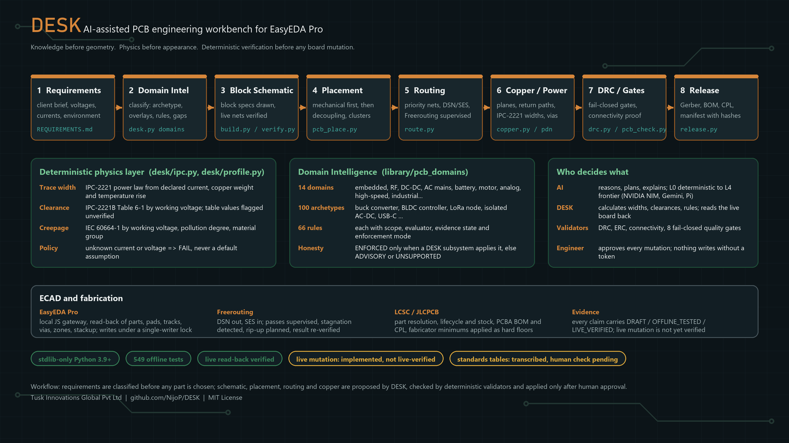

# DESK

**An AI-assisted PCB engineering workbench for EasyEDA Pro.**
Requirements in, verified and manufacturable boards out, with the physics done by code and every board change approved by the engineer.

<p align="center">
  
</p>

[](https://www.python.org/)
[](desk/)
[](tests/)
[](https://pro.easyeda.com/)
[](LICENSE)

Developed by Tusk Innovations Global Pvt Ltd. Pure Python standard library, no pip packages. The one exception is
the optional API-only copper fill, which needs `shapely`.

**Live tests:** two timed ESP32-S3 board benchmarks, each with independent review, graded results and revision A
output files. Run 2 (fresh rebuild) reached **PARTIAL PASS 81/100**; run 1 scored FAIL 50/100. See
[`live-test/`](live-test/README.md).

---

## What DESK does, in engineering terms

You hand DESK a requirements document. It works out what kind of board it is, which electrical rules apply, which component families are needed and what information is still missing. It then drives the schematic, placement, routing, copper and release stages through EasyEDA Pro and Freerouting, while deterministic code calculates trace widths, clearances and creepage, and validators prove the result before anything is released.

Three principles decide how the tool behaves:

1. **Knowledge before geometry.** No part is chosen and no track is drawn until the board's domain, rails, currents and environment are declared.
2. **Physics before appearance.** Widths, clearances and creepage come from IPC-2221, IPC-2221B and IEC 60664-1 formulas and tables in [`desk/ipc.py`](desk/ipc.py), never from a model's guess. An undeclared current or voltage is a hard failure, not a default.
3. **Verification before mutation.** Every live change to a board is planned, checked, applied under a single-writer lock and read back from the ECAD engine. The engineer approves each mutation, and the approval is journalled next to the operation it covers (`DESK_MUTATION_POLICY=require` refuses unapproved ones).

Roles are fixed: **AI reasons, DESK calculates, validators verify, the engineer approves.**

DESK is not a replacement for an ECAD tool or for engineering judgment. It is a co-pilot that refuses to guess.

---

## The workflow

| Stage | What happens | Tool |
|---|---|---|
| 1. Requirements | `REQUIREMENTS.md` with power budget, voltage tree, interfaces, mechanical envelope and GPIO budget (Gate R) | [`docs/00_REQUIREMENTS.md`](docs/00_REQUIREMENTS.md) |
| 2. Domain intelligence | Classify the request into one of 100 PCB archetypes, apply overlays (mains, isolation, RF, motor, battery...), retrieve the rules, list what is missing | `python desk.py domains classify "<text>"` |
| 3. Part selection | Comparison matrix and datasheet-derived passives (Gate B); every MPN resolved against the real EasyEDA library | [`tools/resolve.py`](tools/resolve.py), [`tools/pins.py`](tools/pins.py) |
| 4. Block schematic | Each functional block is a JSON spec; linted offline, drawn on the sheet, then the live netlist is read back and compared with the spec | [`tools/lint.py`](tools/lint.py), [`tools/build.py`](tools/build.py), [`tools/verify.py`](tools/verify.py) |
| 5. Placement | Mechanical constraints first, then decoupling proximity, functional clustering and routability | [`tools/pcb_place.py`](tools/pcb_place.py), [`tools/pcb_check.py`](tools/pcb_check.py) |
| 6. Routing | Nets routed by priority (ground, differential, power, analog, digital, I/O) through Freerouting DSN/SES with pass supervision, stagnation detection and rip-up planning | [`tools/route.py`](tools/route.py) |
| 7. Copper and power | Reference planes, return-path continuity, island detection, IPC-2221 widths per rail, via arrays, voltage-drop estimates | [`desk/copper.py`](desk/copper.py), [`desk/power_distribution.py`](desk/power_distribution.py) |
| 8. DRC and quality gates | Clearance, annular ring, mask dam, fabricator minimums, pad-to-pad copper connectivity, 8 fail-closed acceptance gates | [`tools/drc.py`](tools/drc.py), [`desk/quality.py`](desk/quality.py) |
| 9. Release | Gerber, BOM with LCSC codes, CPL centroids, manifest with hashes; gates run first, exports second, cross-checks third | [`tools/release.py`](tools/release.py) |

The block workflow loop is documented in [`docs/03_BLOCK_WORKFLOW.md`](docs/03_BLOCK_WORKFLOW.md). A failed `verify.py` means the block is cleared and rebuilt from a corrected spec, with a ceiling of two attempts before a human is asked.

---

## Where the numbers come from

| Quantity | Source in code | Method |
|---|---|---|
| Trace width | [`desk/ipc.py`](desk/ipc.py) `calc_trace_width` | IPC-2221 power law `I = k · ΔT^0.44 · A^0.725`, k = 0.048 external / 0.024 internal, from declared current, copper weight and temperature rise. Conservative compared with IPC-2152 chart data. |
| Final width per net | [`desk/profile.py`](desk/profile.py) | `max(net-class width, IPC-2221 width, fabricator minimum)` |
| Clearance | [`desk/ipc.py`](desk/ipc.py), [`desk/profile.py`](desk/profile.py) | IPC-2221B Table 6-1 by working voltage and board location |
| Creepage | [`desk/ipc.py`](desk/ipc.py) | IEC 60664-1 by working voltage, pollution degree and material group; reinforced insulation doubles the distance |
| Fabricator floors | [`desk/manufacturing/jlcpcb/capabilities.py`](desk/manufacturing/jlcpcb/capabilities.py) | Minimum trace, spacing and drill applied as hard lower bounds |

Two things an engineer should know before trusting these:

- The IPC and IEC table values are transcriptions. The flag `verified_against_standard` in `desk/ipc.py` is **False** until a human checks them against the standard text. Every result that depends on them says so.
- The design profile refuses to size copper for a rail whose current is unknown. Routing stops with a `PROFILE:` blocking issue instead of assuming 1 A.

---

## Domain intelligence

New boards are classified before anything is drawn. The library under [`library/pcb_domains/`](library/pcb_domains/) holds:

- **14 domains and 100 archetypes**, from `buck_converter` and `three_phase_bldc_controller` to `isolated_ac_dc`, `lora_transceiver`, `usb_c_interface` and `precision_adc_frontend`. Each archetype lists its typical functional blocks, rails, currents, isolation needs, EMI concerns, thermal considerations, placement and routing priorities, failure modes and the standards that apply.
- **17 overlays** for cross-cutting concerns (mains safety and isolation, galvanic isolation, high current, RF, motor drive, battery management, USB, high-speed digital, precision analog, automotive, harsh environment and more). Overlays stack; a stricter safety rule is never silently discarded when overlays combine.
- **206 component families** with roles, electrical characteristics, required parameters, compatibility and datasheet checks. No part numbers live here: real parts are resolved against the EasyEDA library.
- **66 deterministic rules** with scope, applicability conditions, evaluator, parameters, references, evidence state and enforcement mode. A rule is reported as ENFORCED only when a DESK subsystem actually applies it; otherwise it is ADVISORY or UNSUPPORTED and says so.

```powershell
python desk.py domains classify "LoRaWAN EU868 sensor node, battery powered, 3.3 V, outdoor"
python desk.py domains rules three_phase_bldc_controller --overlays high_current,motor_drive
python desk.py domains validate requirements.json --project projects/MY_BOARD
python desk.py domains check
```

Classification is deterministic (keyword and feature scoring). Ambiguity between mains and low voltage, or around motors and batteries, always returns `REVIEW_REQUIRED` with the questions to ask, never a confident wrong answer. See [`docs/domain_intelligence/NEW_USER_GUIDE.md`](docs/domain_intelligence/NEW_USER_GUIDE.md).

---

## EasyEDA Pro, Freerouting and fabrication

**EasyEDA Pro.** DESK talks to the running desktop or web client through its local JavaScript gateway. It reads back components, pads, tracks, vias, zones, stackup and DRC rules, and writes schematics and PCB changes through two audited paths only: [`tools/build.py`](tools/build.py) for blocks and [`tools/wire.py`](tools/wire.py) for named pins. There is no browser automation and no custom drawing script. Every write goes through a single-writer lock, a baseline hash, a rollback checkpoint and an independent read-back.

**Freerouting.** Boards go out as DSN and come back as SES. DESK runs the engine headless, tracks passes, detects stagnation, plans selective rip-ups and re-verifies connectivity from the returned geometry. A pre-flight gate checks plane nets, outline closure and pads in keep-outs before the engine starts.

**LCSC and JLCPCB.** Parametric search, MPN and C-number resolution, lifecycle (EOL/NRND) and stock, alternatives, PCBA BOM and CPL export, basic/extended part classification and an order guard. Live calls are implemented; automated tests use an offline fixture catalogue.

---

## AI models

DESK routes work through five tiers. L0 is deterministic Python with no model call. L1 to L4 call models of rising capability for reasoning, planning and explanation, with validation on the way back. Providers: NVIDIA NIM over HTTP (default `nvidia/nemotron-3-ultra-550b-a55b`, tool calling verified 2026-11-12), Gemini CLI and the Pi multi-provider CLI.

```powershell
# set NVIDIA_API_KEY in the environment or the DESK credential vault
python desk.py auth configure
python desk.py agent projects/MY_BOARD "read the sheet and list every unconnected pin"
python desk.py agent projects/MY_BOARD "wire U1.VDD to +3V3" --allow-mutation
```

The agent reads the live sheet, plans and explains. It mutates only with `--allow-mutation`, through the same guarded tools an engineer would run by hand. Model output never overrides a calculated width, a verified pin map or a quality gate.

---

## Workflow orchestration (Weft)

Orchestrated workflows are written in [Weft](https://github.com/WeaveMindAI/weft), a typed workflow language with durable runs and human approval steps. Weft orchestrates; DESK engineers: every stage of a workflow is a DESK node that calls one deterministic DESK engine through a local, token-protected service, and only a DESK engine can pass a gate.

```powershell
python desk.py weft status                 # is Weft installed, does it match the pin, is the node service up
python desk.py weft nodes                  # which nodes are backed by an engine, which fail closed and why
python desk.py weft validate               # compile-check the workflows with the Weft compiler
python desk.py weft check-run hardware_design   # would Weft admit the run? (Weft's own admission check, runs nothing)
python desk.py weft run hardware_design --project projects/MY_BOARD --requirements requirements.json
python desk.py weft answer approve.review approve   # a person's decision on a waiting approval
```

Weft is not bundled. It is pinned to an upstream commit (`integrations/weft/WEFT_PIN.json`), runs on Linux or macOS
with Docker (on Windows only inside WSL2), and is built from source at the pin. Without it the engines and every
other tool work as before; `weft run` refuses to start and there is no fallback orchestrator.

**Status: no workflow has been run by a Weft runtime yet.** What is proven on the development machine:

- both workflows compile under upstream's real compiler;
- Weft's own admission check accepts the runs DESK starts;
- the DESK side is tested against the real engines.

Live runs are deferred to a separate Linux machine. The scripted procedure is
[`docs/weft/05_LINUX_VALIDATION.md`](docs/weft/05_LINUX_VALIDATION.md); what is and is not proven is in
[`docs/weft/04_STATUS.md`](docs/weft/04_STATUS.md).

---

## Quick start

Requirements: Python 3.9 or newer (3.11 or 3.12 recommended), Windows 11 is the tested platform. Optional: EasyEDA Pro for live work, Java 17 or newer for Freerouting (Java 25 with Freerouting 2.5.0 is what has been exercised).

```powershell
git clone https://github.com/NijoP/DESK.git
cd DESK

python -m unittest discover -s tests -p "test_*.py"   # no network, no ECAD needed
python -m pip install -e . && desk --version          # optional: the `desk` console command (still zero dependencies)
python desk.py doctor                                 # Python, Java, Freerouting, EasyEDA bridge, config, project binding
python desk.py config show                            # effective configuration: env > ~/.desk/config.json > desk.config.json
python desk.py tools                                  # one line per tool

python tools/new_project.py MY_BOARD                  # projects/MY_BOARD from the template
python desk.py domains classify projects/MY_BOARD/REQUIREMENTS.md
python tools/ctx.py projects/MY_BOARD brief           # where the project is, what comes next
python desk.py dashboard                              # local Mission Control on http://localhost:49630
```

Working on an existing board rather than a new one: `python desk.py rework start|audit|plan|approve|execute|report projects/MY_BOARD` runs an eight-domain audit (requirements, netlist, footprints, placement, routing, power, copper, fabrication), captures a baseline and plans surgical repairs that require an approval token before execution.

---

## Repository map

| Path | Contents |
|---|---|
| [`desk/`](desk/) | Engineering engines: `ipc.py`, `profile.py`, `spec.py`, `copper.py`, `power_distribution.py`, `placement*.py`, `drc_engine.py`, `erc.py`, `quality.py`, `routing/`, `rework/`, `component_intelligence/`, `domain_intelligence/`, `manufacturing/`, `orchestrator/`, `runtime/`, `weft/`; settings in `config.py` |
| [`tools/`](tools/) | Command-line tools for every stage; `python desk.py tools` lists them |
| [`library/`](library/) | Resolved devices, verified pin maps (`library/pins/`), PCB domain knowledge (`library/pcb_domains/`) |
| [`projects/`](projects/) | One directory per board: requirements, block plan, block specs, design profile, ledger |
| [`docs/`](docs/) | Workflow (00 to 09), engineering notes, ecosystem integration, domain intelligence, rework mode, verification |
| [`tests/`](tests/) | Offline unit and fixture tests; live-only checks are skipped unless an ECAD session is present |
| [`integrations/weft/`](integrations/weft/) | Weft workflows, the DESK node library (typed Weft groups) and the pinned upstream commit; Python side in `desk/weft/` |
| [`learning/`](learning/) | Incidents, lessons and playbooks captured from real sessions |
| [`.agents/skills/`](.agents/skills/) | Procedural skills loaded by AI agents; [`AGENTS.md`](AGENTS.md) is the operating manual |

---

## Live tests: ESP32-S3 development board (timed benchmarks, 2026-11-12)

Two timed end-to-end runs against a live EasyEDA Pro project, under the same frozen requirements and rules.
Full record: [`live-test/`](live-test/README.md).

| Run | Verdict (independent Sonnet examiner) | Time used | Board |
|---|---|---:|---|
| **Run 2 (2b), fresh rebuild** | **PARTIAL PASS, 81/100**: all 5 stages passed | 66.7 / 225 min | EasyEDA DRC 0, 43/43 nets, GND routed and verified in Stage 3, rounded outline, GND pours on both layers with stitching, silkscreen checked, Gerber + drills + BOM with LCSC (18/18) + CPL + PDF + `.epro` |
| Run 1 | FAIL, 50/100 (Stage 4 GND opens) | 102.8 / 225 min | DRC 0 only after post-benchmark fixes |

### Run 2 (2b)
- **Setup:**
  - The schematic and PCB were rebuilt from scratch with DESK `main` at 2c9de1a.
  - The run used the same 45 / 45 / 90 / 30 / 15-minute budgets, with no borrowing between stages.
  - Run 2b restarted the clock after an aborted first attempt, so the examiner calls it a **warm start** that is not
    like-for-like with run 1 on time.
- **What kept it from PASS (target was > 90):**
  - The USB pair is about 153 Ω differential, not about 90 Ω. That is a 2-layer geometry limit, and it is disclosed.
  - D− needs a 0.8 mm tap at the ESD array pinout.
  - The 2 ERC warnings cannot be read through the API, and 17 orphan title texts remain in the schematic.
  - There are no teardrops.
  - The pours are API-only static fills.
  - Checkpoints T+20 to T+50 were missed.
- **Human help:** an EasyEDA reopen after a crash (memory pressure) and the Import Changes *Apply* click.
- **DESK fixes from run 2:**
  - the outline "R" spec (y-top origin; the radius no longer written into the rotation field);
  - POLYGON pads that were rotated twice in `copper_fill`;
  - a crash in the `pcb_check --gate` printer.

### Run 1
- **Setup:** Claude Opus 5.5 drove DESK from frozen requirements to an ESP32-S3-WROOM-1 dev board (2 layers,
  74 × 44 mm, 38 parts). It had a 225-minute budget split by stage (45 / 45 / 90 / 30 / 15). A separate Claude
  Sonnet examiner graded the run independently.
- **Current board status: EasyEDA DRC 0 errors.** The 5 GND opens are fixed and all 43 nets are connected.
  Revision A output files have been exported.
- **Graded benchmark verdict: FAIL**, scored 50/100 by the examiner, with 102.8 minutes used. The fixes came after
  the clock stopped, so they do not change the graded result.

  | Stage | Graded benchmark (clock stopped 06:33) | Current board (after fixes) |
  |---|---|---|
  | Schematic | PASS | PASS |
  | Placement | Pass with deviations | Pass with deviations (C5 is 2.7 mm from the module power pin; no rounded corners) |
  | Routing | Pass with deviations | ✅ 43/43 nets connected, 0 clearance, 0 short |
  | Copper | **FAIL**: 5 GND opens | ✅ **Fixed: DRC 0 errors**, GND fully connected |
  | Manufacturing | Not started (stop rule) | Rev A Gerber, BOM with LCSC, CPL, schematic PDF and `.epro` exported; release preflight not yet run |

- **Human help:** a window reconnect before the clock, an *Apply* click in Import Changes, and approval to
  download Freerouting.
- **After the benchmark (not graded):** EasyEDA DRC went from 5 errors to **0**. Revision A Gerber, schematic PDF,
  BOM with LCSC numbers, CPL and the `.epro` project are in
  [`live-test/esp32-s3-plotus/manufacturing-revA/`](live-test/esp32-s3-plotus/manufacturing-revA/). The board is
  not production-released.
- **DESK gained from the run:**
  - API-only GND planes (`tools/copper_fill.py`), needed because EasyEDA's pour rebuild cannot be driven through
    the API in Pro 3.2;
  - explicit via links in `tools/stitch_orphans.py`;
  - refreshed library entries.
- **Defects it exposed:** the DRC summary miscount (0 reported against 174 real errors), the outline JS signature
  and origin, and stale library UUIDs. These are listed in the run's failure register.
- **Reviewer analysis:** uploaded unchanged in
  [`live-test/esp32-s3-plotus/reviewer-analysis/`](live-test/esp32-s3-plotus/reviewer-analysis/). It includes the
  10-minute reports (five were written after the fact), hardware telemetry and the Opus-vs-Nemotron comparison,
  which found nothing to compare because no Nemotron board exists.

---

## Verification status

The test suite was last run on 2026-11-12: 717 tests, 0 failures (9 skips). Environment-dependent tests skip when their prerequisite is absent: a Freerouting 2.2+ jar that starts under the local Java (`library/tools` or `FREEROUTING_JAR`; 2.5.0 with Java 25 passes, the unversioned `freerouting.jar` does not), the private project-one fixture, `shapely`, a free EasyEDA bridge port, Node with Backpass, and the git-ignored WATCH routing fixture. `test_orchestrator` 07/10/11 still fail when `DESK_L*_MODEL_PI` or `DESK_FRONTIER_*` are set in the shell. CI runs the suite on Linux, Windows and macOS.

| Area | Status | Evidence |
|---|---|---|
| IPC-2221 width, clearance, creepage calculations | Offline tested; table values not yet checked against standard text | `tests/test_ipc_models.py`, `tests/test_hardware_reference_values.py`, `tests/test_profile_hardening.py` |
| Domain intelligence (taxonomy, classifier, rule engine, profile compiler) | Offline tested; 13 of 100 archetypes exercised by fixtures, 87 are DRAFT entries | `tests/test_domain_taxonomy.py`, `tests/test_rule_engine.py`, `tests/test_cross_domain_cases.py` and six more |
| Routing intelligence, DSN/SES, connectivity, recovery | Offline tested | 11 `tests/test_routing_*.py` files |
| Power distribution, copper planes, return paths | Offline tested | `tests/test_power_distribution.py`, `tests/test_copper_*.py` |
| Placement, DRC, ERC, quality gates | Offline tested | `tests/test_placement.py`, `tests/test_quality_fail_closed.py` |
| Component intelligence, BOM, JLCPCB | Offline tested with fixture catalogue | `tests/test_ci_*.py`, `tests/test_jlcpcb_integration.py` |
| EasyEDA Pro read-back | Live verified (read-only sessions) | [`docs/product_assessment/LIVE_EASYEDA_OBSERVATION_01.md`](docs/product_assessment/LIVE_EASYEDA_OBSERVATION_01.md) |
| NVIDIA NIM tool-calling agent | Live verified against the NIM endpoint, 2026-11-12 | `desk/orchestrator/agent_loop.py` |
| EasyEDA Pro live mutation (placement, copper, routing write-back) | **Exercised live in two timed ESP32-S3 benchmarks**: blocks built, 40 parts placed, rounded outline, SES imported, API-only GND fills and stitching written, silkscreen moved, all read back. Run 2: PARTIAL PASS 81/100 with DRC 0 inside the clock; run 1: FAIL. Other paths are still not live verified. | [`live-test/`](live-test/README.md), [`docs/product_assessment/LIVE_TEST_STATUS.md`](docs/product_assessment/LIVE_TEST_STATUS.md) |
| API-only copper planes (`pcb_PrimitiveFill`) | Live exercised (Plotus); offline tested. Needs the optional `shapely` package (the tests skip without it) | `tests/test_copper_fill.py`, [`desk/copper_fill.py`](desk/copper_fill.py) |
| Weft orchestration (node contracts, node service, workflows) | Offline tested; workflows compile under upstream's compiler and runs pass upstream's admission check. Linux validation procedure written, **not yet run**. **No run on a Weft runtime yet** | `tests/test_weft_*.py`, [`docs/weft/04_STATUS.md`](docs/weft/04_STATUS.md) |
| Freerouting stopped-job SES with full connectivity | **Not confirmed** | [`docs/engineering/DENSE_BOARD_BENCHMARK_REPORT.md`](docs/engineering/DENSE_BOARD_BENCHMARK_REPORT.md) |

---

## Known limitations

- Live board mutation through the EasyEDA bridge has been exercised in two timed ESP32-S3 benchmarks (run 1 FAIL,
  run 2 PARTIAL PASS 81/100). No controlled live test of each mutation path exists yet; paths not exercised there are marked not live
  verified in source.
- Trace width uses the IPC-2221 power law, not IPC-2152 chart data. Results are conservative for external layers.
- Placement refinement is single pass. It proposes moves; it does not iterate with the router.
- No switching-loop area minimisation and no RF-specific ground-plane synthesis yet. Those rules are ADVISORY in the domain library.
- Junction-temperature and component-rating rules are UNSUPPORTED: DESK lists them, it cannot evaluate them.
- JLCPCB constraints are a static declaration; there is no live DFM or quoting API call.
- Developed and tested on Windows 11. GitHub CI on `main` at `b168be9` (run 43181657514, 2026-11-12) passes on **5 of 8**
  jobs:
  - Passing: Ubuntu with Python 3.11 and 3.12, Windows with 3.11 and 3.12, macOS with 3.12.
  - Python 3.9 on Ubuntu 22.04 and Windows: 4 errors in `test_ci_storage`, because that Python's SQLite has no
    `unixepoch`.
  - macOS with Python 3.11: 1 failure in `test_bridge_port_discovery`.
  - Weft runs are not part of CI (see the Weft section).
- Weft workflows have not been executed by a Weft runtime: durable waits, approval pauses and recovery are unproven, and 22 of the 32 DESK nodes are declared but fail closed until their engine adapter is written.
- Two timed end-to-end benchmarks exist ([`live-test/`](live-test/README.md)):
  - Run 1 **failed** at the copper stage after 102.8 of 225 minutes.
  - Run 2 reached **PARTIAL PASS (81/100)** in 66.7 minutes. It was a warm start.

  Treat the other time targets in the docs as targets, not measurements.
- On a 2-layer 1.6 mm board, USB D+/D− cannot reach 90 Ω differential within the module and ESD pad pitch (run 2
  measured about 153 Ω). Use a 4-layer stack-up when impedance control is required.
- `clear_block` leaves frame rectangles, and deleted schematic texts can persist as orphan TEXT records that neither
  the API nor the GUI removes (run 2 R2-F-001/002).
- EasyEDA Pro 3.2's DRC does not reliably connect a via to an API-created fill. `tools/stitch_orphans.py` therefore
  adds explicit tracks.
- `desk/copper_fill.py` is the one module that needs a third-party package (`shapely`). It is imported lazily, so
  the rest of DESK still runs on the standard library only.

---

## Documentation

| Topic | Document |
|---|---|
| Getting started | [`docs/getting-started.md`](docs/getting-started.md) |
| Requirements and part selection gates | [`docs/00_REQUIREMENTS.md`](docs/00_REQUIREMENTS.md), [`docs/00b_COMPONENT_SELECTION.md`](docs/00b_COMPONENT_SELECTION.md) |
| Block workflow, placement, routing | [`docs/03_BLOCK_WORKFLOW.md`](docs/03_BLOCK_WORKFLOW.md), [`docs/04_PLACEMENT.md`](docs/04_PLACEMENT.md), [`docs/05_ROUTING.md`](docs/05_ROUTING.md) |
| Domain intelligence | [`docs/domain_intelligence/NEW_USER_GUIDE.md`](docs/domain_intelligence/NEW_USER_GUIDE.md), [`TAXONOMY_REFERENCE.md`](docs/domain_intelligence/TAXONOMY_REFERENCE.md), [`RULE_CATALOGUE.md`](docs/domain_intelligence/RULE_CATALOGUE.md), [`EVIDENCE_AND_MATURITY_POLICY.md`](docs/domain_intelligence/EVIDENCE_AND_MATURITY_POLICY.md) |
| Routing intelligence | [`docs/ROUTING_INTELLIGENCE_V2.md`](docs/ROUTING_INTELLIGENCE_V2.md), [`docs/engineering/DENSE_PCB_INTELLIGENCE.md`](docs/engineering/DENSE_PCB_INTELLIGENCE.md) |
| Power and copper | [`docs/engineering/POWER_DISTRIBUTION_INTELLIGENCE.md`](docs/engineering/POWER_DISTRIBUTION_INTELLIGENCE.md), [`docs/engineering/COPPER_ZONE_GENERATION.md`](docs/engineering/COPPER_ZONE_GENERATION.md) |
| EasyEDA Pro, LCSC, JLCPCB | [`docs/ecosystem/02_EASYEDA_PRO_INTEGRATION.md`](docs/ecosystem/02_EASYEDA_PRO_INTEGRATION.md), [`docs/ecosystem/LCSC_INTEGRATION_ARCHITECTURE.md`](docs/ecosystem/LCSC_INTEGRATION_ARCHITECTURE.md), [`docs/ecosystem/JLCPCB_MANUFACTURING_ARCHITECTURE.md`](docs/ecosystem/JLCPCB_MANUFACTURING_ARCHITECTURE.md) |
| Rework mode for existing boards | [`docs/rework/01_REWORK_MODE_OVERVIEW.md`](docs/rework/01_REWORK_MODE_OVERVIEW.md) |
| Context engine and learning | [`docs/07_CONTEXT_ENGINE.md`](docs/07_CONTEXT_ENGINE.md), [`docs/08_LEARNING_ENGINE.md`](docs/08_LEARNING_ENGINE.md) |
| Weft orchestration | [`docs/weft/01_ARCHITECTURE.md`](docs/weft/01_ARCHITECTURE.md), [`02_INSTALL.md`](docs/weft/02_INSTALL.md), [`03_LICENCE.md`](docs/weft/03_LICENCE.md), [`04_STATUS.md`](docs/weft/04_STATUS.md), [`05_LINUX_VALIDATION.md`](docs/weft/05_LINUX_VALIDATION.md) |
| Mission Control dashboard | [`docs/local-dashboard.md`](docs/local-dashboard.md) |
| Live test status and checklist | [`docs/product_assessment/LIVE_TEST_STATUS.md`](docs/product_assessment/LIVE_TEST_STATUS.md), [`docs/LIVE_INTEGRATION_CHECKLIST.md`](docs/LIVE_INTEGRATION_CHECKLIST.md) |
| Agent operating manual | [`AGENTS.md`](AGENTS.md) |

---

## Contributing

1. Python standard library only. No new pip dependencies; the single optional one (`shapely`, API-only copper fill) is imported lazily.
2. Read settings through `desk.config`, never `os.environ` directly (`tests/test_config.py` enforces it).
3. Every width, clearance or creepage rule must cite a formula, a standard table or a fabricator document. No magic numbers.
4. Never weaken a quality gate, bypass DRC or connectivity checks, or replace missing evidence with confidence.
5. Run the full suite before and after a change: `python -m unittest discover -s tests -p "test_*.py"`. Zero failures, zero errors.
6. Read [`AGENTS.md`](AGENTS.md) for conventions, the block workflow and the safety rules.

## License

[MIT](LICENSE). See [NOTICE](NOTICE) for attribution.
