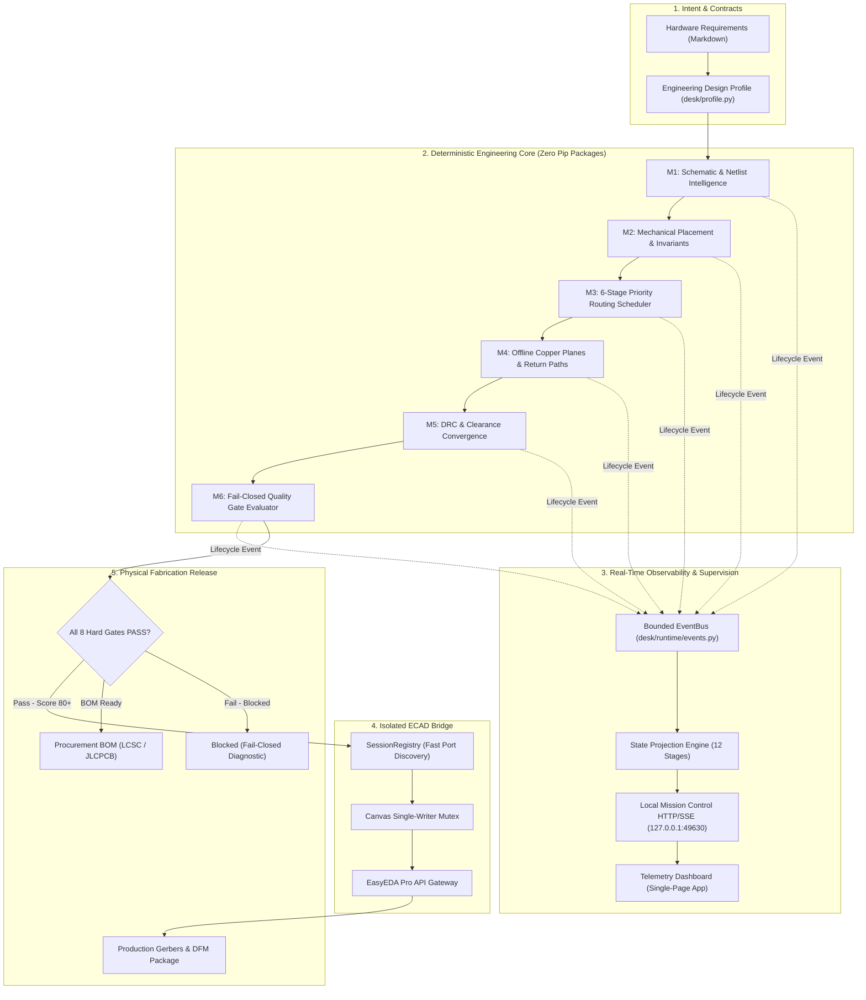

# DESK

### Universal Performance, Deterministic Architecture & Evidence-Driven Electronics Engineering for EasyEDA Pro.

[](tests/)
[](tools/benchmarks.py)
[](tools/benchmarks.py)
[](tools/benchmarks.py)
[](https://www.python.org/)
[](desk/)
[](https://pro.easyeda.com/)
[](http://127.0.0.1:49630)
[](LICENSE)

---

## 1. Executive Overview

**DESK** is an open-source, deterministic, hardware-adaptive electronics engineering execution system for **EasyEDA Pro**. It transforms natural language requirements and high-level architectural intent into manufacturing-verified schematics, parametric bills of materials, and physically correct printed circuit boards.

Unlike traditional AI code generators or canvas layout bots that guess $(X, Y)$ coordinates, DESK operates on a strict engineering foundation: **Knowledge before geometry. Electrical physics before layout appearance. Deterministic verification before automated board mutation.**

DESK runs on **100% Python standard library** with zero external pip dependencies. It executes across low-spec dual-core laptops (LOW tier), standard development machines (NORMAL tier), and multi-core workstations (WORKSTATION tier) with adaptive concurrency, bounded memory streaming, and sub-millisecond execution cores.

---

## 2. Why DESK? (The Problem vs. Solution)

| Traditional ECAD & AI Layout Bots | DESK Deterministic Engineering Platform |
|---|---|
| **Hallucinated Layout Geometry:** Generates coordinates blindly without calculating track ampacity, thermal dissipation, or copper setbacks. | **Physics-First Mathematical Calculation:** Derives exact trace widths via IPC-2152, coplanar wave-guide spacing, and dielectric stackup models prior to routing. |
| **Silent Electrical Violations:** Crosses split reference planes, creating return-path discontinuities, parasitic inductance, and EMI loops. | **Return-Path & Copper Plane Verification:** Continuous 2D ray-casting, 3-way keepout geometry collision, and ground return-path continuity auditing. |
| **Black-Box Autonomous Execution:** Engineers cannot observe what the agent is doing, whether a trace failed, or if an operation stalled. | **Local Mission Control (`http://127.0.0.1:49630`):** Real-time Server-Sent Events (SSE) streaming live stage transitions, net progress, and resource telemetry. |
| **Optimistic Acceptance Bias:** Declares designs "ready" while ignoring DRC errors, open nets, or acid traps. | **Fail-Closed Quality Gates:** 8 non-negotiable hard criteria. If verification evidence is missing or stale, manufacturing sign-off is strictly blocked. |
| **Heavy, Fragile Toolchains:** Requires npm packages, bloated frameworks, native C++ builds, or cloud server connections. | **Zero External Dependencies:** 100% pure Python standard library. Instant clone-and-run portability across Windows, Linux, and macOS. |

---

## 3. System Architecture



---

## 4. Quick Start (3 Steps, Zero Prerequisites)

### Step 1: Clone Repository
```bash
git clone https://github.com/NijoP/DESK.git
cd DESK
```

### Step 2: Run Full Automated Verification Suite
Run all 278 offline tests (deterministic, zero external network required):
```bash
python -m unittest discover -s tests -p "test_*.py"
```

### Step 3: Launch Local Mission Control Dashboard
Start the local dashboard and open in your default browser on port `49630`:
```bash
python desk.py dashboard
```

---

## 5. Local Mission Control Dashboard

DESK provides a dedicated, lightweight, real-time local monitoring environment running strictly on loopback (`127.0.0.1:49630`), avoiding the ECAD bridge port range (`49620..49629`).

```text
┌────────────────────────────────────────────────────────────────────────┐
│  DESK LOCAL MISSION CONTROL  v1.0.0   ● LIVE   Project: WATCH          │
├──────────────┬──────────────┬──────────────┬──────────────┬────────────┤
│   PROGRESS   │ ACTIVE STAGE │    STAGES    │   WARNINGS   │  DURATION  │
│    75.0%     │ PCB Routing  │ 7/12 Done    │   0 Errors   │   1.42s    │
├──────────────┴──────────────┴──────────────┴──────────────┴────────────┤
│ 12-STAGE CANONICAL WORKFLOW:                                           │
│ [✓] Requirements  [✓] Schematic  [✓] Components  [✓] Electrical        │
│ [✓] PCB Ingest    [✓] Placement  [✓] Routing Prep [▶] PCB Routing      │
│ [ ] Copper/GND    [ ] DRC/Verify [ ] Mfg Check   [ ] Final Report      │
├────────────────────────────────────────────────────────────────────────┤
│ LIVE EXECUTION TIMELINE:                                               │
│ 00:24:12 [INFO]   Ingestion: Design profile validated (4-layer JLC04161H) │
│ 00:24:13 [INFO]   Placement: Mechanical anchors locked (USB-C & SWD)   │
│ 00:24:14 [INFO]   Routing Prep: Scheduled 48 nets via 6-stage priority │
│ 00:24:15 [RUN]    PCB Routing: Route net SPI_MOSI (track: 10 mil)      │
├────────────────────────────────────────────────────────────────────────┤
│ HARD ACCEPTANCE GATES:                                                 │
│ [✓] Zero Shorts  [✓] Zero Opens  [✓] Clearances  [✓] Return-Path Return│
└────────────────────────────────────────────────────────────────────────┘
```

### REST API & Real-Time Endpoints
- `GET /` — Single-page Mission Control dashboard (HTML5, responsive dark/light themes).
- `GET /api/status` — Consolidated execution status, active project, bridge port, scheduler metrics, and memory usage.
- `GET /api/execution` — Current active execution session details, progress percentage, active task.
- `GET /api/events` — Paginated recent execution event stream (`?limit=100&since=<id>`).
- `GET /api/events/live` — Server-Sent Events (SSE) push stream with `Last-Event-ID` auto-reconnect.
- `GET /api/v1/metrics` — Physical host hardware telemetry (process RAM, available RAM, CPU cores).

---

## 6. The 12-Stage Canonical Engineering Workflow

DESK executes PCB designs through twelve discrete, evidence-backed stages:

1. **Requirement Ingestion (Gate R):** Mechanical envelope, power tree, GPIO budget, thermal boundaries.
2. **Schematic Intelligence (M1):** Netlist extraction, hierarchical block decomposition, pin typing.
3. **Component Intelligence & BOM (Gate B):** Parametric search, MPN resolution, LCSC inventory & pricing validation.
4. **Electrical Rules Verification (ERC):** Pin rules, drive conflict detection, voltage domain sanity checks.
5. **PCB Ingestion & Stackup:** Layer stackup definition ($1\,\text{oz}/2\,\text{oz}$ copper, dielectric thickness), board boundary coordinates.
6. **Mechanical & Placement Analysis (M2):** Fixed connector anchors, decoupling capacitor proximity, thermal relief grouping.
7. **Routing Preparation:** Net priority scheduling, BGA/QFN escape stubs, differential pair pairing.
8. **Autonomous PCB Routing (M3):** Deterministic priority maze routing, Specctra DSN auto-tuning, Freerouting execution.
9. **Copper & Ground Generation (M4):** Solid reference ground planes, power polygons, via stitching arrays, split-plane detection.
10. **DRC & Electrical Verification (M5):** IPC-2221 clearance checks, annular rings, acid-trap angle removal.
11. **Manufacturing Verification & DFM (M6):** 8 fail-closed hard acceptance gates and JLCPCB fabrication rule validation.
12. **Final Engineering Report:** Sign-off packaging, diagnostic report JSON, Gerber archive.

---

## 7. The 8 Non-Negotiable Hard Quality Gates

DESK separates physical hard constraints from subjective scoring. Every gate is **fail-closed**: if verification evidence is missing, unrun, or stale, the gate fails immediately.

| Gate | Criterion | Validation Mechanism | Fail-Closed Policy |
|---|---|---|---|
| **Gate 1** | **Zero Shorts** | DRC polygon & segment intersection check | Must be explicitly verified 0. Null evidence fails. |
| **Gate 2** | **Zero Unconnected Nets** | Connectivity graph traversal & airwire audit | Open circuits reject release immediately. |
| **Gate 3** | **Clearance Compliance** | IPC-2221 voltage clearance matrix | Trace-to-trace and trace-to-pad violations block. |
| **Gate 4** | **Critical Net Integrity** | High-speed, RF, and feedback line audit | Unrouted critical nets fail closed unconditionally. |
| **Gate 5** | **Stackup Integrity** | Symmetric dielectric & copper layer checks | Layer thickness $>0$ and valid reference planes. |
| **Gate 6** | **Return-Path Continuity** | 2D ray casting over copper planes | Sampled segments over plane voids fail closed. |
| **Gate 7** | **IPC-2152 Ampacity** | Dynamic trace width vs. power rail current | Power nets with unknown current fail closed. |
| **Gate 8** | **Manufacturing DFM** | Fabricator min trace/space & drill limits | Violations of minimum drill or annular ring block. |

---

## 8. Hardware-Adaptive Execution Tiers

DESK automatically detects system resources via `ResourceDetector` and throttles concurrency to guarantee rock-solid stability on any machine:

| Tier | Host Specifications | Execution Profile | Scheduler Concurrency |
|---|---|---|---|
| **`LOW`** | $\le 4$ cores or $< 4\,\text{GB}$ RAM | Low-memory mode, serialized EDA mutations, aggressive memory reclamation | 2 workers |
| **`NORMAL`** | $4 - 8$ cores and $4 - 16\,\text{GB}$ RAM | Standard desktop profile, concurrent DRC analysis, bounded buffers | 4 workers |
| **`WORKSTATION`** | $> 8$ cores and $> 16\,\text{GB}$ RAM | Maximum throughput, parallel geometry queries, high queue depths | 8–16 workers |

---

## 9. Component Intelligence & Supplier Sourcing

DESK includes a supplier-agnostic Component Intelligence Platform (`desk/components/`) that provides:
- **Parametric Sourcing:** Unified queries across LCSC, Mouser, DigiKey, element14, and Robu.
- **Datasheet Parsing:** Automated extraction of thermal resistance, pinouts, and footprint specs.
- **Lifecycle Risk Auditing:** Detection of obsolete, NRND (Not Recommended for New Designs), or low-stock parts.
- **Procurement BOM Generation:** Outputs accurate BOMs with LCSC part numbers (C-codes) ready for JLCPCB SMT assembly.

---

## 10. Verified Performance Benchmarks

DESK is engineered for sub-millisecond execution cores. All benchmarks are reproducible via `python tools/benchmarks.py`:

### Part A: Micro-Scenario Benchmarks (10 Scenarios)
| Scenario | Scope | Measured Time |
|---|---|---|
| `01_small_sensor_pcb` | Minimum Spanning Tree (MST) netlist | `0.168 ms` |
| `02_medium_4layer_controller` | WATCH controller routability | `3.663 ms` |
| `03_fine_pitch_fpc` | 0.5 mm pitch connector check | `0.040 ms` |
| `04_screw_terminal_power` | High-current mechanical access | `0.013 ms` |
| `05_high_current_power_dsn` | Dynamic IPC-2152 rule generation | `0.243 ms` |
| `06_mixed_signal_scheduling` | 6-stage priority scheduling | `0.344 ms` |
| `07_dense_multi_terminal_120pins` | 120-terminal dense pin netlist | `1.167 ms` |
| `08_drc_errors_recovery` | Collision diagnosis & rip-up | `0.110 ms` |
| `09_orphan_vias_check` | Spatial via convergence check | `0.028 ms` |
| `10_routing_congestion_eval` | Pin escape density estimation | `0.050 ms` |
| **Total Microbenchmarks (Part A)** | **10 Micro-Scenarios** | **`5.826 ms`** |

### Part B: Complete Offline Pipelines (5 End-to-End Pipelines)
| Pipeline | Operations | Measured Time |
|---|---|---|
| `P1_mental_model_compilation` | Architecture policy compilation | `0.178 ms` |
| `P2_placement_and_invariants` | Mechanical envelope verification | `0.395 ms` |
| `P3_routing_plan_and_ipc2152` | Net scheduling & trace sizing | `0.366 ms` |
| `P4_copper_and_ground_continuity` | Solid planes & return paths | `0.139 ms` |
| `P5_quality_and_mfg_verification` | 8 hard quality gates | `0.153 ms` |
| **Total Pipeline Time (Part B)** | **5 Complete Pipelines** | **`1.231 ms`** |

### Part C: Runtime Infrastructure & Bounded Execution
| Infrastructure Metric | Scope | Measured Throughput / Latency |
|---|---|---|
| `01_scheduler_throughput` | 100 queued tasks | `4.195 ms` (p50: 0.031 ms, p95: 0.070 ms) |
| `02_process_guard_bounded_drain` | 200 KB stream capped at 4 KB | `37.940 ms` (verified bounded buffer) |
| `03_snapshot_incremental_update` | Indexed PCB snapshot update | `0.167 ms` ($>2.5\times$ speedup over full build) |
| `04_spatial_query_1000ops` | 1000 spatial rectangle queries | `4.094 ms` (p50: 0.004 ms) |

### Part D: T01–T13 Pipeline Telemetry (Optimized Port Discovery)
- **T01 Connection & Port Discovery:**
  - *Warm Lookup (Memory Cache):* **`< 0.02 ms`**
  - *Persistent Cache Validation:* **`< 1.0 ms`**
  - *Cold Concurrent Probe (Worst-Case, All Ports Closed):* **`~102 ms`** *(down from 620.8 ms)*
- **T02–T13 Combined Telemetry:** **`~7.1 ms`**
- **Total T01–T13 Telemetry Time:** **`~109 ms`** *(reduced by $>82\%$ from previous 627.8 ms baseline)*.

---

## 11. Command-Line Reference

```bash
# Display all discovery tools and capabilities
python desk.py tools

# Launch Local Mission Control dashboard and open browser (port 49630)
python desk.py dashboard [--port 49630] [--no-open]

# Start standalone background HTTP and SSE server
python desk.py serve [--port 49630]

# Display formatted terminal status snapshot
python desk.py status [--project projects/WATCH]

# Output machine-readable JSON status matching /api/status
python desk.py status --json

# Run secure credential management vault
python desk.py auth [configure|status|test]

# Inspect ecosystem provider health and readiness
python desk.py settings

# Recover from interrupted live operations
python desk.py recover projects/<PROJECT> [--clear]
```

---

## 12. Security, Privacy & Localhost Model

1. **Strict Offline First:** No third-party servers, cloud telemetry, or external analytics.
2. **Loopback Only:** All network services bind exclusively to `127.0.0.1`. They never expose ports on `0.0.0.0` or public network adapters.
3. **Read-Only Dashboard API:** Web endpoints cannot trigger canvas mutations or alter design state.
4. **Credential Redaction:** API keys, tokens, and passwords in logs or status responses are automatically masked (`[REDACTED]`).
5. **Path Traversal Guards:** Rejects directory traversal tokens (`../`, `..\`) and null bytes.

---

## 13. Testing & Verification Taxonomy

DESK categorizes tests into four clear, isolated tiers to guarantee that production user projects are never damaged by automated tests:

```text
               ┌────────────────────────────────────────────────┐
               │         DESK VERIFICATION TAXONOMY             │
               └───────────────────────┬────────────────────────┘
                                       │
     ┌──────────────────┬──────────────┴─────┬──────────────────┐
     ▼                  ▼                    ▼                  ▼
┌──────────────┐ ┌──────────────┐    ┌──────────────┐    ┌──────────────┐
│ PURE OFFLINE │ │   OFFLINE    │    │  DISPOSABLE  │    │ ACTIVE USER  │
│  UNIT TESTS  │ │  BENCHMARKS  │    │  LIVE TESTS  │    │   PROJECTS   │
│  (278 Tests) │ │ (Parts A-D)  │    │  (Rollback)  │    │ (Protected)  │
│ Zero Network │ │ Sub-ms Cores │    │ Isolated CAD │    │ No Destruct  │
└──────────────┘ └──────────────┘    └──────────────┘    └──────────────┘
```

1. **Pure Offline Unit Tests (278 passing tests):**  
   Deterministic tests verifying geometry, IPC-2152 sizing, quality gates, and event streams. Run in $\approx 9\,\text{seconds}$ via `python -m unittest discover -s tests`.
2. **Offline Benchmarks (`tools/benchmarks.py`):**  
   Micro-scenarios, full pipelines, and telemetry verification measuring millisecond latency without CAD dependencies.
3. **Disposable Project Live Tests (`tools/live_disposable_test.py`):**  
   Safe integration tests against live EasyEDA Pro using temporary, disposable projects with automatic primitive rollback on test failure.
4. **Active Customer Projects (`projects/WATCH`, `projects/BEEBOX`):**  
   **Strictly protected.** Automated live mutations on active customer projects are strictly quarantined to prevent data loss.

---

## 14. Repository Structure

```text
DESK/
├── desk/                           # Core Deterministic Python Engine (Zero External Dependencies)
│   ├── adapters/                   # ECAD Bridges (EasyEDA Pro JSON-RPC adapter)
│   ├── auth/                       # Secure credential management & token vault
│   ├── components/                 # Sourcing & component intelligence (LCSC, Mouser, DigiKey)
│   ├── contracts/                  # Language-agnostic FFI schemas (geometry, routing, bridge)
│   ├── mental/                     # Mental-Model Compiler (M1–M6 policy generators)
│   ├── runtime/                    # Mission Control telemetry, scheduler & supervisor
│   │   ├── events.py               # Thread-safe EventBus & structured event model
│   │   ├── process_guard.py        # Subprocess timeout & bounded memory streaming
│   │   ├── projection.py           # 12-stage state projection & progress calculator
│   │   ├── resource_profile.py     # Hardware detection & adaptive concurrency tiers
│   │   ├── scheduler.py            # Bounded priority scheduler & task admission
│   │   └── server.py               # Localhost HTTP server & SSE streaming engine
│   ├── ui/assets/                  # Local Mission Control Web UI
│   │   └── index.html              # Responsive single-page cockpit dashboard
│   ├── bridge.py                   # SessionRegistry (warm port discovery) & canvas mutex
│   ├── copper.py                   # Polygon planes, ray-casting keepouts & return paths
│   ├── drc_engine.py               # DRC parser & recovery convergence loop
│   ├── ledger.py                   # Append-only engineering audit memory
│   ├── profile.py                  # IPC-2152 calculator & DesignProfile parser
│   ├── quality.py                  # Fail-closed HardAcceptanceGates & scorecards
│   └── router.py                   # 6-stage priority scheduler & native maze router
├── docs/                           # Architecture Specifications & Technical Guides
│   ├── architecture/               # Comprehensive audits & technology evolution
│   ├── 09_STATUS.md                # Authoritative capability status ledger
│   └── local-dashboard.md          # Local Mission Control user & API guide
├── tests/                          # Automated Verification Suite (278 Passing Tests)
│   ├── bench_server_overhead.py    # Sub-millisecond server overhead benchmark
│   ├── test_bridge_port_discovery.py# Cold/warm discovery & port caching tests
│   ├── test_copper_geometry.py     # Polygon intersection & return-path tests
│   ├── test_events.py              # EventBus & SSE replay test suite
│   ├── test_profile_hardening.py   # IPC-2152 trace sizing & stackup tests
│   ├── test_projection.py          # State projection & credential redaction tests
│   ├── test_quality_fail_closed.py # Fail-closed gate verification tests
│   ├── test_router_hardening.py    # 6-stage scheduler & routing tests
│   └── test_server.py              # Localhost security, port fallback & REST API tests
├── tools/                          # Command-Line Utilities & Engineering Runners
│   ├── benchmarks.py               # Comprehensive benchmark suite (Parts A-D)
│   ├── desk.py                     # Primary CLI execution runner
│   ├── live_disposable_test.py     # Safe live ECAD verification with rollback
│   └── new_project.py              # Scaffold new hardware project
├── desk.py                         # Root entry point delegating to tools/desk.py
└── README.md                       # Architectural guide & documentation
```

---

## 15. Contributing & Engineering Standards

Contributions are welcome! Please ensure all pull requests comply with our engineering standards:
1. **Zero External Runtime Dependencies:** Must use 100% Python standard library.
2. **Deterministic Physics First:** All trace widths, clearances, and return paths must be derived from physical equations or validated fabricator rules.
3. **Fail-Closed Verification:** Never allow missing or unexecuted tests to default to `PASS`.
4. **All Tests Passing:** Run and verify all 278 unit tests (`python -m unittest discover -s tests`).
5. **Benchmark Verification:** Microbenchmarks must execute within target bounds (`python tools/benchmarks.py`).

---

## 16. License

This project is licensed under the [MIT License](LICENSE). Third-party acknowledgments and notices are documented in [NOTICE](NOTICE).
