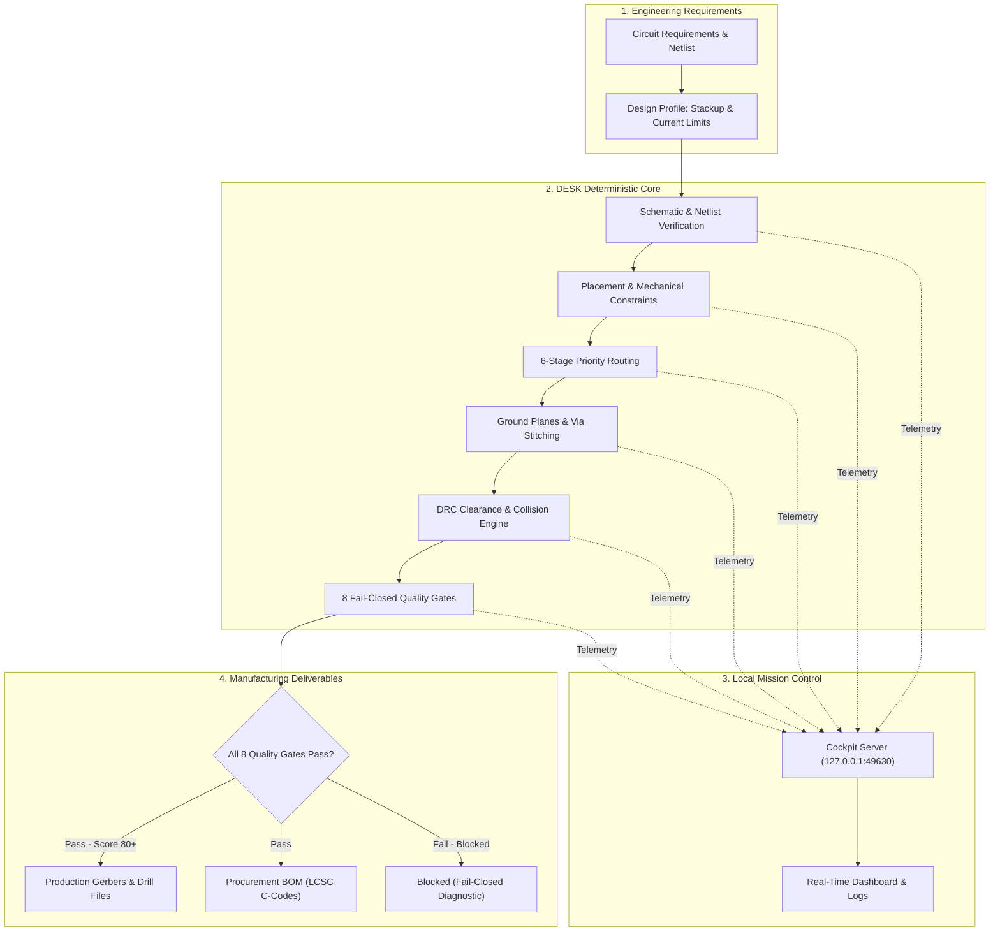

# DESK

### Your electronics engineering workbench.

**From circuit requirements to PCB design, engineering verification and manufacturing preparation.**

[](tests/)
[](https://www.python.org/)
[](desk/)
[](https://pro.easyeda.com/)
[](http://127.0.0.1:49630)
[](LICENSE)

---

## 1. Executive Overview

**DESK** is an open-source, AI-assisted engineering workbench built specifically for hardware and electronics engineers working with **EasyEDA Pro**.

In traditional hardware development, moving from a completed schematic to a fabricated, working circuit board requires hours of repetitive, manual tasks: calculating trace widths for current limits, routing dense connections without creating electromagnetic interference (EMI), generating ground planes, checking manufacturer clearances, and verifying that no airwires remain.

DESK works alongside your ECAD software as an intelligent, physics-guided co-pilot. It does not replace your engineering judgment or guess coordinates like a generic chatbot. Instead, it enforces a fundamental hardware principle:

> **Knowledge before geometry. Physical electrical laws before layout appearance. Deterministic verification before automated board mutation.**

Whether you are starting a new board from scratch, continuing an unfinished design, or verifying a completed layout before sending it to a fab house like JLCPCB, DESK helps you design with confidence.

---

## 2. Why DESK? (The Engineering Problem)

Every electronics engineer recognizes these practical bottlenecks in PCB development:

- **The schematic is finished, but layout is stalled:** You have a validated schematic and netlist, but unplaced footprints and unrouted nets sit on the canvas waiting for manual layout.
- **Trace widths are guessed rather than calculated:** Power rails carrying $2\,\text{A}$ or $5\,\text{A}$ get routed with standard $10\,\text{mil}$ or $12\,\text{mil}$ tracks, risking thermal runaway, voltage sag, or PCB delamination under load.
- **Ground planes get fragmented:** Signal tracks cut across split reference planes, breaking the high-frequency current return path and creating unintended loop antennas that fail FCC/CE compliance.
- **DRC errors are tedious to diagnose:** The ECAD design rule check reports 40 clearance errors, but resolving one by hand creates three new collisions elsewhere.
- **Inherited or unfinished designs:** You inherit a partially completed board from another engineer with unknown netlist changes, half-finished routes, and no documentation of what remains to be done.
- **Manufacturing release anxiety:** Just because a board has zero visual airwires does not mean it will work. Unverified copper slivers, missing thermal relief, or violation of fab house drill tolerances can ruin a production run.

DESK was created to solve these exact engineering challenges through automated physics calculations, deterministic priority scheduling, and fail-closed quality verification.

---

## 3. What is DESK?

Think of **DESK** as an engineering workbench that connects directly to your ECAD environment:

```text
┌────────────────────────────────────────────────────────────────────────┐
│                        HARDWARE ENGINEER                               │
│            (Reviews constraints, inspects results, approves work)     │
└───────────────────────────────────┬────────────────────────────────────┘
                                    │
                                    ▼
┌────────────────────────────────────────────────────────────────────────┐
│                         DESK WORKBENCH                                 │
│  • IPC-2152 Track Width Sizing     • 6-Stage Net Priority Router       │
│  • Ground Plane & Return Paths     • Component Intelligence & BOM      │
│  • 8 Fail-Closed Quality Gates     • Local Mission Control Telemetry   │
└───────────────────────────────────┬────────────────────────────────────┘
                                    │
                                    ▼
┌────────────────────────────────────────────────────────────────────────┐
│                   EASYEDA PRO (Your ECAD Canvas)                       │
│             (Schematics, Footprints, Copper Zones, Gerbers)            │
└────────────────────────────────────────────────────────────────────────┘
```

### DESK vs. Your Existing ECAD Tools

| Your Existing Tool | DESK's Role Alongside It |
|---|---|
| **EasyEDA Pro Schematic Editor** | Inspects netlists, verifies functional block decomposition, and validates power trees before layout begins. |
| **EasyEDA Pro PCB Editor** | Analyzes component density, locks mechanical anchors, plans routing priorities, and synthesizes solid ground planes. |
| **Component Datasheets & Sourcing** | Resolves Manufacturer Part Numbers (MPNs), verifies footprint pinouts, and checks LCSC stock and pricing. |
| **Design Rule Check (DRC)** | Diagnoses collision causes, plans automated rip-up and rerouting, and enforces IPC-2221 electrical clearances. |
| **Manufacturing Preparation** | Evaluates 8 non-negotiable physical gates to verify that the board is genuinely ready for fabrication. |

DESK does **not** replace EasyEDA Pro—it supercharges it with engineering automation and rigorous verification.

---

## 4. What Can You Do with DESK?

### 4.1 Understand Your Electronics Design
- **Functional Block Decomposition:** Organizes complex designs into clear subsystem blocks (e.g., Power Supply, MCU, RF Transceiver, Sensor Interface).
- **Power Tree Analysis:** Automatically maps voltage regulators, input voltages, quiescent currents, and load requirements across domains ($12\,\text{V} \to 5\,\text{V} \to 3.3\,\text{V} \to 1.8\,\text{V}$).
- **Netlist Integrity:** Verifies that every schematic pin is mapped to an authoritative net, flagging floating inputs or missing pull-up/pull-down resistors.

### 4.2 Work with Electronic Components & BOMs
- **Parametric Sourcing:** Searches electronic component databases (LCSC, JLCPCB SMT, Mouser, DigiKey) for active, in-stock parts.
- **Lifecycle Risk Auditing:** Flags End-of-Life (EOL) or Not-Recommended-for-New-Designs (NRND) parts before you commit them to the board.
- **Manufacturing BOM Generation:** Exports production-ready BOMs with accurate LCSC part numbers (C-codes) formatted for automated SMT pick-and-place assembly.

### 4.3 Prepare PCB Component Placement
- **Mechanical Anchor Locking:** Secures edge connectors (USB-C, barrel jacks, terminal blocks), mounting holes, and LEDs in fixed positions.
- **Thermal Clustering:** Groups heat-generating components (LDOs, buck converters, MOSFETs) with adequate spacing and thermal copper dissipation zones.
- **Decoupling Proximity:** Enforces placement of decoupling capacitors directly adjacent to IC power pins with minimal loop inductance.
- **Footprint Invariant Protection:** Ensures placed and verified components are never accidentally shifted or rotated during subsequent operations.

### 4.4 Plan and Complete PCB Connections (Routing)
- **IPC-2152 Physical Track Width Sizing:** Dynamically calculates trace widths based on actual operating current ($I$), copper weight ($1\,\text{oz}$ or $2\,\text{oz}$), and maximum allowed temperature rise ($\Delta T = 10^\circ\text{C}$).
- **6-Stage Routing Priority:** Routes critical connections first to avoid congestion:
  1. *Stage 1:* Ground reference nets (`GND`, `AGND`, `PGND`).
  2. *Stage 2:* Board-edge and connector interfaces (USB, power inputs).
  3. *Stage 3:* High-speed critical signals (differential pairs, RF lines, clocks).
  4. *Stage 4:* Sensitive feedback and analog sense lines.
  5. *Stage 5:* High-current power distribution rails (`VBUS`, `3V3`, `5V`).
  6. *Stage 6:* General digital interconnects and GPIOs.
- **Pin Escape Routing:** Generates clean escape stubs for dense QFN and fine-pitch IC footprints.

### 4.5 Ground and Power Copper Management
- **Solid Reference Planes:** Generates stackup-driven ground planes with configurable board-edge setbacks.
- **Power Polygons:** Synthesizes convex-hull copper pours around high-current switching nodes to minimize parasitic trace resistance.
- **Thermal Relief Connections:** Automatically creates 4-spoke thermal relief for hand-solderable passive pads while maintaining solid copper for thermal power pads.
- **Ground Via Stitching:** Places collision-free arrays of stitching vias between top and bottom ground planes to lower RF impedance and shield sensitive traces.
- **Return Path Discontinuity Detection:** Scans beneath signal tracks to ensure return currents do not cross splits or cutouts in the reference ground plane.

### 4.6 Check the PCB (Verification & DRC)
- **Zero Unintended Shorts:** Ray-casting collision detection guarantees no tracks or copper zones cross different electrical nets.
- **Zero Open Circuits:** Verifies that 100% of populated pins on routed nets are physically connected.
- **IPC-2221 Clearances:** Validates voltage-dependent trace-to-trace and trace-to-pad clearances.
- **Fabricator Rule Validation:** Checks drill diameters, annular ring widths, and copper-to-board-edge clearances against JLCPCB capability tiers.

### 4.7 Observe Engineering Progress (Local Mission Control)
When DESK runs, you do not have to guess what it is doing. Simply open your browser to:

```
http://127.0.0.1:49630
```

You will see the **Local Mission Control** cockpit:
- **Active Project & Execution State:** Displays current board, elapsed duration, and running task.
- **12-Stage Engineering Progress:** Visual workflow cards showing status (Completed, In Progress, Pending) from Requirements through DRC to Release.
- **Live Activity Feed:** Real-time log of every net scheduled, track routed, or copper zone poured.
- **Resource Monitor:** Host CPU and memory usage to ensure lightweight operation.

### 4.8 Prepare Manufacturing Deliverables
- **Fabrication Package:** Verified Gerber RS-274X archives and Excellon NC drill files.
- **Pick-and-Place File:** Centroid coordinates $(X, Y, \text{Rotation}, \text{Layer})$ for automated assembly.
- **Engineering Diagnostic Report:** Formal JSON and Markdown summary documenting all verified gates, layer stackups, and design metrics.

---

## 5. How DESK Fits into Your Engineering Workflow



---

## 6. Choose What You Want to Do

### Workflow A: Create a New Electronics Design (`DESIGN_MODE`)
- **Status:** `AVAILABLE`
- **When to Choose:** You have an idea or functional requirement and want to build a verified schematic and PCB from scratch.
- **What You Provide:** High-level circuit requirements (operating voltage, interfaces, mechanical size) in `projects/<PROJECT>/REQUIREMENTS.md`.
- **What DESK Does:** Synthesizes functional blocks, derives IPC-2152 trace constraints, schedules net routing, pours ground planes, and evaluates quality gates.

### Workflow B: Continue an Unfinished PCB Project (`REWORK_MODE`)
- **Status:** `AVAILABLE`
- **When to Choose:** You have an existing EasyEDA Pro PCB that is partially routed or has outstanding DRC violations that need repair.
- **What You Provide:** An active EasyEDA Pro board document.
- **What DESK Does:** Captures an exact baseline snapshot of existing tracks and footprints, performs an 8-domain engineering audit, proposes a surgical minimal-change repair plan, and requests human approval before applying modifications with readback verification.

### Workflow C: Inspect an Existing Project (`AUDIT_MODE`)
- **Status:** `AVAILABLE`
- **When to Choose:** You want to check an existing PCB layout for hidden return-path splits, trace ampacity violations, or fabrication risks without making any changes.
- **What You Provide:** The project directory or PCB file.
- **What DESK Does:** Runs offline geometry diagnostics and outputs a comprehensive engineering audit report. Strictly read-only; zero board modifications.

---

## 7. What Do You Need Before Starting?

### Hardware Engineer's Checklist

| Prerequisite | Requirement | Notes |
|---|---|---|
| **Computer** | Windows 10/11, Linux, or macOS | Windows PowerShell is fully supported and recommended. |
| **Python** | Python 3.9 or higher | **Zero external packages to install.** DESK uses 100% built-in Python standard libraries. |
| **Git** | Standard Git client | Used to clone the DESK repository. |
| **EasyEDA Pro** | EasyEDA Pro Desktop or Web Client | Recommended for viewing and editing boards. |
| **Memory & CPU** | Any 2-core machine with $\ge 2\,\text{GB}$ RAM | DESK's core algorithms execute in milliseconds with $\le 50\,\text{MB}$ memory. |

---

## 8. Install DESK

### Windows PowerShell (Recommended)

Open **PowerShell** and run:

```powershell
# 1. Clone the repository
git clone https://github.com/NijoP/DESK.git

# 2. Enter the DESK directory
cd DESK

# 3. Verify the installation (runs 303 automated checks in ~13 seconds)
python -m unittest discover -s tests -p "test_*.py"
```

### Linux & macOS

Open your terminal and run:

```bash
# 1. Clone the repository
git clone https://github.com/NijoP/DESK.git

# 2. Enter the DESK directory
cd DESK

# 3. Verify the installation
python3 -m unittest discover -s tests -p "test_*.py"
```

**That's it.** You do not need to run `pip install` or configure complex virtual environments. DESK is ready to use immediately.

---

## 9. Your First DESK Session

Here is how a hardware engineer uses DESK on an engineering project:

### Step 1: Check Current Workbench Status
Query the DESK telemetry engine from PowerShell:

```powershell
python desk.py status
```

*Expected terminal output:*
```text
==============================================================================
                       DESK LOCAL MISSION CONTROL STATUS                      
==============================================================================
Project:    projects/WATCH
Execution:  exec_idle [IDLE]
Progress:   [..............................] 0.0%
Stage:      None
Duration:   0.0s | Warnings: 0

ENGINEERING STAGES (M1-M6 WORKFLOW):
  [ PENDING ] 1. Requirement Ingestion (Gate R)                     
  [ PENDING ] 2. Schematic Intelligence (M1)                        
  [ PENDING ] 3. Component Intelligence & BOM (Gate B)              
  [ PENDING ] 4. Electrical Rules Verification (ERC)                
  ...
==============================================================================
```

### Step 2: Open the Local Mission Control Cockpit
Start the local dashboard and launch your browser:

```powershell
python desk.py dashboard
```

Your browser opens to `http://127.0.0.1:49630`, displaying live project metrics, active stages, and real-time execution logs.

### Step 3: Run 6-Stage Autonomous Routing
Execute priority-driven routing on a sample project:

```powershell
python tools/route.py projects/WATCH --passes 30
```

Watch the terminal and browser update in real time as ground nets, high-speed lines, power distribution rails, and digital buses are calculated, routed, and checked against DRC constraints.

---

## 10. How DESK Protects Your Engineering Work

Hardware engineers are rightly protective of their layout artwork. DESK implements strict safeguards to guarantee your designs are never damaged:

### 1. Before Any Changes Happen
- **Exact Baseline Capture:** DESK hashes and records the precise coordinates of every existing component footprint, pad, trace, and copper zone.
- **Read-Only Inspection First:** DESK never modifies a board without first auditing its current state and presenting issues to the user.

### 2. Before Modifications Are Applied
- **Human-in-the-Loop Approval:** In Rework Mode, DESK generates a proposed repair plan (e.g., *"Rip up track net 3V3 between U1.1 and C4.1 to resolve DRC clearance violation"*) and halts for user authorization before touching the board.
- **Single-Writer Safety Lock:** A canvas mutex prevents multiple processes or accidental double-clicks from corrupting active EasyEDA Pro documents.

### 3. After Modifications
- **Live Readback Verification:** After sending an update, DESK reads back the actual canvas geometry from EasyEDA Pro to confirm that the changes match intended physical constraints.
- **Quarantined Testing:** Production client schematics are strictly isolated from experimental routines; automated mutation tests run solely in disposable workspaces.

---

## 11. What Happens When the Work is Finished?

When an engineering pass completes, DESK classifies the design into one of **four clear readiness states**:

```
                       ┌─────────────────────────┐
                       │  EXECUTION FINISHED     │
                       └────────────┬────────────┘
                                    │
            ┌───────────────────────┴───────────────────────┐
            ▼                                               ▼
   [ All 8 Gates Pass ]                            [ Any Gate Fails ]
            │                                               │
   ┌────────┴────────┐                             ┌────────┴────────┐
   ▼                 ▼                             ▼                 ▼
READY FOR       CONDITIONALLY                 INCOMPLETE /       BLOCKED /
MANUFACTURING   READY                         REWORK NEEDED      UNSAFE
(100% verified  (Routing done,                (Unrouted nets     (Short circuit,
Gerbers, BOM,   minor aesthetic               or open airwires   DRC collision,
zero errors)    warnings)                     remain)            or stackup error)
```

1. **Ready for Manufacturing:** All 8 hard acceptance gates passed with fresh validation evidence. Gerbers, drill files, and BOM are generated and certified.
2. **Conditionally Ready:** All critical physical and electrical rules pass, but minor non-critical warnings exist (e.g., silk-screen overlap or non-optimal testpoint spacing).
3. **Incomplete / Rework Needed:** Some signal nets remain unrouted, or high-density areas require manual pin escape guidance.
4. **Blocked / Unsafe:** A hard gate has failed (e.g., an unintended short circuit, power trace ampacity violation, or clearance collision). DESK strictly blocks manufacturing release until the physical violation is resolved.

---

## 12. Current Capabilities & Development Status

An honest, evidence-based status of DESK capabilities verified by automated test suites:

| Engineering Capability | Current Status | How It Is Verified |
|---|---|---|
| **IPC-2152 Trace Width Sizing** | `AVAILABLE` | Tested against physical copper formulas (`test_profile_hardening.py`). |
| **6-Stage Net Priority Scheduler** | `AVAILABLE` | Tested on multi-terminal netlists (`test_router_hardening.py`). |
| **Copper Planes & Return Paths** | `AVAILABLE` | Ray-casting polygon intersection tests (`test_copper_geometry.py`). |
| **8 Fail-Closed Quality Gates** | `AVAILABLE` | Verified to block unrouted/shorted nets (`test_quality_fail_closed.py`). |
| **Local Mission Control (Cockpit)** | `AVAILABLE` | In-browser server tested on port 49630 (`test_server.py`). |
| **Component Intelligence & BOM** | `AVAILABLE` | Parametric search & pricing tested (`test_component_intelligence.py`). |
| **EasyEDA Pro TCP Bridge** | `AVAILABLE (OFFLINE TESTED)` | Fast port discovery tested; mutations quarantined (`test_bridge.py`). |
| **Rework Mode (Existing Boards)** | `AVAILABLE` | 8-domain engineering audit, baseline snapshot, surgical repair planner & fail-closed release gates (`test_rework_*.py`). |
| **Fabrication Release Packaging** | `AVAILABLE` | BOM and manufacturing output formatting tested. |

---

## 13. Performance and Engineering Accuracy

DESK distinguishes between **mathematical calculation speed** and **full ECAD layout execution**:

- **Mathematical Geometry Calculations:** Core algorithms (IPC-2152 trace sizing, net scheduling, MST wire calculations, ray-casting copper checks) execute in **under 10 milliseconds** across all test scenarios.
- **Full Board Routing & CAD Sync:** Complete multi-pass autorouting of a 4-layer controller board through Freerouting and EasyEDA Pro takes **several seconds**, depending on net count and complexity.
- **Zero Host Overhead:** The Local Mission Control server adds **only $+0.011\,\text{ms}$** of overhead per operation, running within a compact $\approx 50\,\text{MB}$ memory footprint.

All benchmarks are reproducible on your machine:
```powershell
python tools/benchmarks.py
```

---

## 14. Documentation: Find What You Need

Detailed guides organized by your engineering task:

### Getting Started & Basics
- [**Getting Started Guide**](docs/getting-started.md) — Comprehensive walkthrough for new users.
- [**Local Mission Control Guide**](docs/local-dashboard.md) — How to use the telemetry cockpit at `http://127.0.0.1:49630`.
- [**Hardware Design Profiles**](docs/01_PHILOSOPHY.md) — How stackups and trace rules are defined.

### PCB Layout & Verification
- [**Autonomous Routing Architecture**](docs/05_ROUTING.md) — How the 6-stage priority scheduler routes nets.
- [**Rework Mode Architecture & Operations**](docs/rework/01_REWORK_MODE_OVERVIEW.md) — Existing PCB recovery, 8-domain audit, surgical repair, and manufacturing readiness.
- [**Execution Telemetry & Events**](docs/execution-events.md) — Complete event schema for the 12 engineering stages.
- [**Safety Checklist for CAD Integration**](docs/LIVE_INTEGRATION_CHECKLIST.md) — Pre-flight checks before modifying live boards.
- [**Capability Status Ledger**](docs/09_STATUS.md) — Authoritative, granular implementation tracking.

### Agent Memory & Development
- [**Backpass Continuous Learning**](docs/development_memory/00_ADOPTION_AUDIT.md) — How coding agents learn from past development sessions.

---

## 15. Repository Structure

| Directory | Engineering Purpose |
|---|---|
| [`desk/`](desk/) | Core engineering logic: trace sizing, router, copper planes, DRC, and telemetry. |
| [`projects/`](projects/) | Engineering hardware projects (requirements, block diagrams, PCB files). |
| [`library/`](library/) | Verified electronic components, footprints, and supplier mappings. |
| [`tools/`](tools/) | Command-line engineering utilities (routing, linting, benchmarks, project creation). |
| [`docs/`](docs/) | Engineering specifications, user guides, and architecture references. |
| [`tests/`](tests/) | 303 automated verification tests validating physical and electrical rules. |

---

## 16. Who is DESK For?

- **PCB Design Engineers:** Who want to automate repetitive trace sizing, ground pouring, and DRC debugging while retaining full creative control.
- **Hardware & Electronics Engineers:** Who want to verify that physical electrical constraints (current limits, impedance, return paths) are respected before fab release.
- **Hardware Startups & Agile Teams:** Who need rapid turnaround from concept to verified prototype boards without sacrificing design quality.
- **Engineering Students & Researchers:** Who want a transparent, zero-dependency workbench to learn and practice professional PCB engineering principles.

---

## 17. Limitations & Professional Responsibilities

- **Supported CAD:** DESK currently focuses on **EasyEDA Pro**. Support for KiCad and other ECAD formats is planned.
- **Engineering Judgment Required:** DESK is an automated engineering assistant. It calculates traces from physical formulas and flags rule violations, but **the final design sign-off remains the professional responsibility of the human engineer**.
- **Fabricator Tolerances:** Always verify that your selected PCB fabricator (e.g., JLCPCB, PCBWay, OSH Park) supports the minimum trace widths, clearances, and drill diameters specified in your project's design profile.

---

## 18. Contributing & License

We welcome contributions from electronics engineers and developers! To contribute:
1. Ensure all code uses **100% Python standard library** (zero external pip packages).
2. Base all trace width and clearance rules on physical equations or documented fabricator standards.
3. Verify that all 303 automated tests pass (`python -m unittest discover -s tests -p "test_*.py"`).

This project is licensed under the [MIT License](LICENSE).  
Third-party notices and acknowledgments are documented in [NOTICE](NOTICE).
