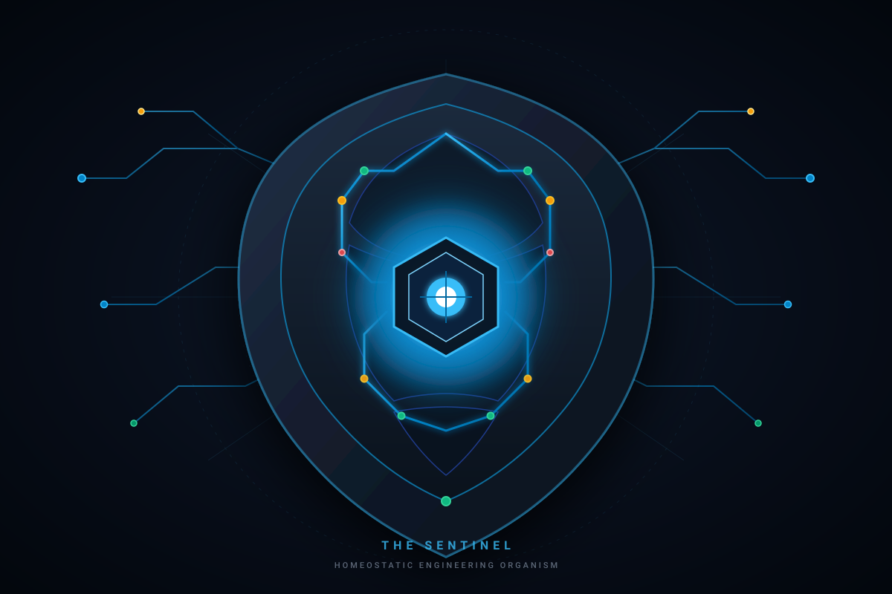

# DESK

### An AI-Assisted Electronics Design Engineering Workbench
**THE SENTINEL — A Homeostatic Engineering Organism**

*Protect the design. Repair the damage. Preserve the integrity.*

<p align="center">
  
</p>

[](https://www.python.org/)
[](desk/)
[](https://pro.easyeda.com/)
[](LICENSE)

---

## 1. What DESK Is

**DESK** is an open-source, AI-assisted engineering workbench built for hardware and electronics engineers working with **EasyEDA Pro**. It is developed by **Tusk Innovations Global Pvt Ltd**.

DESK is not a replacement for the ECAD tool or for engineering judgment. It works alongside your EDA environment as a physics-guided co-pilot that enforces a hardware-first principle:

> **Knowledge before geometry. Physical electrical laws before layout appearance. Deterministic verification before automated board mutation.**

DESK helps you design, route, audit, and prepare boards for fabrication — from requirements to manufacturing readiness — with deterministic confidence and human approval at every stage.

**Important:** DESK is actively developed. Many capabilities have been implemented and tested offline. Live EasyEDA Pro board mutation has not yet been production-verified. See [§9 Verification Status](#9-verification-status) and [§10 Limitations](#10-current-limitations-and-pending-development) for details.

---

## 2. Architecture Overview

DESK is built as a set of Python modules with **zero external pip dependencies** (100% Python standard library).

```
┌────────────────────────────────────────────────────────────────────────┐
│                        HARDWARE ENGINEER                               │
│           (Reviews constraints, inspects results, approves work)       │
└───────────────────────────────────┬────────────────────────────────────┘
                                    │
                                    ▼
┌────────────────────────────────────────────────────────────────────────┐
│                         DESK WORKBENCH                                 │
│                                                                        │
│  Context Engine ─── AI Orchestrator ─── Mission Control Telemetry      │
│       │                   │                      │                     │
│  ┌────┴────┐    ┌────────┴────────┐     ┌───────┴──────┐              │
│  │ Profile  │    │ Routing Intel V2│     │ Local Server │              │
│  │ & Specs  │    │ Dense PCB Intel │     │ :49630       │              │
│  └─────────┘    │ Congestion      │     └──────────────┘              │
│                  │ Escape Analysis │                                    │
│  ┌─────────┐    │ Priority Router │     ┌──────────────┐              │
│  │Component│    │ Power-Aware     │     │ Quality Gates│              │
│  │ Intel   │    │ Width Engine    │     │ (8 domains)  │              │
│  │ & BOM   │    └─────────────────┘     └──────────────┘              │
│  └─────────┘                                                           │
│  ┌─────────┐    ┌─────────────────┐     ┌──────────────┐              │
│  │Placement│    │ Copper & Ground │     │ Rework Mode  │              │
│  │ Intel   │    │ Plane Engine    │     │ Surgical     │              │
│  └─────────┘    └─────────────────┘     │ Repair       │              │
│                                          └──────────────┘              │
│  ┌─────────┐    ┌─────────────────┐     ┌──────────────┐              │
│  │ IPC-2221│    │ DRC / ERC       │     │ Learning &   │              │
│  │ Calc    │    │ Engines         │     │ Decision Log │              │
│  └─────────┘    └─────────────────┘     └──────────────┘              │
└───────────────────────────────────┬────────────────────────────────────┘
                                    │
                                    ▼
┌────────────────────────────────────────────────────────────────────────┐
│               EASYEDA PRO (Desktop or Web ECAD Canvas)                 │
│          FreeRouting (External Routing Engine via DSN/SES)              │
└────────────────────────────────────────────────────────────────────────┘
```

### Core Modules

| Module | Location | Purpose |
|---|---|---|
| Profile & Design Specs | [`desk/profile.py`](desk/profile.py), [`desk/spec.py`](desk/spec.py), [`desk/ipc.py`](desk/ipc.py) | Design profiles, IPC-2221 trace width, electrical constraints, clearance/creepage tables |
| Component Intelligence | [`desk/component_intelligence/`](desk/component_intelligence/) | LCSC/JLCPCB parametric search, lifecycle audit, BOM, procurement |
| Placement Intelligence | [`desk/placement_intel.py`](desk/placement_intel.py), [`desk/placement.py`](desk/placement.py) | Mechanical-first placement, functional clustering, decoupling proximity |
| Placement Refinement | [`desk/placement_refine.py`](desk/placement_refine.py) | Density-aware passive movement proposals (single-pass, not iterative) |
| Routing Intelligence V2 | [`desk/routing/`](desk/routing/) | S-expr DSN parser, pad escape, congestion, priority, strategy, orchestrator |
| Dense PCB Intelligence | [`desk/routing/density.py`](desk/routing/density.py) | Grid-based supply/demand, hotspot detection, corridor discovery |
| Routing Recovery | [`desk/routing/recovery.py`](desk/routing/recovery.py) | Stagnation detection, selective rip-up diagnostics |
| Power Distribution | [`desk/power_distribution.py`](desk/power_distribution.py) | Rail analysis, copper sizing, via arrays, voltage-drop estimation |
| Copper & Ground Planes | [`desk/copper.py`](desk/copper.py) | Reference planes, return-path verification, island detection, zone management |
| Physical Connectivity | [`desk/routing/connectivity.py`](desk/routing/connectivity.py) | True pad-to-pad copper path verification |
| DRC / ERC Engines | [`desk/drc_engine.py`](desk/drc_engine.py), [`desk/erc.py`](desk/erc.py) | Design rules, electrical rules, block-level checks |
| Quality Gates | [`desk/quality.py`](desk/quality.py) | 8 fail-closed acceptance gates for manufacturing readiness |
| Rework Mode | [`desk/rework/`](desk/rework/) | 8-domain audit, baseline capture, surgical repair planning |
| Context Engine | [`desk/context.py`](desk/context.py) | Structural indexing, token-budgeted task packs |
| AI Orchestrator | [`desk/orchestrator/`](desk/orchestrator/) | 5-tier multi-model routing (L0 deterministic → L4 frontier) |
| EasyEDA Bridge | [`desk/bridge.py`](desk/bridge.py), [`desk/adapters/`](desk/adapters/) | EasyEDA Pro window discovery, PCB readback, mutation adapter |
| Mission Control | [`desk/runtime/server.py`](desk/runtime/server.py) | Local telemetry dashboard on port 49630 |
| Learning Engine | [`desk/learn/`](desk/learn/), [`learning/`](learning/) | Incident capture, lessons, engineering experience |
| Decision Ledger | [`desk/ledger.py`](desk/ledger.py) | Append-only engineering decision records |
| JLCPCB Manufacturing | [`desk/manufacturing/jlcpcb/`](desk/manufacturing/jlcpcb/) | Capabilities, quoting, PCBA catalog, order guard |

---

## 3. Current Implemented Capabilities

### 3.1 Hardware Engineering Intelligence

- **IPC-2221 Trace Width Calculation:** Trace widths computed from the IPC-2221 power-law formula based on copper weight, maximum current, and temperature rise. (Note: uses the IPC-2221 formula, not IPC-2152 chart data; conservative.)
- **Design Profiles:** Per-project electrical constraints — voltage rails, current limits with confidence levels (VERIFIED / ESTIMATED / UNKNOWN), layer stackup, differential pairs, net classes, fabricator minimums.
- **Clearance and Creepage Tables:** IPC-2221B Table 6-1 conductor spacing by voltage; IEC 60664-1 creepage distances.
- **Functional Block Decomposition:** Circuits decomposed into subsystem blocks (e.g., WATCH has 13 blocks: Power, Charge, Regulator, Boost, MCU, Audio, IMU, Display, Buttons, LEDs, USB Sense).
- **Offline ERC:** Block-level electrical rules checking from specifications — floating inputs, missing decoupling, pin-type conflicts.
- **Mental Model Pipeline:** Requirements → schematic → placement → routing mental model compilation.

### 3.2 Component Intelligence & BOM

- **LCSC Integration:** Parametric search via LCSC API (offline fixture catalog for testing; live API via `urllib.request`).
- **MPN and C-number Resolution:** Component identity resolution with canonical model.
- **Lifecycle Auditing:** End-of-Life and NRND detection.
- **Pricing and Stock:** Tiered pricing data from LCSC (offline-tested; live requires network).
- **Component Alternatives:** Alternative part discovery.
- **PCBA BOM Generation:** Fabrication-ready BOMs with LCSC C-codes and CPL centroid coordinates.
- **Multi-supplier Architecture:** Extensible supplier provider contracts (LCSC and Mouser providers implemented).

### 3.3 Manufacturing Ecosystem (JLCPCB)

- **Capabilities Declaration:** Static fabrication constraints (min trace 3.5 mil, min drill 0.2mm, max 32 layers, surface finishes).
- **PCBA Catalog:** Basic/extended part classification.
- **Quoting and Order Guard:** Safety checks before order submission.
- **BOM/CPL Export:** JLCPCB-compatible BOM and centroid formats.
- **Note:** Live JLCPCB API integration and fabricator DFM checking are not implemented.

### 3.4 EasyEDA Pro Integration

- **Bridge Discovery:** Automatic detection of running EasyEDA Pro instances via localhost port scanning.
- **PCB Adapter:** Batch readback script for components, pads, tracks, vias, zones, stackup, DRC rules.
- **Customer Project Protection:** WATCH and BEEBOX projects are mutation-protected in code.
- **Live Read-Only Verification:** One successful read-only session documented (13 getter calls, 484ms, WATCH project).
- **Live Mutation Status:** Adapter code exists for copper zone creation, repour, and placement; **not yet live-verified**.

### 3.5 Mechanical-First Component Placement

- **Placement Hierarchy:** Mechanical integrity → Footprint → Electrical → Functional → Routability → Area.
- **Mechanical Envelopes:** Connector mating clearances, mounting hole standoffs, screw terminal access.
- **Functional Clustering:** Power, MCU, sensor, RF/comms grouping with topological passive snapping.
- **Decoupling Proximity:** Capacitors placed adjacent to IC power pins.
- **Placement Refinement:** Single-pass density-aware passive movement proposals (0.5-2mm translations, 90° rotations). This is not iterative co-optimisation — it refines once, proposes moves, and preserves locked components.

### 3.6 Dense PCB Routing Intelligence

- **Grid-based Density Analysis:** Supply/demand modelling per routing layer with adaptive cell sizing (25-50 mil).
- **Hotspot Detection:** 8-connected congested region clustering with measured causes and recommended strategies.
- **Escape Analysis:** Per-pad escape feasibility classification (EASY / MODERATE / RESTRICTED / CRITICAL / NO_LEGAL_ESCAPE).
- **Corridor Discovery:** Identification of quiet routing channels adjacent to hotspots.
- **Incremental Updates:** `update_components()` recomputes only affected cells (placement-routing feedback).

### 3.7 Routing Intelligence V2

- **S-Expression DSN Parser:** Full tokenizer, parser, transformer with round-trip fidelity.
- **7 Routing Strategies:** Two-terminal (A), Multi-terminal MST (B), Escape-first (C), Differential pair (D), Power trunk (E), Plane stitch (F), RF isolated (G).
- **6-Stage Priority Scheduling:** Ground → High-speed differential → Power → Analog → Low-speed digital → Non-critical I/O.
- **Process Supervisor:** Engine discovery, JDK probing, version detection, headless execution, pass tracking, stagnation detection, timeout control.
- **Plateau Detection:** Monitors routing completion; triggers recovery when progress stalls.
- **Per-Pass Progress Reporting:** Wall-clock instrumentation across 20 canonical routing phases.
- **Selective Recovery:** Structured failure diagnostics, conflicting track identification, minimal rip-up plans.
- **Pre-flight Gate:** Three fail-closed structural checks before engine run: plane-net presence, outline closure, pad-in-keepout detection.
- **Physical Connectivity Verification:** True pad-to-pad copper path verification via geometric intersection and connected-component analysis.

### 3.8 Power Distribution & Trace-Width Intelligence

- **Rail Current Analysis:** Per-rail copper sizing proposals based on declared currents (fail-closed for undeclared rails).
- **Profile-Driven Widths:** `trace_width = max(profile_class, IPC_2221_width, fabricator_minimum)`.
- **Via Array Proposals:** Power distribution via arrays.
- **Voltage-Drop Estimation:** Analytical estimates based on trace geometry and copper properties.
- **Note:** Does not include switching-loop area minimisation or RF-specific ground-plane rules.

### 3.9 Ground Planes & Copper Engineering

- **Reference Plane Allocation:** Based on physical stackup declarations.
- **Return-Path Continuity:** 2D polygon containment (ray-casting) for unbroken reference planes under signals.
- **Island Detection:** Unconnected copper island identification and edge setback enforcement.
- **Zone Priority Hierarchy:** Power polygon zones with thermal relief control.
- **Ground Stitching:** Via array synthesis for ground connectivity.

### 3.10 Quality, DRC & Manufacturing Readiness

- **DRC Engine:** Clearance, annular ring, solder mask dam, fabricator minimum checks.
- **ERC Engine:** Netlist continuity, pin-type verification, floating input detection (offline block-level).
- **8 Fail-Closed Quality Gates:** Manufacturing readiness blocked by missing evidence; gates never pass on assumptions.
- **Rework Mode:** 8-domain surgical audit (requirements, netlist, footprints, placement, routing, power, copper, fabrication), baseline capture, dependency-aware repair planning.

### 3.11 AI Model Orchestration

- **5-Tier Execution Hierarchy:** L0 (deterministic, zero LLM) → L1 (fast reasoning) → L2 (capable + validated) → L3 (dual independent review) → L4 (frontier escalation).
- **Three Providers:** AGY (Gemini CLI), Pi (multi-provider CLI), NVIDIA NIM (HTTP direct).
- **Configured Models:** `nvidia/nemotron-3.5-lightning-30b-a3b` (L1), `nvidia/nemotron-3.5-super-vl-120b-a12b` (L2), `nvidia/nemotron-3-ultra-550b-a55b` (L3/L4) — verified on 2026-11-11 against live NIM endpoint.
- **Context Engine:** Structural indexing with token-budgeted task packs; deterministic retrieval for engineering data, BM25 for free-text.
- **Capability Registry:** Per-model capability declarations (vision, tool calling, structured output, thinking control).

### 3.12 Engineering Safety & Human Approval

- **Baseline Capture:** Multi-domain SHA-256 hashing before any operation.
- **Single-Writer Canvas Mutex:** Reentrant locks prevent concurrent process collisions.
- **Atomic Rollback Checkpoints:** Pre-mutation checkpoints for instant rollback.
- **Independent Readback:** Post-mutation canvas geometry re-read for physical truth.
- **Cryptographic Approval Tokens:** Rework mutations require explicit human approval tokens (`RW-APR-XXXX`).
- **Customer Project Quarantine:** Active client projects protected against automated mutation.

### 3.13 Local Mission Control

- **Telemetry Server:** Zero-dependency HTTP server on port 49630 with SSE streaming.
- **Dashboard CLI:** `python desk.py dashboard` launches the monitoring cockpit.

### 3.14 Engineering Learning & Decision Memory

- **Append-Only Decision Ledger:** Structured records with types (decision, fact, assumption, correction, verified), source attribution, and spec-hash staleness detection.
- **Learning Repository:** Incidents, lessons, playbooks, session logs with searchable indices.
- **Skill System:** Firstmate-style conditional skill loader for engineering agents.
- **Ship Command Architecture:** Captain-FirstMate bridge hierarchy with Scout/Ship task classification.

---

## 4. FreeRouting Integration Status

| Item | Status | Evidence |
|---|---|---|
| FreeRouting 2.1.0 on Java 23 | Engine runs; ignores job timeout and max_passes settings | WATCH log: 49 passes, 996s, no SES (killed) |
| FreeRouting 2.5.0 on Java 25 | Smoke test passed (SES in 4.4s); WATCH-DSN stopped at 6 passes, 100KB SES, 11 unrouted | `docs/engineering/DENSE_BOARD_BENCHMARK_REPORT.md` |
| JDK 25 local installation | Installed by the Founder | Reported; not validated by automated check |
| Stopped-job SES proof | **NOT CONFIRMED** | SES obtained from 2.5.0 stop, but with 11 unrouted nets — not a clean proof |
| `python desk.py doctor` | Implemented | `desk/doctor.py` — checks Python, Java, EasyEDA, project prerequisites |

---

## 5. Projects

| Project | Description | Status |
|---|---|---|
| [**WATCH**](projects/WATCH/) | ESP32-S3-based smartwatch — 13 functional blocks, 87 components, 60 nets, 4 copper layers, 30×45mm | Active development; routing attempts made; power-profile currents incomplete |
| [**LIGHT**](projects/LIGHT/) | 230V mains LED dropper — single-block high-voltage design | Block specification and placement plan complete |

---

## 6. Manufacturing Ecosystem

### LCSC

| Capability | Status |
|---|---|
| Component search (parametric) | Offline tested (fixture catalog); live API implemented |
| MPN / C-number resolution | Offline tested |
| Pricing and stock levels | Offline tested |
| Component alternatives | Offline tested |
| BOM generation | Offline tested |
| Live LCSC API calls | Implemented but not verified in automated tests |

### JLCPCB

| Capability | Status |
|---|---|
| Fabrication constraints (trace, drill, layers) | Implemented (static declaration) |
| SMT assembly / basic-extended classification | Implemented |
| BOM / CPL export compatibility | Offline tested |
| Quoting / order guard | Implemented |
| Live API integration | Not implemented |
| Gerber validation | Not integrated (one-off script only) |

### EasyEDA Pro

| Capability | Status |
|---|---|
| API gateway bridge discovery | Offline tested |
| Window and session detection | Offline tested |
| PCB batch readback (components, tracks, vias, zones) | Offline tested |
| Live read-only inspection | Verified (1 session, WATCH project, 13 calls, 484ms) |
| Live board mutation (placement, copper, routing) | **Implemented — NOT LIVE VERIFIED** |
| Customer project quarantine | Offline tested |

---

## 7. Performance Targets

The approved engineering time target for an average ESP32 IoT C2/C3 design:

| Engineering Stage | Target Time |
|---|---:|
| Schematic creation and validation | 45 minutes |
| Component placement | 45 minutes |
| PCB routing and connectivity | 90 minutes |
| Copper pouring | 30 minutes |
| Manufacturing checks | 15 minutes |
| **Total** | **225 minutes** |

> **⚠️ TARGET — NOT A VERIFIED PERFORMANCE CLAIM**
>
> No timed end-to-end ESP32 C2/C3 run has been performed. No representative ESP32-C2 or C3 project exists in the repository. The benchmark definition exists in [`docs/product_assessment/ESP32_BENCHMARK_BASELINE.md`](docs/product_assessment/ESP32_BENCHMARK_BASELINE.md) with per-stage estimates, but most stages are unmeasured or estimated. The routing phase has been partially measured (FreeRouting pass time: 6-42s median; full run: 996s with no SES). Schematic and placement stages are dominated by human transcription time.
>
> This target is aspirational. Do not cite 225 minutes as an achieved result.

---

## 8. AI and Agent Architecture

DESK uses a multi-model orchestration system with three provider adapters:

| Provider | Adapter | Models | Status |
|---|---|---|---|
| **AGY** (Gemini CLI) | [`desk/orchestrator/agy_adapter.py`](desk/orchestrator/agy_adapter.py) | Configurable via `DESK_L*_MODEL_AGY` | Offline tested |
| **Pi** (multi-provider CLI) | [`desk/orchestrator/pi_adapter.py`](desk/orchestrator/pi_adapter.py) | Configurable via `DESK_L*_MODEL_PI` | Offline tested |
| **NVIDIA NIM** (HTTP direct) | [`desk/orchestrator/http_adapter.py`](desk/orchestrator/http_adapter.py) | nemotron-3.5-lightning, super-vl, ultra | Verified on 2026-11-11 |

The 5-tier hierarchy (L0-L4) routes tasks by complexity. L0 is fully deterministic (zero LLM calls). Tool calling, vision support, and structured output capabilities are declared per model in the [capability registry](desk/orchestrator/capabilities.py) but tool calling and vision have not been integration-tested.

**Multi-agent organisation:** A Product Manager-led team structure with 6 teams is documented in [`docs/organisation/PRODUCT_CHARTER_AND_TEAMS.md`](docs/organisation/PRODUCT_CHARTER_AND_TEAMS.md). This is an operational protocol and documentation structure, not a runtime multi-agent system. The decision ledger, skill loader, and ship command architecture exist as code; isolated Git worktrees and runtime agent lifecycle management do not.

---

## 9. Verification Status

Test suite: **428 tests passing** across 74 test files (last verified 2026-11-12).

| Capability | Status | Evidence |
|---|---|---|
| IPC-2221 Trace Width Sizing | `OFFLINE TESTED` | `test_profile_hardening.py`, `test_ipc_models.py`, `test_hardware_reference_values.py` |
| Routing Intelligence V2 & DSN | `OFFLINE TESTED` | `test_routing_dsn.py`, `test_routing_orchestrator.py`, `test_routing_connectivity.py` and 12 more routing test files |
| Dense PCB Intelligence | `OFFLINE TESTED` | `test_dense_intelligence.py` |
| Pad Escape & Congestion | `OFFLINE TESTED` | `test_routing_escape.py`, `test_dense_intelligence.py` |
| Priority Net Routing | `OFFLINE TESTED` | `test_routing_priority.py` |
| Routing Recovery & Plateau Detection | `OFFLINE TESTED` | `test_routing_recovery.py`, `test_routing_pass_tracker.py` |
| Power Distribution | `OFFLINE TESTED` | `test_power_distribution.py` |
| Copper Planes & Return Paths | `OFFLINE TESTED` | `test_copper_geometry.py`, `test_copper_engine.py` |
| Physical Connectivity Verification | `OFFLINE TESTED` | `test_routing_connectivity.py`, `test_connectivity_zones.py` |
| 8 Fail-Closed Quality Gates | `OFFLINE TESTED` | `test_quality_fail_closed.py` |
| Component Intelligence & BOM | `OFFLINE TESTED` | `test_ci_*.py` (8 files) |
| Placement Intelligence | `OFFLINE TESTED` | `test_placement.py`, `test_phase6_placement_policy.py` |
| Rework Mode & 8-Domain Audit | `OFFLINE TESTED` | `test_rework_*.py` (8 files) |
| JLCPCB Manufacturing | `OFFLINE TESTED` | `test_jlcpcb_integration.py` |
| Mission Control Server | `OFFLINE TESTED` | `test_server.py` |
| Context Engine | `OFFLINE TESTED` | `test_context.py` |
| AI Orchestrator (mock providers) | `OFFLINE TESTED` | `test_orchestrator.py` |
| Decision Ledger & Learning | `OFFLINE TESTED` | `test_decision_memory.py`, `test_learn.py` |
| EasyEDA Bridge Discovery | `OFFLINE TESTED` | `test_bridge_port_discovery.py`, `test_easyeda_pro_integration.py` |
| EasyEDA Live Read-Only | `1 SESSION VERIFIED` | [`LIVE_EASYEDA_OBSERVATION_01.md`](docs/product_assessment/LIVE_EASYEDA_OBSERVATION_01.md) |
| **EasyEDA Live Mutation** | `IMPLEMENTED — NOT LIVE VERIFIED` | Zero live mutation tests executed |
| **FreeRouting + Java 25** | `INTEGRATION STARTED` | 2.5.0 smoke passed; WATCH stopped-job produced SES with 11 unrouted |
| **ESP32 225-min Benchmark** | `TARGET ONLY — NOT MEASURED` | No end-to-end timed run exists |

---

## 10. Current Limitations and Pending Development

### Critical Limitations

1. **No live EasyEDA mutation verification.** Board mutation through the EasyEDA Pro bridge has not completed a controlled live test. The adapter code exists and is offline-tested but is explicitly marked `NOT_LIVE_VERIFIED` in source. A 9-stage live test checklist is defined but has never been executed.

2. **FreeRouting stopped-job SES is not cleanly proven.** FreeRouting 2.5.0 under Java 25 produced a SES file after a controlled stop, but with 11 unrouted nets remaining. FreeRouting 2.1.0 ignores external stop settings entirely.

3. **WATCH power-profile currents are incomplete.** The WATCH design profile does not declare explicit rail current limits for several power nets. Power distribution proposals use `CurrentConfidence.UNKNOWN` for these rails and should not be trusted for fabrication without verified current values.

4. **No ESP32 C2/C3 benchmark board exists.** The 225-minute performance target is defined but no representative ESP32-C2 or C3 project exists. No timed end-to-end workflow has been measured.

5. **No live fabricator DFM check.** JLCPCB constraints are hardcoded; no live API integration exists for quoting or DFM validation.

### Important Limitations

- **Cross-platform:** Developed and tested on Windows 11. Linux and macOS should work (pure Python stdlib) but have no test evidence.
- **IPC-2221 formula (not IPC-2152):** Trace width uses the 2221 power-law approximation, not the more detailed 2152 chart data. Conservative for external layers.
- **Placement-routing co-optimisation is single-pass.** The placement refiner proposes moves but does not iterate with the router.
- **No switching-loop area minimisation** or RF-specific ground-plane rules.
- **No client engineering drawing import** (no OCR/PDF parsing).
- **Multi-agent organisation is documentation, not runtime.** Team structure is documented; no runtime multi-agent system with worktree isolation exists.
- **NVIDIA tool calling is verified (2026-11-12) for Nemotron 3 Ultra and 3.5 Lightning via `desk.py agent`; vision remains declared-only.**
- **No Firstmate/Backpass/Herdr/Wefth integration.** Only Pi and AGY adapters are implemented.
- **No 72-class PCB compatibility.** Only WATCH (ESP32-S3 smartwatch) and sensor patch boards have been tested.
- **No senior hardware engineer acceptance recorded.** Acceptance criteria are defined but unfulfilled.

---

## 11. Development Roadmap

A complete requirements traceability audit covering 97 requirements across 12 groups is available:

📋 **[Conversation Requirements Audit](docs/product_assessment/CONVERSATION_REQUIREMENTS_AUDIT.md)**

Summary: 42 verified, 19 implemented but unverified, 22 partially implemented, 8 missing, 4 blocked, 2 not tested.

The five highest-priority items for continued development:

1. Execute the live EasyEDA mutation test checklist on a disposable project.
2. Confirm FreeRouting 2.5.0 stopped-job SES with full connectivity.
3. Complete WATCH power-profile current declarations.
4. Create an ESP32-C2 reference project and run the first timed benchmark.
5. Set up Linux CI to verify cross-platform compatibility.

---

## 12. Installation & Verification

### System Requirements

- **Operating System:** Windows 10/11 (primary). Linux and macOS expected to work (untested).
- **Python:** 3.9 or higher.
- **Dependencies:** Zero external pip packages.
- **Optional:** Java 17+ for FreeRouting external routing engine. Java 25 recommended for FreeRouting 2.5.0.
- **Optional:** EasyEDA Pro (Desktop or Web) for live ECAD integration.

### Installation

```powershell
# Clone repository
git clone https://github.com/NijoP/DESK.git
cd DESK

# Run the test suite
python -m unittest discover -s tests -p "test_*.py"

# Check environment prerequisites
python desk.py doctor
```

### Essential CLI Commands

```powershell
# Check workbench status
python desk.py status

# Launch Mission Control dashboard
python desk.py dashboard

# Route a board with Routing Intelligence V2
python tools/route.py projects/WATCH --mode BALANCED

# Run routing benchmarks
python tools/routing_benchmarks.py

# Component search and BOM
python tools/bom.py projects/WATCH

# PCB design-rule check
python tools/drc.py projects/WATCH

# Start Rework Mode
python desk.py rework start projects/WATCH

# Audit existing PCB across 8 domains
python desk.py rework audit projects/WATCH

# Quality gates and manufacturing readiness
python desk.py rework report projects/WATCH
```

---

## 13. Documentation

| Area | Document |
|---|---|
| **Routing Intelligence V2** | [`docs/ROUTING_INTELLIGENCE_V2.md`](docs/ROUTING_INTELLIGENCE_V2.md) |
| **Dense PCB Intelligence** | [`docs/engineering/DENSE_PCB_INTELLIGENCE.md`](docs/engineering/DENSE_PCB_INTELLIGENCE.md) |
| **Congestion Optimisation** | [`docs/engineering/CONGESTION_OPTIMISATION.md`](docs/engineering/CONGESTION_OPTIMISATION.md) |
| **Power Distribution** | [`docs/engineering/POWER_DISTRIBUTION_INTELLIGENCE.md`](docs/engineering/POWER_DISTRIBUTION_INTELLIGENCE.md) |
| **Copper Zone Generation** | [`docs/engineering/COPPER_ZONE_GENERATION.md`](docs/engineering/COPPER_ZONE_GENERATION.md) |
| **Placement Co-optimisation** | [`docs/engineering/PLACEMENT_ROUTING_COOPTIMISATION.md`](docs/engineering/PLACEMENT_ROUTING_COOPTIMISATION.md) |
| **EasyEDA Integration** | [`docs/ecosystem/02_EASYEDA_PRO_INTEGRATION.md`](docs/ecosystem/02_EASYEDA_PRO_INTEGRATION.md) |
| **LCSC Integration** | [`docs/ecosystem/LCSC_INTEGRATION_ARCHITECTURE.md`](docs/ecosystem/LCSC_INTEGRATION_ARCHITECTURE.md) |
| **JLCPCB Manufacturing** | [`docs/ecosystem/JLCPCB_MANUFACTURING_ARCHITECTURE.md`](docs/ecosystem/JLCPCB_MANUFACTURING_ARCHITECTURE.md) |
| **Capability Matrix** | [`docs/product_assessment/PRODUCT_CAPABILITY_MATRIX.md`](docs/product_assessment/PRODUCT_CAPABILITY_MATRIX.md) |
| **Requirements Audit** | [`docs/product_assessment/CONVERSATION_REQUIREMENTS_AUDIT.md`](docs/product_assessment/CONVERSATION_REQUIREMENTS_AUDIT.md) |
| **ESP32 Benchmark Baseline** | [`docs/product_assessment/ESP32_BENCHMARK_BASELINE.md`](docs/product_assessment/ESP32_BENCHMARK_BASELINE.md) |
| **Live Test Status** | [`docs/product_assessment/LIVE_TEST_STATUS.md`](docs/product_assessment/LIVE_TEST_STATUS.md) |
| **THE SENTINEL Identity** | [`docs/identity/DESK_CHARACTER_IDENTITY.md`](docs/identity/DESK_CHARACTER_IDENTITY.md) |
| **Rework Mode (16-part series)** | [`docs/rework/01_REWORK_MODE_OVERVIEW.md`](docs/rework/01_REWORK_MODE_OVERVIEW.md) |
| **Getting Started** | [`docs/getting-started.md`](docs/getting-started.md) |
| **Mission Control** | [`docs/local-dashboard.md`](docs/local-dashboard.md) |
| **Product Charter & Teams** | [`docs/organisation/PRODUCT_CHARTER_AND_TEAMS.md`](docs/organisation/PRODUCT_CHARTER_AND_TEAMS.md) |
| **Learning Repository** | [`learning/README.md`](learning/README.md) |

---

## 14. Engineering Safety

1. **Baseline Capture:** Multi-domain SHA-256 hashes record every footprint, trace, and copper boundary before any operation.
2. **Single-Writer Mutex:** Reentrant canvas locks prevent concurrent process collisions.
3. **Atomic Rollback:** Pre-mutation checkpoints for instant rollback on failure.
4. **Independent Readback:** Geometry re-read from the CAD engine to confirm physical truth.
5. **Fail-Closed Gates:** Missing verification evidence blocks manufacturing release.
6. **Human Approval Required:** Rework mutations require explicit cryptographic approval tokens.
7. **Customer Protection:** Active client projects (WATCH, BEEBOX) are mutation-protected in code.

---

## 15. Contributing

We welcome contributions from electronics engineers and software developers:

1. All code must use **100% Python standard library** (zero external pip packages).
2. Base trace width and clearance rules on physical equations or documented fabricator standards.
3. Run all automated tests: `python -m unittest discover -s tests -p "test_*.py"`.
4. See [AGENTS.md](AGENTS.md) for development conventions and agent-system architecture.

---

## 16. License

[MIT License](LICENSE) — See [NOTICE](NOTICE) for attribution.

---

<p align="center">
  <b>DESK is actively developed. Some live hardware workflows still require validation.</b><br>
  <b>A healthy PCB is not merely a board without visible errors. It is a design whose intent, structure, and physical constraints remain intact.</b><br>
  <b>DESK exists to protect that integrity.</b>
</p>
