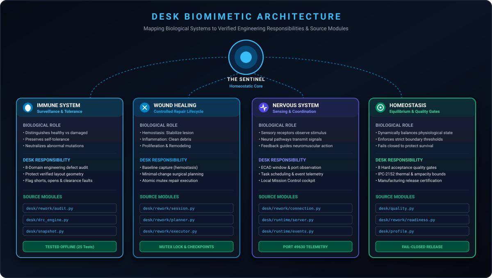
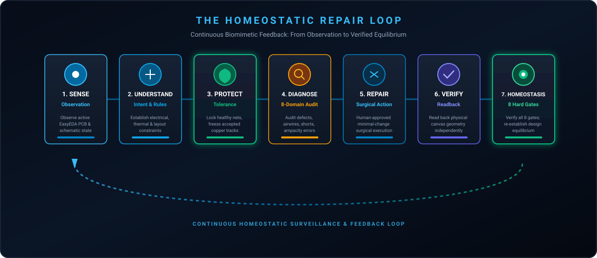

# DESK

### Your Electronics Engineering Workbench.
**THE SENTINEL — A Homeostatic Engineering Organism**

*Protect the design. Repair the damage. Preserve the integrity.*

<p align="center">
  
</p>

[](tests/)
[](https://www.python.org/)
[](desk/)
[](https://pro.easyeda.com/)
[](http://127.0.0.1:49630)
[](LICENSE)

---

## 1. Executive Overview

**DESK** is an open-source, AI-assisted engineering workbench built specifically for hardware and electronics engineers working with **EasyEDA Pro**.

In traditional Electronic Design Automation (EDA), moving from an engineering requirement to a fabricated, working circuit board requires hours of iterative, manual tasks: sizing trace widths for high-current limits, routing dense connections without creating electromagnetic interference (EMI), pouring ground planes, diagnosing DRC clearance collisions, and verifying manufacturing readiness.

DESK works alongside your ECAD software as an intelligent, physics-guided co-pilot. It does not replace your engineering judgment or guess coordinates like a generic chatbot. Instead, it enforces a fundamental hardware principle:

> **Knowledge before geometry. Physical electrical laws before layout appearance. Deterministic verification before automated board mutation.**

Whether you are starting a new board from scratch, continuing an unfinished design, or repairing an existing PCB layout before releasing it to a fabrication house like JLCPCB, DESK helps you design with deterministic confidence.

---

## 2. The Philosophy: Homeostasis in Electronics Design

In natural biology, **homeostasis** is the active process by which an organism maintains internal stability while adjusting to external changes. An organism regulates its temperature, repairs cellular lesions, neutralizes pathogens, and balances metabolic energy.

A printed circuit board is not a static 2D drawing. It is a high-density physical ecosystem governed by rigorous physical laws:

```
┌────────────────────────────────────────────────────────────────────────┐
│                        HOMEOSTATIC EQUILIBRIUM                         │
├────────────────────────────────────────────────────────────────────────┤
│  Electrical Continuity    ◄───►    Trace Ampacity & Thermal Limits     │
│  Signal Integrity & EMI   ◄───►    Unbroken Copper Reference Planes    │
│  Component Placement      ◄───►    Fabricator Clearances & Tolerances  │
└────────────────────────────────────────────────────────────────────────┘
```

When an engineer inherits an unfinished or defective PCB, standard autorouters or automated scripts often cause catastrophic collateral damage: they indiscriminately rip up tuned traces, split continuous reference planes, or suppress design rules to make errors disappear.

DESK approaches PCB engineering through the lens of biomimetic homeostasis: **maintaining the health, stability, and intent of the design while diagnosing and repairing defects.**

---

## 3. Meet THE SENTINEL

**THE SENTINEL** is the character persona and operational intelligence of DESK. It is not an autonomous black-box or a playful mascot; it is a sophisticated engineering guardian with six core behavioral traits:

```
                  ┌──────────────────────────────┐
                  │        THE SENTINEL          │
                  │   Core Character Persona     │
                  └──────────────┬───────────────┘
                                 │
     ┌──────────────┬────────────┼────────────┬──────────────┐
     ▼              ▼            ▼            ▼              ▼
1. OBSERVANT   2. PROTECTIVE 3. DIAGNOSTIC 4. METHODICAL 5. SCEPTICAL 6. ADAPTIVE
```

1. **Observant:** Understands the board deeply before acting. It samples active ECAD windows, ingests netlists, and captures exact multi-domain baseline fingerprints down to the micro-via.
2. **Protective:** Exhibits biological immune tolerance toward healthy, verified geometry. Existing high-speed differential pairs, analog layouts, and accepted tracks are locked as `PROTECTED`.
3. **Diagnostic:** Identifies true physical root causes across 8 engineering domains rather than masking symptoms or deleting tracks.
4. **Methodical:** Enforces a controlled repair lifecycle (Hemostasis $\to$ Inflammation $\to$ Proliferation $\to$ Remodeling). No mutation occurs without dependency planning.
5. **Sceptical:** Never trusts an operation simply because an API returned success. It physically re-reads canvas geometry to confirm continuity and clearance independently.
6. **Adaptive:** Measures host CPU pressure and memory headroom to throttle concurrency, running comfortably on a 2-core laptop or scaling across a 64-core workstation.

---

## 4. The Biological Foundations

DESK builds its core architecture around three biological mechanisms:

<p align="center">
  
</p>

### A. The Immune System (Surveillance & Tolerance)
The immune system defends the organism by eliminating pathogens while exhibiting rigorous **self-tolerance** toward healthy native tissue.
- **Surveillance:** DESK continuously scans designs across 8 physical domains to discover unrouted airwires, polygon keepout violations, and trace ampacity shortfalls.
- **Tolerance:** Verified component footprints and human-crafted routing are protected against automated modification.
- *Core Principle:* **Never attack healthy engineering structures while attempting to repair defective ones.**

### B. Wound Healing (Controlled Surgical Repair)
When living tissue is damaged, recovery proceeds through four strictly controlled phases:

| Biological Phase | Biological Role | DESK Engineering Operation |
|---|---|---|
| **1. Hemostasis** | Vasoconstriction and clot formation stabilize the wound site | **Baseline Capture:** Lock canvas mutex (`write_op`) and hash multi-domain baselines (`geometry_rev`, `stackup_rev`). |
| **2. Inflammation** | Macrophages identify defects and clear debris | **8-Domain Audit:** Systematically inventory and categorize issues (`issue_inventory.json`). |
| **3. Proliferation** | Cellular signaling directs targeted tissue regeneration | **Surgical Repair Planning:** Formulate minimal-change repairs and acquire cryptographic approval tokens (`RW-APR-XXXX`). |
| **4. Remodeling** | Re-align fibers and test tensile physical strength | **Readback Verification:** Re-read physical geometry and evaluate 8 fail-closed quality gates. |

### C. The Nervous System (Sensing, Coordination & Feedback)
The nervous system samples sensory receptors, transmits action potentials, coordinates muscular movements, and receives proprioceptive feedback.
- **Sensory Sensing:** Interrogates active EasyEDA Pro desktop and web instances via localhost bridge discovery.
- **Coordination:** Dispatches tasks through an adaptive priority scheduler with bounded CPU and I/O queues.
- **Proprioceptive Feedback:** Reads back physical canvas geometry after every mutation to ensure intended physical constraints were met.
- *Core Principle:* **Every action must be informed by observation and followed by feedback.**

---

## 5. The Homeostatic Operating Loop

DESK operates in a continuous, seven-stage closed engineering loop:

<p align="center">
  
</p>

1. **SENSE:** Interrogate the active ECAD window, identify the bound project, and ingest current schematic and board states.
2. **UNDERSTAND:** Establish electrical, mechanical, and manufacturing constraints from design profiles and calculate IPC-2152 trace widths.
3. **PROTECT:** Isolate verified geometry, nets, and footprints, marking them `PROTECTED` against involuntary alteration.
4. **DIAGNOSE:** Audit defects across the 8 physical domains, classifying issues by severity (`CRITICAL`, `WARNING`, `INFO`).
5. **REPAIR:** Create a dependency-aware surgical repair plan and execute minimal-change actions under single-writer locks with explicit human approval.
6. **VERIFY:** Read back physical canvas geometry independently from CAD cache to confirm expected modifications and zero unintended collisions.
7. **RESTORE HOMEOSTASIS:** Verify all 8 hard acceptance quality gates and prove that the design has reached stable electrical and manufacturing equilibrium.

---

## 6. How DESK Works (Supported Engineering Capabilities)

DESK coordinates end-to-end electronics engineering across three primary workflows:

```
┌────────────────────────────────────────────────────────────────────────┐
│                        THREE CORE WORKFLOWS                            │
├────────────────────────┬───────────────────────┬───────────────────────┤
│ Workflow A:            │ Workflow B:           │ Workflow C:           │
│ Green-Field Design     │ Rework Mode           │ Read-Only Audit       │
│ (`DESIGN_MODE`)        │ (`REWORK_MODE`)       │ (`AUDIT_MODE`)        │
├────────────────────────┼───────────────────────┼───────────────────────┤
│ From requirements and  │ Take an unfinished or │ Inspect layout for    │
│ block specs to routed  │ DRC-failing PCB and   │ return-path splits,   │
│ board and BOM.         │ execute repairs.      │ ampacity, and DRC.    │
└────────────────────────┴───────────────────────┴───────────────────────┘
```

### 1. Schematic & Netlist Intelligence
- **Functional Block Decomposition:** Decomposes complex circuits into subsystem blocks (Power, MCU, RF, Sensors).
- **Power Tree Synthesis:** Maps voltage drops, quiescent currents, and regulator sequencing ($12\,\text{V} \to 5\,\text{V} \to 3.3\,\text{V}$).
- **Electrical Rules Check (ERC):** Verifies netlist continuity, pin types, and detects floating inputs or missing pull-ups.

### 2. Component Intelligence & BOM Sourcing
- **Parametric Search:** Queries LCSC, Mouser, and JLCPCB for active components, prices, and stock levels.
- **Lifecycle Auditing:** Identifies End-of-Life (EOL) and NRND parts before layout commitment.
- **Automated PCBA BOM & Centroid:** Generates fabrication-ready BOMs (with LCSC C-codes) and CPL centroid coordinates.

### 3. Physical Placement & Invariant Protection
- **Mechanical Anchors:** Locks connectors (USB-C, headers), mounting holes, and edge components in fixed positions.
- **Thermal Clustering:** Enforces adequate copper area and thermal relief for power converters and drivers.
- **Decoupling Proximity:** Places decoupling capacitors adjacent to IC power pins for minimal loop inductance.

### 4. IPC-2152 Trace Width Calculation
- Trace widths are calculated directly from physical thermal formulas based on layer copper weight (1 oz / 2 oz), maximum continuous current, and allowed temperature rise ($\Delta T = 10^\circ\text{C}$).
- Enforces: `trace_width = max(profile_class, IPC_2152_width, fabricator_minimum)`.

### 5. 6-Stage Priority Net Routing
- Priority-ordered net routing schedules critical nets before general signals:
  1. Ground nets and reference returns.
  2. High-speed and impedance-controlled differential pairs.
  3. Power distribution rails.
  4. Analog and sensitive sensor traces.
  5. Low-speed digital communication buses.
  6. Non-critical digital I/O lines.

### 6. Ground Planes & Return Path Verification
- 2D polygon intersection checks ensure continuous copper reference planes under signal lines, preventing split-plane EMI antennas.

### 7. Rework Mode: 8-Domain Surgical Audit & Repair
When auditing an existing board, DESK evaluates 8 distinct domains:
- **Domain A:** Requirements & System Intent (voltage rails, interfaces).
- **Domain B:** Schematic vs. PCB Netlist Consistency (unrouted airwires, net mismatches).
- **Domain C:** Component Footprints & Geometry (courtyard collisions, pin numbering).
- **Domain D:** Placement & Mechanical Constraints (board outline, hole clearances).
- **Domain E:** Routing & Topology (IPC-2152 ampacity, trace necking).
- **Domain F:** Power & Thermal Distribution (high-current trace drop, thermal relief).
- **Domain G:** Copper Planes & Ground Integrity (plane splits, island antennas).
- **Domain H:** Fabrication Rules & DRC (annular rings, solder mask dams, fab minimums).

---

## 7. Biology Meets Engineering: Architecture Mapping

Every biomimetic concept maps directly to concrete, test-verified Python modules:

| Biological System | EDA Responsibility | Source Module | Status |
|---|---|---|---|
| **Sensory Receptors** | EasyEDA window discovery and socket binding | [`desk/rework/connection.py`](desk/rework/connection.py)<br>[`desk/bridge.py`](desk/bridge.py) | `TESTED_OFFLINE` |
| **Immune Tolerance** | Protect verified geometry and footprints | [`desk/rework/planner.py`](desk/rework/planner.py)<br>[`desk/snapshot.py`](desk/snapshot.py) | `TESTED_OFFLINE` |
| **Immune Surveillance** | 8-Domain engineering defect audit | [`desk/rework/audit.py`](desk/rework/audit.py)<br>[`desk/drc_engine.py`](desk/drc_engine.py) | `TESTED_OFFLINE` |
| **Hemostasis** | Canvas mutex lock and multi-domain baselining | [`desk/ops.py`](desk/ops.py)<br>[`desk/rework/baseline.py`](desk/rework/baseline.py) | `TESTED_OFFLINE` |
| **Wound Healing** | Minimal-change surgical repair planning | [`desk/rework/planner.py`](desk/rework/planner.py)<br>[`desk/router.py`](desk/router.py) | `TESTED_OFFLINE` |
| **Motor Action** | Mutex-locked execution with checkpoints | [`desk/rework/executor.py`](desk/rework/executor.py)<br>[`desk/runtime/checkpoints.py`](desk/runtime/checkpoints.py) | `TESTED_OFFLINE` |
| **Proprioception** | Canvas geometry readback and verification | [`desk/rework/executor.py`](desk/rework/executor.py)<br>[`desk/adapters/easyeda_pcb_adapter.py`](desk/adapters/easyeda_pcb_adapter.py) | `TESTED_OFFLINE` |
| **Homeostasis** | 8 Fail-closed hard acceptance quality gates | [`desk/quality.py`](desk/quality.py)<br>[`desk/rework/readiness.py`](desk/rework/readiness.py) | `TESTED_OFFLINE` |
| **Nervous Coordination** | Task scheduler and telemetry streaming | [`desk/runtime/scheduler.py`](desk/runtime/scheduler.py)<br>[`desk/runtime/server.py`](desk/runtime/server.py) | `TESTED_OFFLINE` |
| **Immunological Memory**| Append-only decision ledger and learning | [`desk/ledger.py`](desk/ledger.py)<br>[`desk/learn/`](desk/learn/) | `TESTED_OFFLINE` |

*For complete architectural specifications, see [Biological to Engineering Mapping](docs/identity/BIOLOGICAL_TO_ENGINEERING_MAPPING.md).*

---

## 8. Working with EasyEDA Pro

DESK is engineered to work alongside **EasyEDA Pro** (both Desktop client and Web browser).

```
┌────────────────────────────────────────────────────────────────────────┐
│                        HARDWARE ENGINEER                               │
│           (Reviews constraints, inspects results, approves work)       │
└───────────────────────────────────┬────────────────────────────────────┘
                                    │
                                    ▼
┌────────────────────────────────────────────────────────────────────────┐
│                         DESK WORKBENCH                                 │
│  • IPC-2152 Track Width Sizing     • 6-Stage Net Priority Router       │
│  • Ground Plane & Return Paths     • Component Intelligence & BOM      │
│  • 8 Fail-Closed Quality Gates     • Local Mission Control Telemetry   │
└───────────────────────────────────┬────────────────────────────────────┘
                                    │
                                    ▼
┌────────────────────────────────────────────────────────────────────────┐
│                   EASYEDA PRO (Your ECAD Canvas)                       │
│             (Schematics, Footprints, Copper Zones, Gerbers)            │
└────────────────────────────────────────────────────────────────────────┘
```

### The Role of the Engineer
- **Human Authority:** DESK is an automated engineering assistant. It calculates geometry and flags violations, but **the human engineer holds final approval authority**.
- **Cryptographic Approval:** In Rework Mode, mutations cannot execute without an explicit human approval token (`RW-APR-XXXX`) bound to that exact repair ID.
- **Safety Quarantine:** Active client projects (`WATCH`, `BEEBOX`) are protected against automated mutation. Test mutations execute exclusively in disposable workspaces.

---

## 9. Local Mission Control (Telemetry Cockpit)

DESK includes an integrated, zero-dependency telemetry server providing real-time in-browser monitoring of all engineering operations:

```powershell
python desk.py dashboard
```

- **URL:** [`http://127.0.0.1:49630`](http://127.0.0.1:49630)
- **Zero Overhead:** Adds $\le +0.011\,\text{ms}$ execution latency with a lightweight memory footprint ($\approx 50\,\text{MB}$).
- **Streaming Telemetry:** Real-time Server-Sent Events (SSE) stream the 12 canonical engineering stages, DRC convergence, active rework states, and gate evaluations.

---

## 10. Engineering Safety Guarantees

Hardware engineers are rightly protective of their layout artwork. DESK implements strict safeguards:

1. **Exact Baseline Capture:** Multi-domain SHA-256 hashes record every footprint, trace vertex, and copper boundary before any operation begins.
2. **Single-Writer Canvas Mutex:** Reentrant canvas locks (`write_op`) prevent concurrent processes from colliding on active documents.
3. **Atomic Rollback Checkpoints:** Checkpoints are stored before every atomic mutation, enabling instant rollback if verification fails.
4. **Independent Readback:** Geometry is read back from the CAD engine to confirm physical truth rather than assuming success.
5. **Fail-Closed Gate Architecture:** Missing verification evidence blocks manufacturing release; gates never pass on assumptions.

---

## 11. Quick Start

### Hardware Engineer's Checklist
- **Operating System:** Windows 10/11 (PowerShell recommended), Linux, or macOS.
- **Python:** Python 3.9 or higher.
- **Dependencies:** **Zero external pip packages.** DESK uses 100% Python standard library.
- **Hardware:** Runs on any 2-core machine with $\ge 2\,\text{GB}$ RAM.

### Installation & Verification

#### Windows PowerShell (Recommended)
```powershell
# 1. Clone repository
git clone https://github.com/NijoP/DESK.git

# 2. Enter directory
cd DESK

# 3. Verify installation (runs 332 automated checks in ~12 seconds)
python -m unittest discover -s tests -p "test_*.py"
```

#### Linux & macOS
```bash
git clone https://github.com/NijoP/DESK.git
cd DESK
python3 -m unittest discover -s tests -p "test_*.py"
```

### Essential CLI Commands

```powershell
# Check workbench telemetry status
python desk.py status

# Launch Local Mission Control Cockpit
python desk.py dashboard

# Route board with Routing Intelligence V2 (BALANCED mode, supervised execution)
python tools/route.py projects/WATCH --mode BALANCED

# Run full routing performance and correctness benchmark
python tools/routing_benchmarks.py

# Start Rework Mode on an existing project (captures baseline snapshot)
python desk.py rework start projects/WATCH

# Audit existing PCB across 8 physical domains
python desk.py rework audit projects/WATCH

# Review inventory of discovered issues
python desk.py rework issues projects/WATCH

# Generate dependency-aware surgical repair plan
python desk.py rework plan projects/WATCH

# Authorize a surgical repair (generates bound approval token)
python desk.py rework approve projects/WATCH RP-0006

# Execute surgical repair under mutex lock with readback verification
python desk.py rework execute projects/WATCH RP-0006

# Evaluate 8 hard quality gates and generate manufacturing readiness report
python desk.py rework report projects/WATCH
```

---

## 12. Project Status & Limitations

An authoritative, evidence-based status of DESK capabilities verified by automated test suites:

| Engineering Capability | Current Status | Verification Evidence |
|---|---|---|
| **IPC-2152 Trace Width Sizing** | `AVAILABLE (OFFLINE TESTED)` | Tested against physical copper formulas (`test_profile_hardening.py`). |
| **Routing Intelligence V2 & S-Expr DSN** | `AVAILABLE (OFFLINE TESTED)` | Pad escape feasibility, AST S-expr DSN parser, process supervisor, true physical connectivity (`test_routing_*.py`, 29 tests). |
| **Copper Planes & Return Paths** | `AVAILABLE (OFFLINE TESTED)` | Ray-casting polygon intersection tests (`test_copper_geometry.py`). |
| **8 Fail-Closed Quality Gates** | `AVAILABLE (OFFLINE TESTED)` | Verified to block unrouted/shorted nets (`test_quality_fail_closed.py`). |
| **Local Mission Control Cockpit** | `AVAILABLE (OFFLINE TESTED)` | In-browser server tested on port 49630 (`test_server.py`). |
| **Component Intelligence & BOM** | `AVAILABLE (OFFLINE TESTED)` | Parametric search & pricing tested (`test_component_intelligence.py`). |
| **Rework Mode & 8-Domain Audit** | `AVAILABLE (OFFLINE TESTED)` | 8-domain audit, baseline snapshot, repair planner (`test_rework_*.py`, 25 tests). |
| **EasyEDA Pro Official CLI & Safety**| `AVAILABLE (OFFLINE TESTED)` | Window discovery, session inspection, customer project barriers (`test_easyeda_pro_integration.py`). |
| **EasyEDA Pro Live Bridge Mutation**| `IMPLEMENTED BUT NOT LIVE VERIFIED` | Adapter signatures implemented; live execution on production customer boards quarantined (`tools/live_disposable_test.py`). |

---

## 13. Contributing & Documentation

### Documentation Directory
- [**Routing Intelligence V2 Architecture**](docs/ROUTING_INTELLIGENCE_V2.md) — Pad escape engine, AST DSN parser, process supervisor, and physical connectivity.
- [**Routing Benchmark & Regression Report**](docs/ROUTING_BENCHMARK_REPORT.md) — Empirical performance metrics on Project One dataset.
- [**Character Identity: THE SENTINEL**](docs/identity/DESK_CHARACTER_IDENTITY.md) — Comprehensive character persona and behavioral traits.
- [**Biomimetic Design Philosophy**](docs/identity/BIOMIMETIC_DESIGN_PHILOSOPHY.md) — Detailed explanation of homeostasis, immunology, and wound healing in EDA.
- [**Visual Identity Guide**](docs/identity/VISUAL_IDENTITY_GUIDE.md) — Visual standards, color palette, and asset usage.
- [**Biological to Engineering Mapping**](docs/identity/BIOLOGICAL_TO_ENGINEERING_MAPPING.md) — Source-code-level verification of biological mechanisms.
- [**README Validation Report**](docs/identity/README_VALIDATION_REPORT.md) — Verification of technical claims and links.
- [**Rework Mode Architecture Series**](docs/rework/01_REWORK_MODE_OVERVIEW.md) — Complete 16-part technical specification for PCB recovery and surgical repair.
- [**Local Mission Control Guide**](docs/local-dashboard.md) — How to operate the telemetry cockpit.

### Contributing
We welcome contributions from electronics engineers and software developers:
1. Ensure all code uses **100% Python standard library** (zero external pip packages).
2. Base all trace width and clearance rules on physical equations or documented fabricator standards.
3. Verify that all 332 automated tests pass (`python -m unittest discover -s tests -p "test_*.py"`).

---

<p align="center">
  <b>A healthy PCB is not merely a board without visible errors. It is a design whose intent, structure, and physical constraints remain intact.</b><br>
  <b>DESK exists to protect that integrity.</b>
</p>
