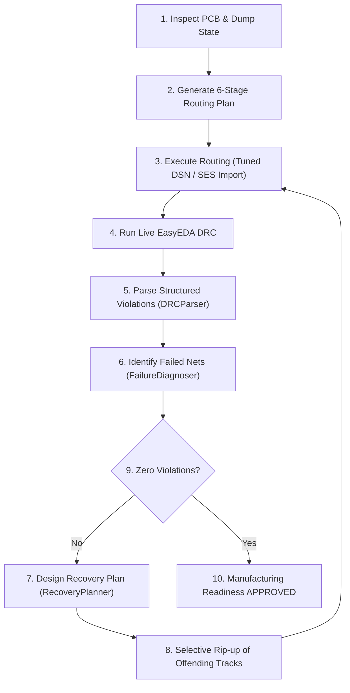

# 05 — Autonomous PCB Routing & DRC Convergence Engine

> **Routing Philosophy: Connectivity-First, DRC-Driven Closed Loop.**
> The objective is to connect every required pad on every populated PCB net while maintaining electrical isolation and design rules.

---

## 1. 6-Stage Priority Routing Order

The routing engine operates strictly in 6 prioritized stages:

```
STAGE 1 — GND PREPARATION
  Identify ground pads, evaluate legal nearby through-vias, and generate short escape stubs.
STAGE 2 — CONNECTOR ROUTING
  Verify connector pin maps, escape fine-pitch pads, and route connector-to-IC networks.
STAGE 3 — CRITICAL SIGNALS
  Differential pairs (USB, CAN, RS485), high-speed buses, clocks, timing-sensitive, and analog sense lines.
STAGE 4 — CONTROL & SENSOR SIGNALS
  I2C, SPI, UART, GPIOs, sensor buses, feedback dividers, and digital control lines.
STAGE 5 — POWER DISTRIBUTION
  Calculate IPC-2152 trace widths based on current capacity (e.g. 12+ mil for power rails vs 5 mil signals).
STAGE 6 — REMAINING CONNECTIONS
  Complete all remaining populated nets; check every endpoint for 100 % connectivity.
```

---

## 2. Multilayer & Stackup Management

The engine automatically detects the board stackup from `pcb_dump.json`:
- **2-Layer Boards**: Top layer for primary signal and power routing; Bottom layer dedicated to an unbroken ground reference plane with short jumpers where necessary.
- **4-Layer Boards**:
  - `Top`: Component placement and primary high-priority signals.
  - `Inner 1 (GND)`: Continuous, unbroken ground reference plane.
  - `Inner 2 (PWR/Signal)`: Power distribution islands and secondary signal routing.
  - `Bottom`: Auxiliary signal routing and connector breakout escapes.

---

## 3. EasyEDA Pro DSN Tuning

EasyEDA Pro's DSN export requires geometric and constraint tuning before routing:
- **Boundary Rectification**: Corrects DSN board boundaries to match the true PCB outline rectangle.
- **Fine-Pitch Clearance & Width**: Tunes default clearance to 4.02 mil and width to 5.0 mil for tight IC escapes.
- **Power Class Rules**: Slices power nets (`VBUS`, `VBAT`, `VSYS`, `3V3`, `5V`) into dedicated classes with widened tracks (12.0+ mil).

---

## 4. DRC Closed-Loop Convergence

Routing is never assumed complete until verified by live EasyEDA DRC (`tools/drc.py --converge`).



---

## 5. Routing Failure Recovery

When nets cannot be routed:
1. **Identify Disconnected Endpoints**: Pinpoint open pads and failed nets.
2. **Selective Rip-Up**: Only remove offending tracks (`conflicting_tracks_to_ripup`), preserving all valid routes.
3. **Layer Transition & Vias**: Insert escape vias and shift routing to alternative legal layers.
4. **Iterative Audit**: Track delta metrics (resolved vs newly introduced errors) in `state/pcb_iterations.json` and append to `LEDGER.jsonl`.
5. **Acceptance Targets**:
   - Zero unconnected SMD pads
   - Zero disconnected tracks
   - Zero orphan vias
   - Zero unconnected populated nets
   - Zero unintended shorts
   - Zero clearance violations.
