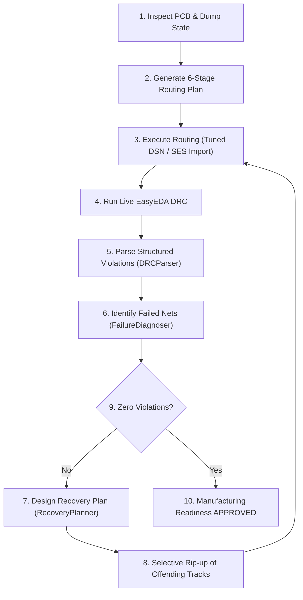

# 05 — Autonomous PCB Routing & DRC Convergence Engine

> **Routing Philosophy: Connectivity-First, DRC-Driven Closed Loop.**
> The objective is to connect every required pad on every populated PCB net while maintaining electrical isolation and design rules.

---

## 1. 6-Stage Priority Routing Order

The routing engine operates strictly in 6 prioritized stages:

```
STAGE 1 — GND PREPARATION
  Identify ground pads, evaluate legal nearby through-vias, and generate short escape stubs.
STAGE 2 — CONNECTOR ROUTING
  Verify connector pin maps, escape fine-pitch pads, and route connector-to-IC networks.
STAGE 3 — CRITICAL SIGNALS
  Differential pairs (USB, CAN, RS485), high-speed buses, clocks, timing-sensitive, and analog sense lines.
STAGE 4 — CONTROL & SENSOR SIGNALS
  I2C, SPI, UART, GPIOs, sensor buses, feedback dividers, and digital control lines.
STAGE 5 — POWER DISTRIBUTION
  Calculate IPC-2152 trace widths based on current capacity (e.g. 12+ mil for power rails vs 5 mil signals).
STAGE 6 — REMAINING CONNECTIONS
  Complete all remaining populated nets; check every endpoint for 100 % connectivity.
```

---

## 2. Multilayer & Stackup Management

The engine automatically detects the board stackup from `pcb_dump.json`:
- **2-Layer Boards**: Top layer for primary signal and power routing; Bottom layer dedicated to an unbroken ground reference plane with short jumpers where necessary.
- **4-Layer Boards**:
  - `Top`: Component placement and primary high-priority signals.
  - `Inner 1 (GND)`: Continuous, unbroken ground reference plane.
  - `Inner 2 (PWR/Signal)`: Power distribution islands and secondary signal routing.
  - `Bottom`: Auxiliary signal routing and connector breakout escapes.

---

## 3. EasyEDA Pro DSN Tuning

EasyEDA Pro's DSN export requires geometric and constraint tuning before routing:
- **Boundary Rectification**: Corrects DSN board boundaries to match the true PCB outline rectangle.
- **Fine-Pitch Clearance & Width**: Tunes default clearance to 4.02 mil and width to 5.0 mil for tight IC escapes.
- **Power Class Rules**: Slices power nets (`VBUS`, `VBAT`, `VSYS`, `3V3`, `5V`) into dedicated classes with widened tracks (12.0+ mil).

---

## 4. DRC Closed-Loop Convergence

Routing is never assumed complete until verified by live EasyEDA DRC (`tools/drc.py --converge`).



---

## 5. Routing Failure Recovery

When nets cannot be routed:
1. **Identify Disconnected Endpoints**: Pinpoint open pads and failed nets.
2. **Selective Rip-Up**: Only remove offending tracks (`conflicting_tracks_to_ripup`), preserving all valid routes.
3. **Layer Transition & Vias**: Insert escape vias and shift routing to alternative legal layers.
4. **Iterative Audit**: Track delta metrics (resolved vs newly introduced errors) in `state/pcb_iterations.json` and append to `LEDGER.jsonl`.
5. **Acceptance Targets**:
   - Zero unconnected SMD pads
   - Zero disconnected tracks
   - Zero orphan vias
   - Zero unconnected populated nets
   - Zero unintended shorts
   - Zero clearance violations.

## Dense-board intelligence and engine integration (added 2026-11-12)

Before the engine runs, `tools/route.py` now builds a congestion map with measured causes
(`desk/routing/density.py`), hands the priority order and plane nets to Freerouting, passes
per-net clearances into the DSN, stops the engine when no better unrouted count appears for
`stagnation_patience` passes (`PassTracker`), and can continue from the previous session with
`--continue`. Details and measured results: `docs/engineering/DENSE_PCB_INTELLIGENCE.md`,
`docs/engineering/CONGESTION_OPTIMISATION.md`, `docs/engineering/DENSE_BOARD_BENCHMARK_REPORT.md`.

## Recoverable routing (added 2026-11-12, after the UPS_1000 live test)

The engine run is now checkpoint-driven and the pre-flight checks each pad against its own net rule. Details and the
evidence behind every change: `docs/reliability/RELIABILITY_AUDIT.md`, `docs/reliability/SELF_HEALING_ARCHITECTURE.md`.

* **Feasibility gate** (phase 9e, `desk/routing/feasibility.py`): a net rule larger than the copper gap of the package
  it terminates on is reported as a BLOCKING engineering decision (`state/route/engineering_decisions.json`) and the
  engine is not started. No spacing value is changed by DESK; `--acknowledge-blocked` records the operator's choice.
  The spacing model (`desk/spacing.py`) keeps IPC clearance, IEC creepage (only across declared `insulation_barriers`)
  and the fabricator minimum apart; `design_profile.json` `spacing_policy` defaults to the historical
  `CREEPAGE_AS_CLEARANCE` and `FUNCTIONAL` is a Captain decision.
* **Adaptive chunks** (`desk/routing/adaptive.py`): the first chunk measures the board with two passes; later chunks
  are sized from the measured pass time so a slow board gets one-pass chunks with a window long enough to finish.
  `DESK_FR_CHUNK_SAFETY` (default 0.6) is the fraction of the window filled with estimated pass time.
* **Checkpoint** (`desk/routing/checkpoint.py`, `state/route/checkpoint/chunk_best.ses`): the best valid SES survives
  every later timeout, crash or corrupt file; `--continue` resumes from it.
* **Engine profiles** (`desk/routing/engine_profiles.py`): Freerouting 2.1.x cannot be bounded on this host (it ignores
  `max_passes` and `job_timeout`, writes the SES only at 100 %, and a terminated JVM writes nothing); the run is
  refused with `ENGINE_UNBOUNDABLE`. Use 2.5.0 with the bundled JDK 25.
* **Outcomes**: every chunk is named (`CHUNK_TIMEOUT`, `ENGINE_TIMEOUT`, `ZERO_PASSES_TIMEOUT`, `SES_NOT_GENERATED`,
  `SES_CORRUPTED`, `SES_NOT_IMPROVED`, `PARTIAL_ROUTING_SUCCESS`, `FULL_ROUTING_SUCCESS`, `ENGINE_IGNORES_LIMITS`) in
  `state/route/progress_chunks.json`; an engine failure writes `state/route/route_failure.json`.
* **Verdict**: `ROUTING VERDICT: FULL` only when the physical connectivity readback connects every populated net;
  otherwise `PARTIAL` and `tools/route.py` returns 3. An engine SUCCESS is not a routing verdict.
