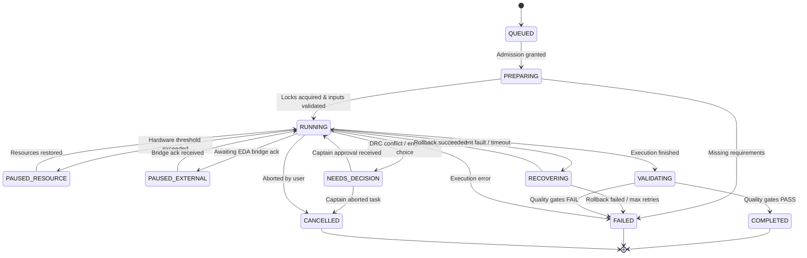

# Durable Engineering Task Runtime

## 1. Overview & Inspiration

The DESK Durable Task Runtime synthesizes durability concepts from **Pi** (`replay safety and deterministic state machines`) and concurrency controls from **Herdr** (`process supervision and bounded pools`).

Electronics engineering operations are expensive, stateful, and often irreversible if accidentally duplicated against an active EDA canvas. An intermittent crash, bridge timeout, or model hallucination must never corrupt a board or leave phantom copper polygons. The task runtime provides:

1. **Durable Task Inbox**: Persistent queue with monotonic sequence numbering, deduplication, and profile revision binding.
2. **12-State Task Lifecycle**: Formal finite state machine governing every task.
3. **Replay Safety & Idempotency Rules**: Clear categorization of reads vs mutations.
4. **Event-Driven Supervision**: Structured JSON event ledger waking up agents only when human intervention or stage progression is required.

---

## 2. The 12-State Task Lifecycle

### Complete State Definitions

1. `QUEUED`: Instruction received and stored in inbox; awaiting resource admission.
2. `PREPARING`: Allocating memory budget, resolving design profile revision, acquiring locks.
3. `RUNNING`: Actively executing deterministic pipeline stage or tool action.
4. `PAUSED_RESOURCE`: Temporarily halted due to CPU/RAM threshold limits; awaiting capacity.
5. `PAUSED_EXTERNAL`: Paused waiting for external EDA application or asynchronous background worker.
6. `NEEDS_DECISION`: Engineering choice or rule override required; paused awaiting Captain input.
7. `RECOVERING`: Rollback to last valid checkpoint following a transient failure.
8. `VALIDATING`: Output generated; running M6 quality hard gates and evidence checks.
9. `COMPLETED`: All quality gates passed with verified evidence ledger.
10. `FAILED`: Terminal failure; quality gate failed or unrecoverable error.
11. `UNKNOWN`: Unverified state (e.g., lost heartbeat during crash); fail-closed.
12. `CANCELLED`: Explicitly aborted by Captain before completion.

---

## 3. Replay Safety & Idempotency Classifications

Every operation registered in `desk/operation_registry.py` must declare one of four replay safety policies:

| Replay Policy | Definition | Example Operations | Safe Action on Crash |
| :--- | :--- | :--- | :--- |
| `SAFE_READ` | Zero state mutation. Querying state or calculating values in memory. | Net query, DRC check, spatial query, IPC width calculation. | Re-execute immediately. |
| `SAFE_IDEMPOTENT` | Mutating operation that produces identical state when repeated with same inputs. | Set component position, assign net name, re-pour zone with fixed seed. | Safe to re-run with same inputs. |
| `UNSAFE_MUTATION` | Non-idempotent operation that creates new primitives or appends state. | Create track, place via, add copper zone primitive. | **NEVER re-run blindly**. Must verify canvas readback or rollback checkpoint before retrying. |
| `RECONCILE_BEFORE_RETRY` | Operation requiring fresh PCB readback and geometry reconciliation prior to any retry. | Batch track routing, auto-stitching via arrays. | Query active canvas state, diff against expected state, repair delta. |

---

## 4. Durable Inbox & Event-Driven Supervision

The inbox ledger (`desk/runtime/task_inbox.py`) enforces:
- **Monotonic Sequence Numbering**: Guarantees FIFO or priority execution.
- **Idempotency Hash**: `hash(task_type, payload, profile_rev)`. Re-submitting the exact same task payload returns the existing task ID without duplicate processing.
- **Profile Revision Binding**: Tasks bind to a specific `DesignProfile` revision. If the Captain modifies design rules while a task is queued, the task is flagged `STALE` or auto-re-prepared.

The event supervisor (`desk/runtime/events.py`) emits structured events:
- `task.queued`, `task.started`, `task.stage_completed`, `task.needs_decision`, `task.completed`, `task.failed`.
- Models are awakened only on `task.needs_decision` or terminal completion, eliminating expensive token burn on polling loops.
