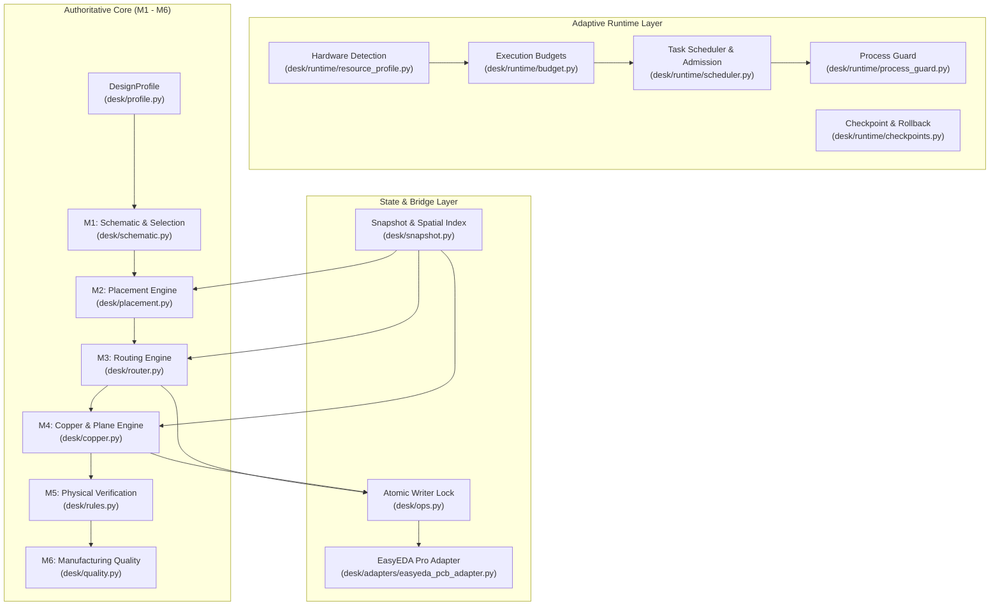

# Engineering Execution Architecture

## 1. Architecture Overview

DESK (Design Engineering System Kernel) is an adaptive, deterministic electronics engineering execution system. It bridges high-level human engineering requirements and low-level physical PCB implementation across EDA environments (such as EasyEDA Pro), while running efficiently across low-end laptops (8 GB RAM / 2 cores) up to multi-core workstations (64 GB RAM / 32 cores).

---

## 2. Hardware-Adaptive Execution Engine

DESK profiles host hardware on startup and binds an execution profile without requiring external configuration:

1. **Low-End Tier (LOW)**:
   - Memory $\le$ 8 GB, CPU Cores $\le$ 2.
   - Concurrency: Serial execution (concurrency = 1).
   - Spatial Grid Index: Coarser bin size (10.0 mm).
   - Snapshots: Disk-backed with aggressive memory garbage collection.
   - Batch Sizes: 50 primitives per batch to avoid UI freezes in EDA.
2. **Mainstream Tier (MEDIUM)**:
   - Memory $\le$ 16 GB, CPU Cores $\le$ 4.
   - Concurrency: Moderate (concurrency = 2).
   - Spatial Grid Index: Standard bin size (5.0 mm).
   - Memory caching of active net connectivity.
   - Batch Sizes: 200 primitives per batch.
3. **Workstation Tier (HIGH / UNCONSTRAINED)**:
   - Memory > 16 GB, CPU Cores > 4.
   - Concurrency: Bounded parallel verification & multi-zone polygon decomposition.
   - Spatial Grid Index: Fine bin size (2.0 mm) with full in-memory caching.
   - Batch Sizes: 1000 primitives per batch.

---

## 3. The Authoritative M1–M6 Engineering Pipeline

Unlike generative LLM coding assistants that output hallucinated track coordinates, DESK strictly separates procedural agent orchestration from authoritative engineering math:

- **M1 (Requirements & Schematic)**:
  - Validates net topologies, pin definitions, voltage ratings, and component packages.
  - Compiles user requirements into a typed `DesignProfile`.
- **M2 (Placement & Thermal Partitioning)**:
  - Partitions circuits into functional clusters: High-Voltage/Power, Sensitive Analog/RF, Digital Control, and I/O.
  - Enforces thermal separation distance and decoupling capacitor proximity rules.
- **M3 (Deterministic Routing Planner)**:
  - Calculates trace width using IPC-2152 equations based on layer copper weight (oz/ft²) and allowable temperature rise.
  - Respects net-class minimum clearance, RF 50 $\Omega$ microstrip geometry, and differential pair impedance matching.
- **M4 (Copper & Ground Plane Engine)**:
  - Synthesizes continuous ground return paths.
  - Evaluates polygon boundaries, keepout voids, thermal reliefs, solid spoke connections, and isolated copper islands.
- **M5 (Design Rule Verification)**:
  - Deterministic clearance verification, unrouted net detection, and differential length skew analysis.
- **M6 (Quality Hard Gates & Manufacturing Approval)**:
  - 5-state gate evaluation (`PASS`, `FAIL`, `UNKNOWN`, `NOT_RUN`, `STALE`).
  - Strict fail-closed policy: missing verification evidence immediately invalidates manufacturing sign-off.

---

## 4. Single Serialized Writer Boundary

Live EDA canvases cannot tolerate concurrent mutations. DESK enforces a strict, atomic cross-process writer lock:

- Lock acquisition uses POSIX `O_CREAT | O_EXCL` semantics (or Windows equivalent via `os.open`).
- Lock files record PID, timestamp, and active task ID.
- Stale locks are evicted only if the recording PID is verified dead via OS process signaling.
- All bridge operations (`pcb_PrimitivePour`, track creation, via placement) must yield the lock immediately upon batch completion.
