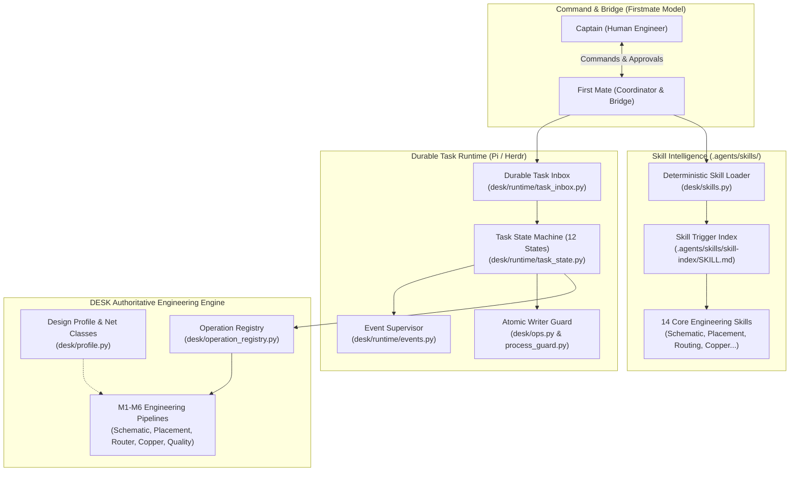

# Firstmate Integration Audit & Reference Architecture Assessment

## 1. Executive Summary

This document presents a comprehensive technical audit of the reference architecture repository **Firstmate** (`https://github.com/kunchenguid/firstmate`) alongside secondary references **Herdr** (`https://github.com/earendil-works/herdr`) and **Pi** (`https://github.com/earendil-works/pi`), and outlines their direct integration, adaptation, or rejection within the **DESK** (Design Engineering System Kernel) platform.

DESK is a deterministic electronics engineering execution system for RF, power electronics, mixed-signal, and high-current PCB design. Integrating architectural principles from Firstmate, Pi, and Herdr accelerates agent orchestration, skill discoverability, and task durability without sacrificing DESK's core requirement: **strict, deterministic engineering correctness governed by physics and manufacturing constraints**.

---

## 2. Reference Repository Analysis

### 2.1 Firstmate (`kunchenguid/firstmate`)
Firstmate introduces an operational hierarchy rooted in a disciplined maritime command metaphor:
- **Captain**: The human user and primary decision authority.
- **First Mate**: The primary AI agent coordinator, bridge operator, greeting responder, and workflow orchestrator.
- **Crew**: Specialized, short-lived task execution agents (e.g., schematic, placement, routing).
- **Scouts**: Read-only reconnaissance workers producing structured markdown intelligence reports without side effects.
- **Skill Trigger Index (`.agents/skills/skill-index/SKILL.md`)**: A centralized indexing mechanism for conditional skill loading based on explicit regex/keyword triggers.
- **Skill Architecture (`.agents/skills/<skill>/SKILL.md`)**: Portable markdown files with structured YAML frontmatter defining triggers, inputs, outputs, and execution checklists.
- **Durable Task Inbox & Event-Driven Supervision**: Decoupled message queuing with explicit acknowledgments and revision binding.

### 2.2 Herdr (`earendil-works/herdr`)
Herdr focuses on persistent process supervisors and bounded concurrency:
- **Bounded Process Pools**: Limiting concurrent agent invocations and tool forks based on hardware thresholds.
- **Process Guard & Liveness**: Monitoring PID liveness, detecting stalled workers, and safely reclaiming orphaned resources.
- **Single Serialized Writer Boundary**: Ensuring that only one process holds the write lease on external targets (such as EDA canvases or file ledgers) at any instant.

### 2.3 Pi (`earendil-works/pi`)
Pi emphasizes durable state orchestration and deterministic replay safety:
- **12-State Task Lifecycle**: Explicit state transitions preventing illegal jumps (`QUEUED` → `PREPARING` → `RUNNING` → `COMPLETED`/`FAILED`).
- **Replay Safety & Idempotency**: Categorizing every task and operation into `SAFE_READ`, `SAFE_IDEMPOTENT`, `UNSAFE_MUTATION`, and `RECONCILE_BEFORE_RETRY`.
- **Event-Driven Supervision**: Dispatching structured lifecycle events (`task.queued`, `task.stage_completed`, `task.needs_decision`) rather than polling busy-loops.

---

## 3. Comparative Architecture Assessment: Adopted vs. Rejected Patterns

| Architectural Concept | Source | DESK Disposition | Engineering Rationale |
| :--- | :--- | :--- | :--- |
| **Skill Trigger Index (`SKILL.md`)** | Firstmate | **ADOPTED** | Eliminates prompt bloating. Agents load only the skills relevant to the active design phase (e.g., routing skills loaded only during routing). |
| **YAML Frontmatter Skills** | Firstmate | **ADOPTED** | Provides machine-readable skill definitions, trigger matching, input/output schemas, and execution checklists. |
| **Captain / First Mate Hierarchy** | Firstmate | **ADOPTED** | Establishes unambiguous authority boundaries. Captain retains ultimate approval over design changes and destructive mutations; First Mate coordinates without pretending to be the designer. |
| **Natural Greeting Handling** | Firstmate | **ADOPTED** | First Mate acknowledges cordial greetings respectfully as Captain without launching resource-intensive engineering scans or spawning worker crew. |
| **Ship Tasks vs. Scout Tasks** | Firstmate | **ADOPTED** | Decouples read-only investigative audits (Scout tasks) from design-mutating deliverables (Ship tasks). |
| **Shell-Script Tooling (`bin/fm-*.sh`)** | Firstmate | **REJECTED** | DESK must run universally on Windows 10/11 and Linux without requiring Bash, WSL, or external shell dependencies. Replaced by pure Python runtime modules in `desk/runtime/` and `tools/`. |
| **Unconstrained LLM Routing** | Firstmate | **REJECTED** | Freeform LLM routing produces non-deterministic PCB traces and violation of DRC rules. In DESK, LLM coordinates while deterministic modules (M1–M6) calculate physical geometry. |
| **Bounded Concurrency & Process Guard** | Herdr | **ADOPTED** | Hardware-adaptive concurrency limits prevent out-of-memory thrashing on 8 GB laptops while scaling up on 64 GB workstations. |
| **Single Serialized Writer Boundary** | Herdr | **ADOPTED** | Atomic file-descriptor locking (`O_CREAT \| O_EXCL`) ensures zero concurrent canvas writes to EasyEDA Pro. |
| **12-State Task Lifecycle** | Pi | **ADOPTED** | Replaces ad-hoc string statuses with formal state machine transitions and immutable ledger history. |
| **Operation Replay Safety Classification** | Pi | **ADOPTED** | Distinguishes idempotent calculations from mutating EDA writes, ensuring safe crash recovery without ghost primitives. |

---

## 4. Architectural Mapping to DESK Modules

### Module Mapping Matrix

1. **Firstmate Skill System** $\rightarrow$ `.agents/skills/` & `desk/skills.py`:
   - Central index in `.agents/skills/skill-index/SKILL.md`.
   - 14 domain-specific skills for schematic, placement, routing, copper, verification, intake, diagnostics, and recovery.
   - Deterministic skill resolution based on exact trigger keywords, regex, and intent classification.

2. **Firstmate Captain-FirstMate Personality** $\rightarrow$ `desk/context.py`, `tools/ctx.py`, and `AGENTS.md`:
   - Professional, disciplined nautical engineering partnership.
   - Addressed as "Captain" at least once per conversational turn.
   - Cordial greetings resolved immediately without crew invocation.
   - Explicit approval gates before any destructive or canvas-mutating action.

3. **Pi Durable Task Lifecycle** $\rightarrow$ `desk/runtime/task_state.py`:
   - Strict 12-state transition engine (`QUEUED`, `PREPARING`, `RUNNING`, `PAUSED_RESOURCE`, `PAUSED_EXTERNAL`, `NEEDS_DECISION`, `RECOVERING`, `VALIDATING`, `COMPLETED`, `FAILED`, `UNKNOWN`, `CANCELLED`).
   - Replay safety classifications: `SAFE_READ`, `SAFE_IDEMPOTENT`, `UNSAFE_MUTATION`, `RECONCILE_BEFORE_RETRY`.

4. **Pi Durable Task Inbox** $\rightarrow$ `desk/runtime/task_inbox.py`:
   - Monotonic sequencing, idempotency hashing, design profile revision binding, and delivery receipts.

5. **Herdr Event Supervisor & Process Guard** $\rightarrow$ `desk/runtime/events.py` & `desk/runtime/process_guard.py`:
   - Structured JSON event stream.
   - PID liveness monitoring, graceful worker shutdown, and deadlock prevention.

6. **Herdr Single Serialized Writer** $\rightarrow$ `desk/ops.py`:
   - Atomic cross-process lock protecting EasyEDA Pro bridge mutations.

---

## 5. Verification & Acceptance Criteria

1. **Zero External Dependencies**: All newly introduced modules must execute cleanly using Python 3.10+ standard library modules (`json`, `re`, `os`, `sys`, `pathlib`, `dataclasses`, `enum`, `typing`, `time`, `hashlib`).
2. **Deterministic Skill Loading**: Skill loader must match query tokens against indexed frontmatter without invoking any external AI API.
3. **Task Lifecycle Invariants**: Illegal state transitions (e.g., `QUEUED` directly to `COMPLETED` without `RUNNING`) must raise deterministic errors.
4. **Idempotency Guarantee**: Submitting identical task messages to the durable inbox must return the existing task reference rather than duplicating execution.
