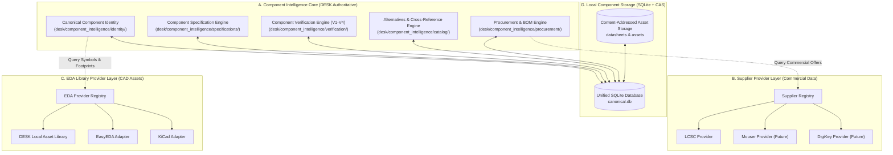

# Existing Architecture Audit: Component Intelligence & Supplier Integration

## 1. Executive Summary

This audit assesses the current state of electronic component handling, library management, and BOM operations in the DESK repository. It identifies existing assets, analyzes architectural deficiencies, and charts a non-destructive migration path to establish a **Universal Component Intelligence & Supplier Integration Platform**.

Under the non-negotiable architectural principles established by the Master Directive:
- **DESK owns canonical component identity and engineering intelligence.**
- **Suppliers provide commercial information (stock, pricing, packaging, lead times).**
- **EDA providers provide engineering-library assets (symbols, footprints, 3D models).**

These three domains must remain strictly decoupled. External vendors (LCSC, Mouser, DigiKey, EasyEDA, KiCad) must never dictate or own DESK's internal canonical component schemas.

---

## 2. Existing Capabilities & Reusable Modules

| Module / Asset | Existing Capability | Architectural Assessment & Reusability |
| :--- | :--- | :--- |
| `library/devices.json` | Stores ~650 devices with MPN, EasyEDA UUIDs (`libraryUuid`, `uuid`), footprint, and LCSC part codes. | **Partially Reusable**: Serves as a historical seed cache for local EasyEDA asset UUIDs and LCSC mappings. Needs migration into a normalized SQLite component database. |
| `library/pins/<MPN>.json` | Stores pinout tables `[{num, name}]` extracted from EasyEDA schematic primitives. | **Reusable**: High-value local pin cache. Should be indexed as local EDA symbol asset pins under the local EDA provider. |
| `desk/component_intel.py` | RegEx-based component classification (`ComponentClassifier`), pin pitch extraction, footprint invariant validation (`FootprintIntegrityEngine`). | **Highly Reusable**: Directly reusable for physical verification (V3) and category inference. |
| `desk/models.py` | `PadGeometry`, `FootprintInvariant`, `ComponentRequirement`. | **Reusable**: Base geometric and footprint models. Canonical component identity models will build upon this foundation. |
| `tools/resolve.py` | Resolves MPNs to EasyEDA devices using live `eda.lib_Device.search()`. | **Legacy Interface**: Tightly coupled to a live EasyEDA Pro bridge instance. Fails offline. Must be replaced by the supplier/EDA abstraction with offline-first local library resolution. |
| `tools/bom.py` | Generates BOM from block specs, performs capacitor voltage derating checks, and passive consolidation checks. | **Reusable**: Engineering rules (1.5x rail voltage derating, passive package standardization) will be integrated into the Component Specification and Procurement engines. |
| `tools/pins.py` | Extracts symbol pin mappings by creating and deleting temporary parts on an active schematic sheet. | **Legacy Interface**: Dangerous mutation on live sheets. Must be superseded by offline symbol asset extraction and caching. |
| `desk/quality.py` | 5-state verification engine (`PASS`, `FAIL`, `UNKNOWN`, `NOT_RUN`, `STALE`). | **Core Pattern**: Established verification lifecycle to be inherited by the Component Verification Engine across V1–V4 levels. |
| `desk/runtime/` | Hardware-adaptive scheduler, resource budgets, and bounded process guard. | **Infrastructure**: Provides rate-limiting, threadpool bounds, and disk caching for supplier API connectors. |
| `desk/operation_registry.py` | Machine-readable registry for deterministic engineering operations. | **Integration Point**: Internal agent tools (`find_component`, `verify_component`, `build_procurement_bom`) will register here. |

---

## 3. Identified Deficiencies & Missing Capabilities

1. **Tight Coupling between MPN, Supplier, and EDA**:
   In `library/devices.json`, an LCSC code (`C11702`) and EasyEDA UUIDs (`17aa4e57...`) are stored directly on the MPN key. There is no concept of a canonical manufacturer identity, multi-supplier offers (e.g., getting the same part from Mouser or DigiKey), or multiple footprint variants.
2. **Lack of a Supplier Abstraction Layer**:
   No unified interface exists for querying supplier availability, real-time pricing tiers, minimum order quantities (MOQ), or packaging formats (tape & reel vs. cut tape).
3. **Absence of a Structured Database**:
   Relying on large JSON files (`devices.json`) leads to race conditions, poor query performance, lack of transactional safety, and inability to perform multi-criteria searches (e.g., "0402 10uF 16V X7R ceramic capacitor").
4. **No Formal Verification Levels (V1–V4)**:
   A part is currently considered valid simply if an entry exists in `devices.json`. There is no automated verification of manufacturer authenticity (V1), electrical limits (V2), footprint geometry (V3), or stock viability (V4).
5. **No Alternatives & Cross-Reference Engine**:
   No mechanism exists to declare or verify drop-in pin-compatible replacements, electrical equivalents, or second-source alternatives when primary parts go out of stock.
6. **Live Bridge Dependency for Basic Resolution**:
   Resolving a part currently requires an active EasyEDA Pro desktop window running on localhost port 49620. Offline engineers cannot discover or verify parts.

---

## 4. Architectural Domain Separation

---

## 5. Proposed File Modifications & Additions

### Proposed New Modules (`desk/component_intelligence/`)
1. **Identity & Core Models**:
   - `desk/component_intelligence/identity/models.py`: Canonical component, manufacturer, package, and datasheet records.
   - `desk/component_intelligence/identity/resolver.py`: Normalization, MPN matching, duplicate detection, and canonical ID generation.
2. **Supplier Provider Layer**:
   - `desk/component_intelligence/suppliers/capabilities.py`: Typed supplier capability flags.
   - `desk/component_intelligence/suppliers/base.py`: Abstract `SupplierProvider` base class.
   - `desk/component_intelligence/suppliers/registry.py`: Thread-safe supplier registry and isolation boundary.
   - `desk/component_intelligence/suppliers/models.py`: Normalized supplier offers, pricing breaks, and inventory snapshots.
   - `desk/component_intelligence/suppliers/providers/lcsc/`:
     - `client.py`: Resilient HTTP client with backoff, timeouts, and rate limits.
     - `provider.py`: LCSC provider implementation conforming to base contract.
     - `mapper.py`: Normalized mapping of LCSC categories, packages, prices, and stock.
     - `models.py`: Typed representation of LCSC API payloads.
3. **EDA Library Provider Layer**:
   - `desk/component_intelligence/eda/base.py`: Abstract `EDALibraryProvider` base class.
   - `desk/component_intelligence/eda/registry.py`: EDA provider registry.
   - `desk/component_intelligence/eda/models.py`: Canonical symbol, footprint, pin mapping, and 3D model assets.
   - `desk/component_intelligence/eda/providers/local.py`: Local offline asset provider.
   - `desk/component_intelligence/eda/providers/easyeda.py`: Safe EasyEDA offline cache and bridge adapter.
   - `desk/component_intelligence/eda/providers/kicad.py`: KiCad `.kicad_sym` / `.kicad_mod` parser and adapter.
4. **Specification & Verification Engine**:
   - `desk/component_intelligence/specifications/engine.py`: Unit-normalized electrical and physical property extraction.
   - `desk/component_intelligence/verification/engine.py`: V1 (Identity), V2 (Electrical), V3 (Physical), V4 (Procurement) verification engine.
5. **Alternatives & Procurement**:
   - `desk/component_intelligence/catalog/alternatives.py`: Compatibility checking, pinout matching, and derating comparison.
   - `desk/component_intelligence/procurement/engine.py`: Multi-supplier BOM pricing, stock availability, and currency normalization.
6. **Local Database & Storage**:
   - `desk/component_intelligence/storage/database.py`: Normalized SQLite database schema, versioned migrations, and transactions.
   - `desk/component_intelligence/storage/repository.py`: High-level persistence API.
7. **Public Agent API**:
   - `desk/component_intelligence/api.py`: Clean, stable facade for AI agents and CLI tools.

### Existing Files Proposed for Modification
- `desk/operation_registry.py`: Register component intelligence operations (`find_component`, `verify_component`, `build_procurement_bom`).
- `tools/bom.py`: Enhance to utilize procurement engine for multi-supplier comparison while preserving existing CSV output formats.
- `tools/ctx.py`: Add `ctx.py part <MPN>` command for instant agent context retrieval.

---

## 6. Migration & Backward Compatibility Strategy

1. **Seed Migration**:
   Create a migration script that imports existing records from `library/devices.json` and `library/pins/*.json` into the new SQLite canonical database, creating canonical components, manufacturers, LCSC supplier offers, and local EDA assets automatically.
2. **Non-Breaking Existing APIs**:
   `S.load_library()` and `library/devices.json` remain functional as read-only fallbacks during the transition period.
3. **Pure Standard Library**:
   The entire database and HTTP stack relies solely on Python's built-in `sqlite3`, `urllib.request`, `json`, `dataclasses`, and `hashlib` without adding external dependencies (e.g., requests, SQLAlchemy).
