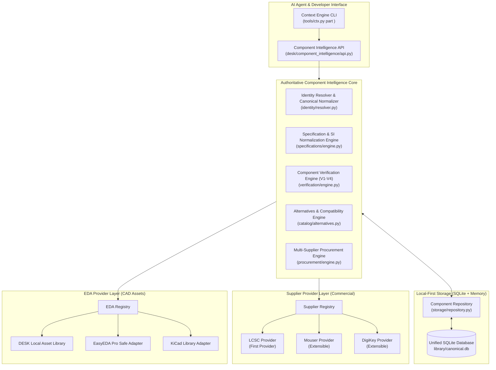

# Universal Component Intelligence Platform — System Architecture

## 1. Architectural Mission & Core Separation

The DESK Universal Component Intelligence Platform establishes a supplier-agnostic, local-first engineering foundation. It enforces the non-negotiable architectural separation between three distinct domains:

1. **Component Intelligence Core (DESK-owned)**:
   - Owns canonical component identity, normalized specifications, verification evidence, and compatibility rules.
2. **Supplier Provider Layer (Commercial data)**:
   - Provides live distributor pricing, volume price break ladders, warehouse stock, packaging, and datasheets.
3. **EDA Library Provider Layer (CAD assets)**:
   - Provides symbols, footprints, 3D models, and pin-to-pad mappings.

---

## 2. Invariants & Guarantees

1. **Supplier Independence**: Adding or removing a commercial supplier (LCSC, Mouser, DigiKey) never alters the canonical component schema or engineering verification rules.
2. **Local-First & Offline Resilience**: In the absence of network connectivity or API access, all previously cached components, local pin definitions, and footprints remain fully searchable and verifiable.
3. **Fail-Closed Verification**: The 5-state lifecycle (`PASS`, `FAIL`, `UNKNOWN`, `NOT_RUN`, `STALE`) guarantees that missing evidence is treated as fail-closed.
4. **Deterministic Substitutions**: AI models may propose component replacements, but substitution viability is evaluated deterministically by the Alternatives Engine. Cheaper parts are never substituted automatically.
5. **Zero External Dependencies**: The entire architecture runs strictly on Python 3.10+ standard library (`sqlite3`, `urllib.request`, `json`, `dataclasses`, `hashlib`).
