# 01 — Backpass Architecture for DESK

## Architectural Positioning

Backpass operates strictly as an **offline, development-time agent memory optimization system**. It is completely separated from the DESK production PCB execution pipeline.

```mermaid
flowchart TD
    subgraph DESK_DEV_ENVIRONMENT ["DESK Development Environment (Agent Memory Loop)"]
        Agents["Coding Agents<br/>(Claude Code, OpenCode, Codex, Pi)"]
        Transcripts["Local Session Transcripts<br/>(~/.claude, ~/.local/share/opencode)"]
        
        subgraph BACKPASS_CORE ["Backpass Core Engine"]
            Discovery["1. Discovery Adapters<br/>(Classify & Match CWD)"]
            LossAnalysis["2. Loss Analysis (Tier 1)<br/>(Extract Gaps & Failure Quotes)"]
            Aggregation["3. Gap Aggregation<br/>(Corroborate >= 2 Sessions)"]
            Synthesis["4. Synthesis (Tier 2)<br/>(Generate Budgeted Edits)"]
        end
        
        HumanGate{{"Human Gate (Review & Apply)<br/>(backpass apply --no-ui)"}}
        
        MemoryWeights["Canonical Project Memory<br/>- AGENTS.md<br/>- CLAUDE.md (pointer)<br/>- .agents/skills/"]
        
        Agents -->|"Runs Tasks"| Transcripts
        Transcripts --> Discovery
        Discovery --> LossAnalysis
        LossAnalysis --> Aggregation
        Aggregation --> Synthesis
        Synthesis --> HumanGate
        HumanGate -->|"Approved Diffs"| MemoryWeights
        MemoryWeights -.->|"Loads Context"| Agents
    end

    subgraph DESK_PRODUCTION_ENGINE ["DESK Production Application (Python Engine)"]
        Req["Client Requirements"] --> M1["M1: Schematic Intelligence"]
        M1 --> M2["M2: Placement Intelligence"]
        M2 --> M3["M3: Routing Planner (6-Stage)"]
        M3 --> M4["M4: Copper & Ground Synthesis"]
        M4 --> M5["M5: DRC & Manufacturing Limits"]
        M5 --> M6["M6: Fail-Closed Hard Gates"]
        M6 --> Release["Manufacturing Release (Gerber/BOM)"]
    end

    style DESK_DEV_ENVIRONMENT fill:#f8f9fa,stroke:#343a40,stroke-width:2px
    style DESK_PRODUCTION_ENGINE fill:#e8f4f8,stroke:#0077b6,stroke-width:2px
    style BACKPASS_CORE fill:#fff3cd,stroke:#ffc107,stroke-width:1px
```



---

## Separation Guarantees

1. **Zero Runtime Dependency:** Backpass is packaged as a Node.js CLI tool (`backpass` via npm). It is not listed in DESK's `pyproject.toml`, `requirements.txt`, or Python modules.
2. **Zero Production Import:** Neither `desk.*` nor `tools/*.py` import or depend on Backpass.
3. **Fail-Safe Isolation:** If Backpass is uninstalled or fails, DESK's core electrical, routing, placement, and DRC pipelines function completely uninterrupted.
4. **State Segregation:** All Backpass telemetry, cached transcript loss calculations, gap ledgers, and proposals reside exclusively in the local `.backpass/` directory, which is excluded from Git via `.git/info/exclude` and `.gitignore`.

---

## Two-Tier Execution Model

Backpass implements a mathematically inspired optimization loop over project instructions:

```
AGENTS.md + skills (weights) ──► Agent Session (forward pass) ──► Transcript on disk (loss signal)
           ▲                                                              │
           │                                                              ▼
           └────── Human Approval Gate ◄── Proposed Edits ◄── Loss & Gradients
```

### Tier 1: Per-Transcript Loss Analysis (Cheap Model)
- Invoked per newly discovered session.
- Runs through `acpx` using fast models (e.g. `gpt-5.6-luna` or `claude-sonnet-5`).
- Identifies instruction non-compliance, repeated tool errors, excessive file reads, and context thrashing.
- Outputs structured gap observations anchored with verbatim quotes from the transcript.

### Tier 2: Multi-Session Synthesis & Gradient Descent (High-Reasoning Model)
- Aggregates gap sightings across sessions into a persistent gap ledger (`.backpass/gap-ledger.json`).
- Applies the **Corroboration Floor**: Gaps must be witnessed across $\ge 2$ independent development sessions before triggering an instruction proposal.
- Uses high-reasoning models (e.g. `claude-opus-5` or `gpt-5.6-sol`) in a sandboxed staging directory (`.backpass/synthesis/`) to produce exact diffs.
- Categorizes operations into `ADD`, `REWRITE`, `REMOVE`, `EXTRACT` (to skill), or `MOVE`.

---

## Token Budget Mechanics

Backpass enforces a strict token budget for always-loaded instructions:
- **Default Budget:** 5,000 tokens for the combined surface of `AGENTS.md` and all skill descriptions in `.agents/skills/*/SKILL.md`.
- **Overflow Mechanism:** Detailed workflows that exceed the budget or have narrow task applicability ($< 20\%$ relevance) are automatically proposed as extracted skills under `.agents/skills/<skill-name>/SKILL.md`.
- **Trigger Optimization:** The skill's YAML frontmatter `description` acts as the trigger condition, keeping always-loaded token cost minimal (~25 tokens per skill) while keeping procedural bodies deferred until triggered.
