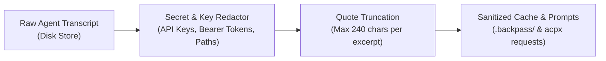

# 06 — Privacy, Security, and Redaction Specification

This document details the security model, credential handling, local data boundaries, and transcript redaction mechanisms governing Backpass in the DESK project.

---

## 1. Threat Model & Sensitive Data Assets

Coding agent development transcripts capture the entire conversational and execution history of developers working on DESK. Transcripts frequently contain:

1. **Authentication Tokens & Secrets:**
   - EasyEDA Pro web cookies and session tokens.
   - API keys for component supplier aggregators or LLM backends.
   - Local SSH keys or environment secrets.
2. **Proprietary Hardware Intellectual Property:**
   - Unreleased customer schematics, netlists, and circuit topologies.
   - Component values, proprietary pin mappings, and bill-of-materials costs.
3. **Host Environment Metadata:**
   - Windows hostnames, absolute user directory paths (`C:\Users\HP\...`), and internal network identifiers.

---

## 2. Redaction Architecture

Backpass implements an aggressive, automated redaction pipeline (`src/redact.js`) executed locally **before** any transcript text is written to the cache or processed by LLM calls:

### Redaction Rules:
- **API Keys & High-Entropy Strings:** Recognized formats (e.g., `sk-ant-*`, `ghp_*`, `xoxb-*`, bearer headers) are replaced with `[REDACTED]`.
- **Session Tokens & Cookies:** EasyEDA authorization headers and session IDs are stripped.
- **Verbatim Quote Bounds:** Evidence quotes captured for proposals are capped at 240 characters to prevent dumping entire proprietary blocks or codebases.

---

## 3. Storage and Boundary Guarantees

1. **Local-First Processing:**  
   Backpass runs exclusively on the local machine. It does not phone home, does not upload telemetry to third-party tracking services, and maintains all state under `.backpass/`.
2. **Git Exclusions (Dual-Layer Defense):**
   - **Layer 1 (`.git/info/exclude`):** Backpass automatically registers `.backpass/` upon `backpass init`.
   - **Layer 2 (`.gitignore`):** Explicit entry in `.gitignore` prevents leaks even across clean checkouts or fresh clones.
3. **No Credential Generation:**  
   Backpass never prompts for or stores third-party API keys in its configuration files. Model calls rely solely on the user's pre-authenticated agent harnesses via `acpx`.
4. **Human Verification Gate:**  
   Every proposed edit generated by Backpass includes verbatim supporting quotes and unified diffs. The human reviewer verifies that no sensitive client data or credentials leak into `AGENTS.md` before approving.
