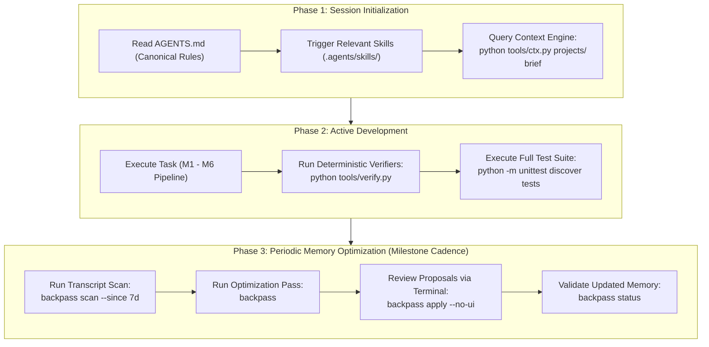

# 07 — Repeatable Daily Development Workflow

This document outlines the operational lifecycle for DESK engineers and autonomous coding agents, integrating Backpass into the standard engineering routine.

---

## 1. Development Lifecycle Overview



---

## 2. Step-by-Step Developer Protocol

### Phase 1: Before a Development Session
1. **Review Canonical Instructions:**  
   Confirm `AGENTS.md` rules and any project-specific constraints.
2. **Consult Context Engine:**  
   Always initialize work via the Context Engine rather than reading large documentation files whole:
   ```powershell
   python tools/ctx.py projects/<P> brief
   python tools/ctx.py projects/<P> block <ID>
   ```
3. **Verify Git Working Copy:**  
   Ensure the repository is clean and on the intended feature branch.

### Phase 2: During Development
1. **Adhere to the Captain / First Mate Protocol:**  
   Treat the human lead as Captain; keep greetings concise and non-mutating.
2. **Follow Fail-Closed Rules:**  
   - Never write raw EasyEDA drawing JavaScript.
   - Never guess pin numbers or invent MPNs.
   - Never mark QA `pass: true` without datasheet formula justification.
3. **Run Verifiers Continuously:**  
   Only tool-verified outputs count as progress:
   ```powershell
   python tools/lint.py projects/<P> <ID>
   python tools/verify.py projects/<P> <ID>
   ```

### Phase 3: After Development (Milestone Review Cadence)
Do not run Backpass after every minor commit. Run it periodically (e.g. after completing a schematic block, routing a board, or wrapping up a multi-session milestone):

1. **Scan Recent Sessions:**  
   Check which transcripts were generated and associated with the DESK repository:
   ```powershell
   backpass scan --since 7d
   ```
2. **Execute Backward Pass (Read-Only Analysis & Proposal):**  
   Runs Tier 1 loss extraction and Tier 2 synthesis. Backpass will **never write** during this step:
   ```powershell
   backpass
   ```
3. **Inspect Cache and Budget:**  
   ```powershell
   backpass status
   ```
4. **Human Review and Application (The Human Gate):**  
   Review each proposed edit, inspect verbatim transcript quotes, and accept or reject:
   ```powershell
   backpass apply --no-ui
   ```
5. **Post-Apply Verification:**  
   Run the test suite to guarantee that memory edits did not introduce regressions:
   ```powershell
   python -m unittest discover -s tests -p "test_*.py"
   ```
