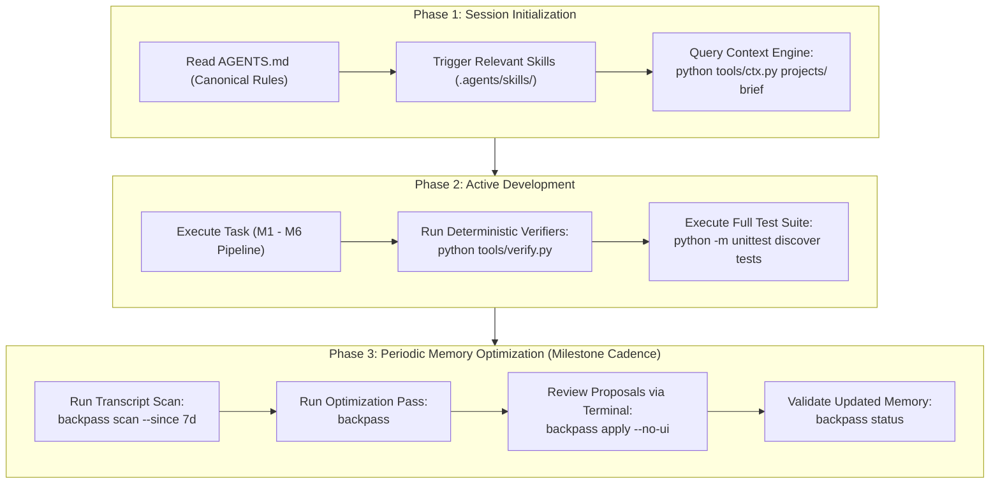

# 07 — Repeatable Daily Development Workflow

This document outlines the operational lifecycle for DESK engineers and autonomous coding agents, integrating Backpass into the standard engineering routine.

---

## 1. Development Lifecycle Overview



---

## 2. Step-by-Step Developer Protocol

### Phase 1: Before a Development Session
1. **Review Canonical Instructions:**  
   Confirm `AGENTS.md` rules and any project-specific constraints.
2. **Consult Context Engine:**  
   Always initialize work via the Context Engine rather than reading large documentation files whole:
   ```powershell
   python tools/ctx.py projects/<P> brief
   python tools/ctx.py projects/<P> block <ID>
   ```
3. **Verify Git Working Copy:**  
   Ensure the repository is clean and on the intended feature branch.

### Phase 2: During Development
1. **Adhere to the Captain / First Mate Protocol:**  
   Treat the human lead as Captain; keep greetings concise and non-mutating.
2. **Follow Fail-Closed Rules:**  
   - Never write raw EasyEDA drawing JavaScript.
   - Never guess pin numbers or invent MPNs.
   - Never mark QA `pass: true` without datasheet formula justification.
3. **Run Verifiers Continuously:**  
   Only tool-verified outputs count as progress:
   ```powershell
   python tools/lint.py projects/<P> <ID>
   python tools/verify.py projects/<P> <ID>
   ```

### Phase 3: After Development (Milestone Review Cadence)
Do not run Backpass after every minor commit. Run it periodically (e.g. after completing a schematic block, routing a board, or wrapping up a multi-session milestone):

1. **Scan Recent Sessions:**  
   Check which transcripts were generated and associated with the DESK repository:
   ```powershell
   backpass scan --since 7d
   ```
2. **Execute Backward Pass (Read-Only Analysis & Proposal):**  
   Runs Tier 1 loss extraction and Tier 2 synthesis. Backpass will **never write** during this step:
   ```powershell
   backpass
   ```
3. **Inspect Cache and Budget:**  
   ```powershell
   backpass status
   ```
4. **Human Review and Application (The Human Gate):**  
   Review each proposed edit, inspect verbatim transcript quotes, and accept or reject:
   ```powershell
   backpass apply --no-ui
   ```
5. **Post-Apply Verification:**  
   Run the test suite to guarantee that memory edits did not introduce regressions:
   ```powershell
   python -m unittest discover -s tests -p "test_*.py"
   ```
6. **Record the funnel (A7):** add one ledger `decision` entry per milestone pass with the counts sessions → findings
   → corroborated gaps → proposed edits → accepted edits, citing `.backpass/proposal.json`.

### Where `tools/learn.py` fits
`python tools/learn.py run` adds DESK-specific deterministic signals that Backpass does not compute: context-engine
bypasses, oversized tool outputs, EasyEDA API failures, retry loops. Accepting one of its AGENTS.md proposals only
writes `.desk_learn/tasks/<id>.md`. Use the task as evidence for `backpass apply`, or make the change by hand in a
reviewed commit. `backpass apply` is the only writer of `AGENTS.md`, `CLAUDE.md` and `.agents/skills/`.

### Operator steps not yet performed (A6, A7)
These need a person with the session history and a logged-in model harness. They have **not** been done in this
repository yet:

- **A6. Point Backpass at the sessions that exist.** Keep the in-repo `.backpassrc.json` on its defaults. Name the
  fleet worktree pools in the personal `~/.config/backpass/config.json` (`discovery.cloneRoots`, SSH hosts); Backpass
  already associates worktrees of the same clone. Windows SSH remotes are unsupported by Backpass, so history on a
  Windows host needs a native or WSL run there. Record `backpass scan --strict` per-harness counts in
  [08_VALIDATION_REPORT.md](08_VALIDATION_REPORT.md), replacing the 2026-11-08 "0 sessions" record.
- **A7. Milestone cadence with real evidence.** After each milestone: `backpass` (model calls on the operator's own
  harness), then `backpass apply` reviewed edit by edit, then the funnel ledger entry above. The first accepted edit
  must be backed by at least 2 distinct sessions (Backpass enforces this), and the measured always-loaded tokens must
  stay within `budgetTokens`. With a thin corpus, "nothing corroborated" is the expected, honest result.
