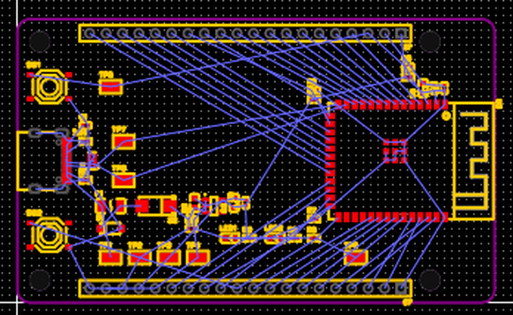
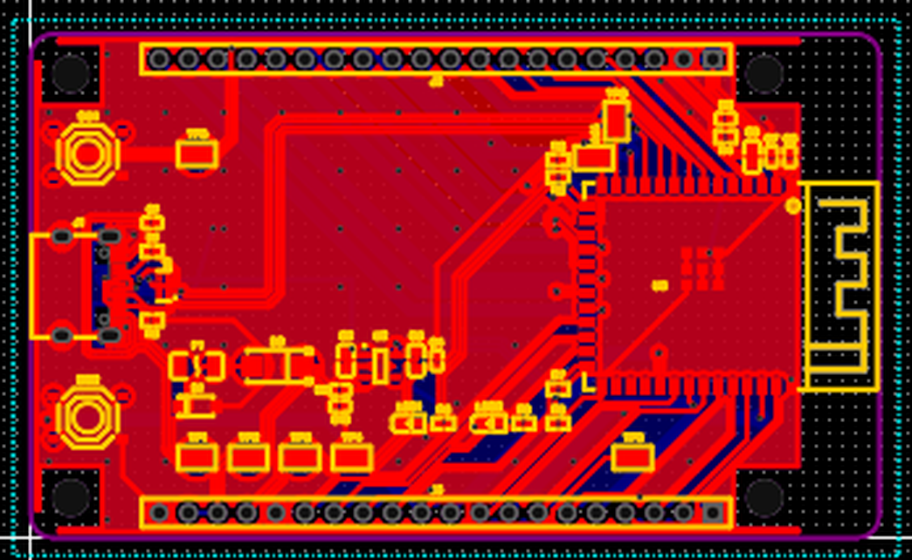
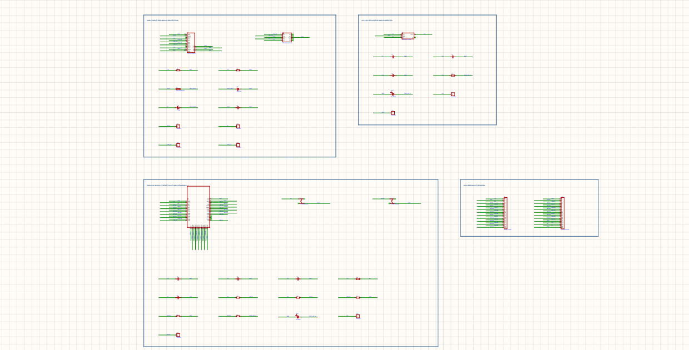
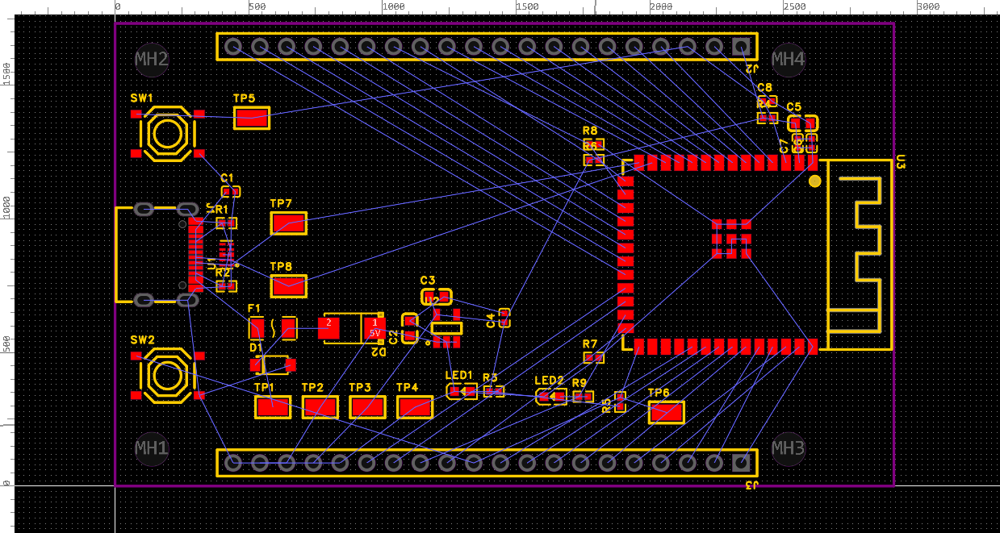
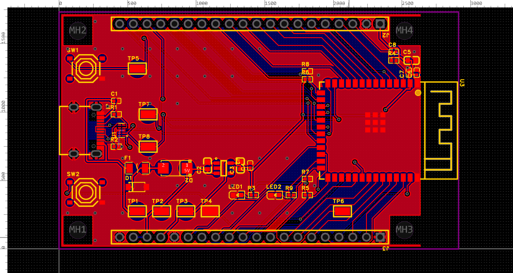
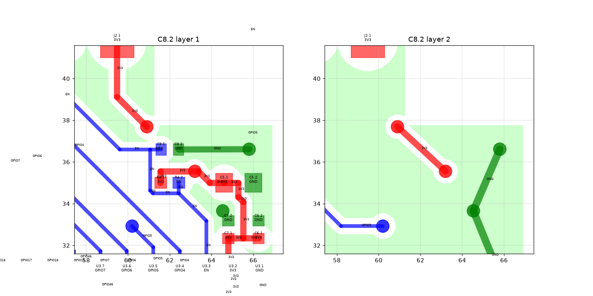

# DESK live tests

These are real end-to-end runs of DESK against a live EasyEDA Pro session, each graded by an independent reviewer.
Every run keeps its frozen requirements, timing, failure register, reviewer analysis and output files, so the results
can be checked rather than taken on trust.

| Run | Board | Builder | Reviewer | Graded verdict | Time used | Board state |
|---|---|---|---|---|---:|---|
| [**Run 2 (2b)**](#run-2-fresh-rebuild-2026-11-12) · [`esp32-s3-plotus-run2/`](esp32-s3-plotus-run2/) | ESP32-S3 dev board, 2 layers, 74 × 44 mm, rounded corners | Claude Opus 5.5 driving DESK (latest `main`, 2c9de1a) | Claude Sonnet examiner (separate session) | **PARTIAL PASS, 81/100** | 66.7 / 225 min | ✅ DRC 0, 43/43 nets, full rev A package |
| [Run 1](#run-1-first-benchmark-2026-11-12) · [`esp32-s3-plotus/`](esp32-s3-plotus/) | same requirements | Claude Opus 5.5 driving DESK | Claude Sonnet examiner | **FAIL, 50/100** | 102.8 / 225 min | DRC 0 only after post-benchmark fixes |

Run 2 was a full restart from an empty schematic and PCB, under the same frozen requirements, rules and stage
budgets. The Captain's target was **a score above 90; run 2 reached 81**. §R2.6 lists the points still between
81 and a PASS.

---

# Run 2: fresh rebuild (2026-11-12)

## R2.1 What changed from run 1
- **Clean slate.** The existing schematic and PCB were removed and both were rebuilt from scratch with the latest
  DESK from GitHub (`main` at 2c9de1a, fast-forwarded before the run).
- **Same rules.**
  - Frozen requirements, verified by hash.
  - Stage budgets S1 45 / S2 45 / S3 90 / S4 30 / S5 15 min, with no borrowing between stages.
  - Documented API calls only, readback after every change, no orders, nothing pushed during the run.
  - A separate Sonnet examiner with write access to its evaluation folder only.
- **Lessons from run 1 applied:**
  - GND is routed and verified **inside Stage 3**. Run 1 deferred it and failed Stage 4.
  - The board uses a strict GND model in which a via is *not* trusted to join a fill.
  - The USB pair is in-line with no stubs to TP7/TP8.
  - Corners are rounded and C5 sits within 2 mm of the module.

### Restart (attempt 1 aborted, outside the clock)
- **What went wrong:** attempt 1's schematic picked up 17 orphan TEXT records ("ghost" block titles). They are left
  behind by DESK's `clear_block` and neither the API nor the GUI can delete them.
- **What the Captain did:** the Captain was asked to delete the 7 visible ghost texts, but wiped the whole schematic
  and PCB instead.
- **The restart:** the Captain chose a restart as **run 2b** with a fresh clock. Attempt 1 is archived in
  [`attempt1-aborted/`](esp32-s3-plotus-run2/attempt1-aborted/) together with the
  [`WIPE_RECORD.json`](esp32-s3-plotus-run2/builder-records/WIPE_RECORD.json). Its ~89 minutes of wall time are not
  on the 2b clock.
- **Warm start:** the reviewer counts run 2b as a warm start, because tooling and lessons were carried over. Its
  speed is therefore **not like-for-like** with run 1.

## R2.2 Results (graded run 2b)
The clock ran from 13:54:08 to 15:00:50 IST: **66.7 of 225 minutes**. Every stage closed STAGE_END_PASS within its
budget.

| Stage | Budget | Used | Builder evidence | Reviewer grade |
|---|---:|---:|---|---|
| 1 Schematic | 45 | 11.2 | 4 blocks VERIFIED, 40 parts / 43 nets match spec; EasyEDA ERC 0 errors, 2 warnings (count only, text not exposed by the API); itemized audit: 0 floating pins, 0 single-pin nets | PASS with caveats (ERC warnings unread, 17 orphan texts) |
| 2 Placement | 45 | 12.3 | DESK gate "PLACEMENT & ROUTABILITY OK", routability 0.88; rounded 74 × 44 outline, 4 × M3; decoupling 0.85–0.88 mm from U3 | PASS |
| 3 Routing | 90 | 33.0 | **EasyEDA DRC 0**; DESK verifier 43/43; strict GND model 1 group; USB D+/D− 63.05 / 63.76 mm (Δ 0.71 mm); power 0.305 mm | PARTIAL (USB ≈153 Ω diff, not 90 Ω; 0.8 mm D− tap at the ESD array) |
| 4 Copper | 30 | 3.1 | GND pour on both layers (0.3 mm clearance, 0.5 mm edge, thermals on 8 THT pads), 35 grid stitching vias + 6 second vias, antenna keep-out 0.000 mm² copper, DRC 0 | PASS on records (Gerber-level check UNVERIFIED) |
| 5 Manufacturing | 15 | 6.4 | Silkscreen check PASS (90 texts ≥ 0.91 mm), final DRC 0, Gerber + 3 drill files, BOM with LCSC on 18/18 lines, CPL, PDF, .epro | PASS with caveats |

**Reviewer score: 81/100, PARTIAL PASS** ("strong; one step from PASS"):

| Electrical | Physical | Manufacturing package | Evidence and honesty | Total |
|---:|---:|---:|---:|---:|
| 25/30 | 20/25 | 21/25 | 15/20 | **81** (run 1: 50) |

**Human interventions on the 2b clock:**
- **EasyEDA reopen:** the Captain reopened EasyEDA after a crash (R2-F-004, likely out of memory; free RAM fell to
  553 MB).
- **Import Changes:** the Captain clicked *Apply* in Import Changes. The API cannot apply schematic-to-PCB changes.

**Disclosed post-end change:**
- **What:** an acute-angle audit found two open 45° 5V junctions at C9, and they were removed at T+68.1 min.
- **Logged:** as the bench event `POST_END_REFINEMENT`.
- **Re-verified afterwards:** refill, DRC 0, 43/43, the silkscreen check and the exports.
- **Reviewer:** "no verdict effect".

| Schematic | Placement (Stage 2) | Final board (copper + silkscreen) |
|---|---|---|
|  |  |  |

## R2.3 How each stage was done
- **Schematic.** DESK `build.py` / `verify.py`, four blocks:
  - USB_PWR_IN;
  - REG_3V3;
  - MCU_CORE;
  - HEADERS.

  C9/C10 were added so the 5 V rail carries 10 µF + 1 µF + 100 nF. To avoid the ghost-text lines, the rows sit
  below them.
  [`erc_report.txt`](esp32-s3-plotus-run2/builder-records/erc_report.txt) has the ERC summary and the itemized audit,
  and [`orphan_text_records.txt`](esp32-s3-plotus-run2/builder-records/orphan_text_records.txt) lists the ghosts.
- **Placement.** DESK `pcb_place.py` places from
  [`placement.json`](esp32-s3-plotus-run2/builder-records/placement.json) ([record](esp32-s3-plotus-run2/builder-records/PLACEMENT_RECORD.md)) with reserved routing channels. The
  board has:
  - a rounded outline built from `["R", x, y_top, w, h, rotation, radius]`;
  - 4 NPTH holes;
  - copper keep-outs at the USB-C slots and the rounded corners.
- **Routing**
  ([`ROUTING_RECORD.md`](esp32-s3-plotus-run2/builder-records/ROUTING_RECORD.md)):
  1. Freerouting with GND included plateaued at 29 unrouted, and its USB topology had stubs, so the result was
     discarded.
  2. The USB pair was hand-designed to be in-line: J1 → ESD U1 (flow-through) → TP7/TP8 → module. It was injected
     into the DSN as **protected wiring**, and Freerouting then routed everything else
     ([`usb_route.py`](esp32-s3-plotus-run2/benchmark-scripts/usb_route.py)).
  3. The SES import forces 6 mil widths, so USB went back to 10 mil and power to 12 mil.
  4. GND was completed with fills plus explicit, clearance-checked links
     ([`gnd_links.py`](esp32-s3-plotus-run2/benchmark-scripts/gnd_links.py)).
  5. TP7/TP8 were moved onto the pair's final drops. A clash between the TP7 pad and 3V3 was fixed by rerouting 3V3.
- **Copper** ([`COPPER_RECORD.md`](esp32-s3-plotus-run2/builder-records/COPPER_RECORD.md)):
  - API-only GND fills (`tools/copper_fill.py`).
  - A 5.08 mm stitching grid (`stitching.py`).
  - `stitch_second_via.py`, which gives a second via to every pour piece hanging on a single via.
- **Silkscreen and release:**
  - Designators were relocated using the true live text boxes
    ([`silk_place.py`](esp32-s3-plotus-run2/benchmark-scripts/silk_place.py)).
  - Labels were added: the brand line, a function label at each of TP1–TP8, and mirrored J2/J3 pin labels on the
    bottom.
  - [`silk_check.py`](esp32-s3-plotus-run2/benchmark-scripts/silk_check.py) checks every text: minimum height 0.914
    mm, minimum gap to a pad 0.358 mm, no overlaps.
  - The LCSC BOM was cross-checked against the block specs
    ([`make_bom_lcsc.py`](esp32-s3-plotus-run2/benchmark-scripts/make_bom_lcsc.py)).

## R2.4 Failure register (R2-F-001 … R2-F-012)
[`failure_register.json`](esp32-s3-plotus-run2/builder-records/failure_register.json). The reviewer accepted every
entry as plausible and consistent with the files.

| ID | What | Status |
|---|---|---|
| R2-F-001 | `clear_block` leaves frame rectangles (still in latest main) | worked around (deleted by id) |
| R2-F-002 / 005 | deleted schematic texts persist as 17 orphan TEXT records | not fixable via API/GUI; disclosed |
| R2-F-003 | EasyEDA ERC API returns counts only, no warning text | API limitation |
| R2-F-004 | EasyEDA crashed (memory pressure suspected) | Captain reopen |
| R2-F-006 | `pcb_check.py --gate` text printer KeyError | **fixed in DESK** |
| R2-F-007 | outline helper: wrong signature, wrong origin, radius written into the rotation field | **fixed in DESK** |
| R2-F-008 | `copper_fill.pad_geometry` rotated absolute POLYGON pads twice | **fixed in DESK** (+ test) |
| R2-F-009 | Freerouting GND plateau / USB stubs | protected hand-routed USB + GND links |
| R2-F-010 | SES import overrides track widths to 6 mil | widen scripts |
| R2-F-011 | TP7/TP8 relocation conflicts (gate, then DRC pad-to-track) | resolved; DRC 0 |
| R2-F-012 | `sch_ManufactureData.getSvgFile` absent | PDF only |

## R2.5 Reviewer analysis (uploaded unchanged)
All files are in [`esp32-s3-plotus-run2/reviewer-analysis/`](esp32-s3-plotus-run2/reviewer-analysis/):
- [`FINAL_INDEPENDENT_EVALUATION.md`](esp32-s3-plotus-run2/reviewer-analysis/FINAL_INDEPENDENT_EVALUATION.md):
  gate-by-gate verdict, failure-register review and the score.
- [`RUN2_VS_RUN1_COMPARISON.md`](esp32-s3-plotus-run2/reviewer-analysis/RUN2_VS_RUN1_COMPARISON.md): run 1 against
  run 2, flagged as a warm start and so not like-for-like on time.
- [`HARDWARE_PERFORMANCE_REPORT.md`](esp32-s3-plotus-run2/reviewer-analysis/HARDWARE_PERFORMANCE_REPORT.md) and
  [`HARDWARE_RESOURCE_METRICS.csv`](esp32-s3-plotus-run2/reviewer-analysis/HARDWARE_RESOURCE_METRICS.csv). The run
  was **memory-bound**:
  - EasyEDA held about 11–12 GB private memory.
  - Free RAM fell to 553 MB, and 16 of 67 samples were under 1 GB.
  - CPU averaged 57 %, and the GPU sat idle.
- [`10_MIN_REPORTS/`](esp32-s3-plotus-run2/reviewer-analysis/10_MIN_REPORTS/): **T+20 to T+50 were written late, from
  file evidence**, because the builder missed those checkpoints. The reviewer marks them as LATE / RETROACTIVE.
  [`EVALUATOR_LIMITATIONS.md`](esp32-s3-plotus-run2/reviewer-analysis/EVALUATOR_LIMITATIONS.md) records what the
  reviewer could not check: no EasyEDA access, no Gerber viewer, and no live re-run of the builder's tools.

## R2.6 What still stands between 81 and a PASS
- **USB impedance (gate not met as written).**
  - Edge-coupled 0.254 / 0.246 mm on a 1.6 mm 2-layer board gives about 153 Ω differential.
  - About 90 Ω would need about 1.0 mm traces, which do not fit the 0.5 mm-pitch ESD array or the 1.27 mm module pads,
    or else a 4-layer stack-up (h ≈ 0.2 mm).
  - At USB Full Speed (12 Mb/s, 63 mm) this is electrically tolerable, but the gate is not met.
- **D− tap.** The TPD4E05U06 DQA pinout puts D− (pin 2) between D+ and GND with an NC column opposite, so D− is
  reached by a 1.1 mm via-to-pad tap.
- **Schematic.** There are 2 ERC warnings whose text the API cannot return, and 17 orphan title texts remain in the
  saved sheet.
- **Not done:** teardrops (no API), native EasyEDA pours (the static fills are the API-only substitute), and an
  independent Gerber inspection.
- **Process.** Checkpoints T+20 to T+50 were missed, and most evidence comes from the builder's own tools; the raw
  DRC JSON and the file hashes are independent.

## R2.7 Output files: revision A (run 2b)
These are in [`esp32-s3-plotus-run2/manufacturing-revA/`](esp32-s3-plotus-run2/manufacturing-revA/). The SHA-256
hashes are in [`RELEASE_RECORD.md`](esp32-s3-plotus-run2/builder-records/RELEASE_RECORD.md), and the reviewer
recomputed them and found a match.

| File | Contents |
|---|---|
| `PLOTUS_ESP32S3_revA_gerber.zip` | Copper (top and bottom), solder mask, silkscreen, top paste, outline, document; PTH, NPTH and via drill files |
| `PLOTUS_ESP32S3_revA_BOM_JLCPCB.csv` | JLCPCB BOM with an **LCSC Part #** on all 18 lines (40 parts), MPN cross-checked against the specs |
| `PLOTUS_ESP32S3_revA_bom_utf8.csv` / `_cpl_utf8.csv` | EasyEDA's BOM and pick-and-place (40 parts, mm), converted to UTF-8 |
| `PLOTUS_ESP32S3_revA_schematic.pdf` | Schematic |
| `PLOTUS_ESP32S3_revA_project.epro` | Full EasyEDA Pro project |

> **No order was placed.** Before ordering, decide on the USB impedance question (stay on 2 layers or move to
> 4 layers), and open the Gerbers in a viewer.

## R2.8 DESK changes from run 2 (commit `d68612a`)
- **`desk/routing/outline.py`:**
  - "R" spec corrected to `[x, y_top, w, h, rotation, radius]`.
  - The origin is now the bottom-left corner.
  - The radius goes into field 7, so the outline is no longer rotated by 78.7°.
  - Calls use the live `create(net, layer, polygon, lineWidth, lock)` signature.
  - Validation now flags rotated outlines instead of every radius.
- **`desk/copper_fill.py`:** absolute (already rotated) POLYGON pads are no longer rotated again.
- **`tools/pcb_check.py`:** the `--gate` text printer no longer crashes on `plan_sync` entries.
- **Tests:**
  - 7 outline tests and 1 new copper-fill test.
  - Full suite: **717 tests OK** (9 live-only skips). It was run with this machine's `DESK_*` model environment
    overrides cleared; those overrides make 3 orchestrator tests fail on clean `main` too.
- The run 2 benchmark scripts are kept in
  [`esp32-s3-plotus-run2/benchmark-scripts/`](esp32-s3-plotus-run2/benchmark-scripts/) for reproduction. They contain
  this machine's absolute paths and window ID.

---

# Run 1: first benchmark (2026-11-12)

## 1. What was tested
Could an AI agent, using DESK as its only design tool, take a frozen requirements pack to a manufacturable
ESP32-S3 dev board in a live EasyEDA Pro project, within a fixed time budget and with no help in the GUI?

- **Tool under test:** DESK, an isolated benchmark copy of this repository. The live repository was not touched
  during the run.
- **CAD:** EasyEDA Pro 3.2.149, driven only through the local API gateway (`POST /execute`, one designated window
  ID). The rules were documented API calls only, readback after every change, and no GUI clicks by the agent.
- **Builder:** Claude Opus 5.5, as Claude Code.
- **Reviewer:** a Claude Sonnet examiner (`plotus-sonnet-examiner`) running as a separate session. It could write
  only to the evaluation folder and could not touch EasyEDA. Its job was 10-minute progress reports, hardware
  telemetry, a final independent verdict and a comparison with an earlier Nemotron 3 Ultra attempt.
- **Machine:** Windows 11, 15.3 GB RAM. Inference ran remotely, so the local GPU sat idle.

## 2. Benchmark parameters
### Time budget (monotonic clock, `time.monotonic_ns`)
| Stage | Budget (min) | Scope |
|---|---:|---|
| 1 Schematic | 45 | All essential blocks, LCSC-resolved parts, ERC evidence |
| 2 Placement | 45 | All parts placed, outline, holes, decoupling ≤ 2 mm, antenna keep-out, deterministic placement check |
| 3 Routing | 90 | Every net physically connected, 0 shorts / 0 critical DRC, USB constraints, routing record |
| 4 Copper | 30 | GND pour on top and bottom, every GND pad connected, no islands, stitching, clearances |
| 5 Manufacturing | 15 | Gerber, drill, BOM (LCSC), CPL, preflight checks |
| **Total** | **225** | **A stage cannot borrow time from another stage.** |

### Rules
- **Frozen requirements:** [`requirements/`](esp32-s3-plotus/requirements/). The SHA-256 hashes in
  `FROZEN_HASHES.txt` were checked during the run and never changed.
- **Stop rule:**
  - If a stage fails a hard gate, later stages that depend on it are not started.
  - Never force-terminate EasyEDA or unrelated sessions.
  - No orders are placed.
  - Nothing is pushed during the run.
- **Allowed verdicts:** PASS, PARTIAL PASS, TIME TARGET FAILED, FAIL, INCONCLUSIVE.
- **Required records:**
  - `timing.json`, `stage_metrics.json`, `progress.json`, `execution.jsonl`
  - a failure register
  - the reviewer's 10-minute reports, a telemetry CSV, a hardware report, a final evaluation and a comparison
    report

### Key design parameters (from `DESIGN_PARAMETERS.md`)
- **Board:** 2 layers, 1.6 mm, 1 oz copper. Minimum 5 mil track and space, 0.3 mm via drill. Rectangular outline
  with rounded corners. 4 × M3 holes.
- **Power path:** USB-C VBUS (5 V) → polyfuse → TVS → Schottky → AP2112K-3.3 LDO. Decoupling of 10 µF + 1 µF +
  100 nF per domain.
- **USB-C interface:**
  - native USB on GPIO19/20;
  - 5.1 kΩ pull-downs on CC1 and CC2;
  - a 4-line ESD array on D+/D−/CC1/CC2;
  - the connector centered on a short edge.
- **Controls and straps:** EN reset with a 10 kΩ / 1 µF RC network, BOOT on GPIO0, strapping pins handled.
- **Headers and indicators:** 2.54 mm headers on the long edges, a power LED and a status LED.

## 3. The design that was built
- **Module:** ESP32-S3-WROOM-1-N16R8 (LCSC C2913202).
- **USB-C:** TYPE-C-31-M-12 (C165948) with 5.1 k Rd on CC1 and CC2, and a TPD4E05U06DQAR ESD array (C125795).
- **Power:** SMD1206P050TF polyfuse, SMF5.0A TVS, SS34 Schottky, AP2112K-3.3 LDO (600 mA).
- **Controls and straps:**
  - EN 10 k / 1 µF RC network with a RESET button;
  - GPIO0 pull-up with a BOOT button;
  - GPIO3 pull-up, GPIO45/46 pull-downs.
- **Indicators and test points:** green power LED, blue LED on GPIO48. 8 test points: VBUS, 5V, 3V3, GND, EN,
  GPIO0, D+, D−.
- **Headers:** 2 × 1×20 2.54 mm headers carrying 31 GPIOs, UART0, EN and power.
- **Board:** 74 × 44 mm, 2 layers, 4 × M3 NPTH. Antenna flush with the edge and a keep-out across its full width.
- **Parts and nets:** 38 parts, 43 nets, every part with an LCSC number. (Run 2 adds C9/C10: 40 parts.)

Deviations from the frozen text, all recorded:
- The parameter file lists GPIO4–7/15–17 as strapping pins. On the ESP32-S3 the straps are GPIO0/3/45/46, so no
  extra pull-ups were added.
- The "38 pins, 0.5 mm pitch" module description is wrong. The real footprint (41 pads, 1.27 mm pitch) was used.
- The board is 74 × 44 mm instead of about 60 × 40 mm, to fit 20-pin headers, corner M3 holes and the antenna
  keep-out.

| Schematic | Placement (Stage 2) | Copper (end of Stage 4) |
|---|---|---|
|  |  |  |

## 4. Benchmark results (graded run)
The clock ran from 04:50:28 to 06:33:18 IST: **102.8 of 225 minutes**. It stopped early because Stage 4 failed a
hard gate.

| Stage | Budget | Used | Builder result | Reviewer result | Board after post-benchmark fixes |
|---|---:|---:|---|---|---|
| 1 Schematic | 45 | 28.3 | PASS (DESK verify and lint pass; EasyEDA ERC 0 errors) | PASS with caveats (1 ERC warning not itemised) | PASS |
| 2 Placement | 45 | 11.9 | PASS_WITH_DEVIATION | NOT FULLY MET: C5 is 2.7 mm from the module power pin (limit 2.0 mm), no rounded corners, DESK placement check `passed=false` | Unchanged deviations: C5 2.7 mm, no rounded corners |
| 3 Routing | 90 | 38.1 | PASS_WITH_DEVIATION: 42/43 nets, 0 clearance, 0 short; GND left to the pours | NOT FULLY MET: GND gate moved to Stage 4; USB not impedance-controlled; test-point stubs | ✅ 43/43 nets connected, 0 clearance, 0 short |
| 4 Copper | 30 | 23.3 | **FAIL**: 5 GND connection errors | **FAIL** | ✅ **DRC 0 errors**, GND fully connected |
| 5 Manufacturing | 15 | 0 | Not started (stop rule) | NOT STARTED | Rev A files exported (§8); release preflight not run |

- **Verdict:** **FAIL**. The builder and the reviewer agree.
- **Reviewer's production-readiness score:** **50/100**:

| Electrical | Physical | Manufacturing package | Evidence and honesty |
|---:|---:|---:|---:|
| 17/30 | 15/25 | 3/25 | 15/20 |

- **The failure is electrical:**
  - The USB ESD array (U1 pins 3 and 8) has no ground.
  - The CC2 pull-down (R2) floats, so USB-C won't attach in one plug orientation.
  - The EN reset capacitor (C8) floats.
- **Cause:** GND was left out of the router to save time, which walled these pads in with other nets' copper.
  Run 2 routes GND in Stage 3 for this reason.
- **Time was not the problem.** No stage ran over its budget, and 122 minutes were unused.

### Human interventions (all recorded)
- **Before the clock:** the Captain reconnected an EasyEDA window whose ID had gone stale.
- **H-001:** the Captain clicked *Apply* in Import Changes, because the API cannot apply schematic-to-PCB changes.
- **H-002:** the Captain approved downloading Freerouting 2.1.0, since no routing engine was installed.
- **H-003:** the agent asked for a GUI "rebuild copper" click, and the Captain **declined** it.
- **Requirements added during the run:** schematic neatness and manufacture-grade placement neatness.

### Failure register
The register holds 23 entries (F-001…F-020 and H-001…H-003): [`failure_register.json`](esp32-s3-plotus/builder-records/failure_register.json).
DESK defects it exposed:
- **DRC summary:** DESK's summary reported 0 clearance errors when there were 174 real ones (F-015). The raw
  EasyEDA DRC was used instead.
- **Board outline:** the outline JS had the wrong signature and placed the origin at the top-left (F-008, F-009).
  This was fixed in DESK after run 2 (R2.8).
- **Library:** stale short-UUID library entries made part creation hang for 120 s (F-001).
- **Pours:** `rebuildCopperRegion()` cannot be driven through the API in this client (F-018). This led to the new
  API-only copper fill, see §6.

## 5. Reviewer analysis (uploaded unchanged)
All files are in [`reviewer-analysis/`](esp32-s3-plotus/reviewer-analysis/):
- [`FINAL_INDEPENDENT_EVALUATION.md`](esp32-s3-plotus/reviewer-analysis/FINAL_INDEPENDENT_EVALUATION.md): a
  gate-by-gate verdict, a review of the failure register and the score.
- [`OPUS_VS_NEMOTRON_COMPARISON.md`](esp32-s3-plotus/reviewer-analysis/OPUS_VS_NEMOTRON_COMPARISON.md): **not
  comparable.** The Nemotron 3 Ultra project folder holds the requirements and empty templates only. The reviewer
  declares no winner.
- [`HARDWARE_PERFORMANCE_REPORT.md`](esp32-s3-plotus/reviewer-analysis/HARDWARE_PERFORMANCE_REPORT.md) and
  [`HARDWARE_RESOURCE_METRICS.csv`](esp32-s3-plotus/reviewer-analysis/HARDWARE_RESOURCE_METRICS.csv): 103
  samples, one per minute.
  - CPU averaged 64 %, and EasyEDA held a steady ~41 %.
  - Free RAM dropped as low as 317 MB when EasyEDA and the Freerouting JVM ran together.
  - The GPU sat idle.
- [`10_MIN_REPORTS/`](esp32-s3-plotus/reviewer-analysis/10_MIN_REPORTS/) holds the progress reports from T+10 to
  T+100. **Five of them (T+20, T+60, T+70, T+90, T+100) were written late, after the fact.** The reviewer could
  only run while prompted, so supervision was not continuous. This is disclosed in
  [`EVALUATOR_LIMITATIONS.md`](esp32-s3-plotus/reviewer-analysis/EVALUATOR_LIMITATIONS.md).
- Two questions the reviewer raised for the Founder remain open:
  - The "stop rule" is not in the frozen files.
  - A DESK connectivity report said 2/43 nets, against 42/43 from EasyEDA DRC and the independent check. This
    was never explained.

## 6. DESK changes made because of run 1
- **`desk/copper_fill.py` and `tools/copper_fill.py`: API-only GND planes.** DESK now computes the plane copper
  itself and writes it as `pcb_PrimitiveFill` polygons. The design:
  - clearance to other-net copper;
  - thermal spokes on through-hole pads;
  - removal of islands that have no via or through-hole anchor;
  - idempotent re-runs, tracked in `state/copper_fills.json`.

  This cut ground opens from 73 to 5 with no help in the GUI.
- **`tools/stitch_orphans.py`: clearance-checked stitch vias for orphan copper and pads.** After the run it also
  gained `explicit_link()`. Every via placed for an orphan pad now also gets a straight, clearance-checked bottom
  track to an existing GND via. Pads that already have a GND track are skipped. Why: EasyEDA's DRC does not
  reliably join a via to a static fill. Two vias sitting fully inside both GND fills, with copper confirmed in the
  Gerbers, still raised "Connection Error", and the outcome depended on creation order.
- **Library:** refreshed the stale entries for TPD4E05U06DQAR and SS34, and added the Plotus parts.
- **Tests:** `tests/test_copper_fill.py` has 4 tests, all passing (5 after run 2).

## 7. After the benchmark: DRC 5 → 0 (not graded)
At the Captain's request, after the clock stopped, the last five errors were fixed with explicit copper:
- a GND track U1.3 → U1.8 → R2.2;
- the 3V3 track around C8 moved to the bottom layer, freeing a top GND track from C8.2 to a GND via;
- a link from the module GND pin U3.1 to the ground area near C5/C6.

Every change was clearance-checked before it was made (minimum 0.219 mm, against a 6 mil rule). Then both GND
planes were recomputed.

- **EasyEDA DRC:** `pcb_Drc.check(true,false,true)` reports **0 errors**, confirmed twice:
  [`drc_final_post_remediation.json`](esp32-s3-plotus/builder-records/drc_final_post_remediation.json).
- **Connectivity:** all 42 signal and power nets are connected by tracks, and GND forms one connected group.
- **Full record:** [`REMEDIATION_RECORD.md`](esp32-s3-plotus/builder-records/REMEDIATION_RECORD.md).



## 8. Output files: revision A (run 1, exported after remediation)
These are in [`manufacturing-revA/`](esp32-s3-plotus/manufacturing-revA/), exported from the live project:

| File | Contents |
|---|---|
| `PLOTUS_ESP32S3_revA_gerber.zip` | Gerber for copper (top/bottom), solder mask, silkscreen, paste, outline and document layers; PTH, NPTH and via drill files (67 vias); flying-probe data |
| `PLOTUS_ESP32S3_revA_schematic.pdf` | Schematic, 4 blocks on one sheet |
| `PLOTUS_ESP32S3_revA_BOM_JLCPCB.csv` | JLCPCB-format BOM with an **LCSC Part #** column: 18 lines covering 38 parts, cross-checked against EasyEDA's BOM |
| `PLOTUS_ESP32S3_revA_bom_utf8.csv` | EasyEDA's own BOM export, converted to UTF-8 |
| `PLOTUS_ESP32S3_revA_cpl_utf8.csv` | Pick-and-place (CPL), 38 parts, in mm |
| `PLOTUS_ESP32S3_revA_project.epro` | The full EasyEDA Pro project. Import it with *File → Open → EasyEDA Pro project* |

> **Superseded by run 2.** Run 1's rev A is kept as a record. Its open items (C5 at 2.7 mm, square corners,
> unreviewed silkscreen, TP7/TP8 stubs on USB) were all addressed in run 2's design.

---

# Folder map
```
live-test/
  esp32-s3-plotus-run2/      run 2 (2b): fresh rebuild, PARTIAL PASS 81/100
    requirements/            frozen requirements, design parameters, acceptance criteria and hashes
    builder-records/         timing, stage metrics, execution log, failure register, ERC report,
                             placement/routing/copper/release records, USB/angle/silk checks
      drc/                   raw EasyEDA DRC JSON per step + applied remediation plans
    benchmark-scripts/       run 2 scripts (USB protected routing, GND links, stitching, silk, BOM)
    reviewer-analysis/       independent evaluation, run 2 vs run 1, hardware report, telemetry CSV,
                             10-minute reports, limitations, examiner log
    manufacturing-revA/      Gerber + drills, BOM (LCSC), CPL, schematic PDF, EasyEDA project
    attempt1-aborted/        the aborted first attempt (timing, failures, ERC report)
    images/                  schematic, placement, final board
  esp32-s3-plotus/           run 1: FAIL 50/100 (later DRC 0 after fixes)
    requirements/ builder-records/ reviewer-analysis/ manufacturing-revA/ images/
```
